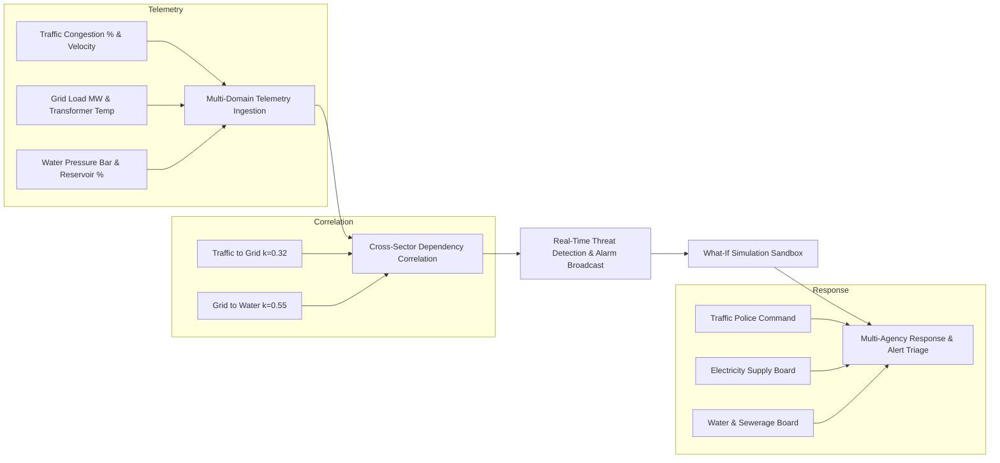

# CityNexus: Urban Infrastructure Intelligence Platform

<p align="center">
  
  
  
  
  
</p>

---

## 📌 1. Project Overview

Modern metropolitan infrastructure operates on fragile, hidden interdependencies. Today, **traffic mobility, electrical power distribution, and public water utilities are managed in municipal silos**. 

A change in one system often triggers unexpected domino effects in another:
- Peak arterial traffic congestion and EV charging queues create sudden transmission surges on electrical substations.
- Transformer overheating causes localized voltage drips or load shedding.
- Power cuts to water treatment booster pumps lead to hydrostatic mains pressure drops, leaving communities without water.

**CityNexus** is an urban intelligence and decision-support platform designed to break down these operational silos. Acting as a predictive digital twin, it unifies multi-domain sensor telemetry, calculates downstream blast radiuses, models cross-sector cascades through what-if simulations, and enables inter-agency coordination before localized problems escalate into citywide crises.

> **Operational Guardrail**: CityNexus is strictly an **observational and advisory decision-support system**. It provides real-time cross-domain awareness and recommended action playbooks without executing direct physical SCADA actuation (e.g., remote breaker trips or valve motor operation).

---

## 🔄 2. Complete System Workflow



The system executes in five continuous operational stages:
1. **Telemetry Ingestion**: Gathers telemetry from traffic sensors, electrical substations, and water pump stations across geographic metropolitan zones.
2. **Topology & Correlation Analysis**: Maps assets in a directed dependency graph with empirical transfer factors ($k_{tg} = 0.32$, $k_{gw} = 0.55$, $k_{wt} = 0.20$).
3. **Automated Threat Detection**: Threshold monitors identify anomalies (e.g., congestion $>80\%$, substation load $>85\%$, water pressure $<3.0\text{ Bar}$) and broadcast alerts via the global ticker.
4. **Predictive What-If Simulation**: Operators test perturbation scenarios using forward-propagation cascade math to evaluate 1st and 2nd order downstream effects before taking action.
5. **Collaborative Triage & Resolution**: Incident drawers let operators from different departments record notes, acknowledge tickets, and coordinate responses with full audit logs.

---

## ✨ 3. Key Features

### 🏢 Command Center & Telemetry
- **Multi-Domain Command Dashboard (`/dashboard`)**: Unified overview displaying aggregated metrics, zone health scores, and an active cross-sector threat matrix.
- **Global Incident Ticker**: Real-time horizontally scrolling incident banner broadcasting active cascade threats across every application screen.
- **Sectoral Deep-Dive Consoles**:
  - **Traffic Mobility (`/dashboard/traffic`)**: Arterial flow rates, congestion indexing, vehicle velocity curves, and adaptive signal phase tracking.
  - **Power Grid (`/dashboard/electricity`)**: Substation MW load vs. rated capacity, 24-hour diurnal demand curves, and transformer core thermal alarms ($>65^\circ\text{C}$).
  - **Public Utilities (`/dashboard/utilities`)**: Mains hydrostatic pressure profiles, low-pressure alert thresholds ($<3.0\text{ Bar}$), booster pump health, and reservoir levels.

### 🧪 Simulation & Predictive Analytics
- **What-If Scenario Simulation Sandbox (`/simulation`)**:
  - Interactive multi-parameter perturbation sliders ($-50\%$ to $+100\%$).
  - Deterministic forward-propagation engine calculating cascading deltas in real-time:
    $$\Delta Load_{grid} = Baseline \times (1 + \delta_{traffic} \times 0.32)$$
    $$\Delta Pressure_{water} = Baseline \times (1 - \delta_{grid} \times 0.55)$$
  - Before vs. After comparison table with automated mitigation recommendations.
- **Cross-Infrastructure Dependency Graph (`/dependencies`)**:
  - Interactive directed asset network visualizing physical and electrical couplings (`powers`, `feeds`, `controls`, `protects`).
  - Downstream blast-radius calculator highlighting secondary and tertiary vulnerable assets.
- **Forensic Historical Post-Mortem (`/history`)**:
  - Synchronized multi-domain cross-correlation time series charts demonstrating how past traffic peaks preceded grid surges and water pressure drops.
  - One-click CSV export for municipal post-incident audits.

### 🗺️ GIS & Governance
- **Interactive GIS Geospatial Map (`/map`)**:
  - Leaflet-powered GIS mapping with color-coded zone health boundary polygons.
  - Interactive asset telemetry sheets sliding out upon clicking nodes.
- **Multi-Domain Alert Center (`/alerts`)**:
  - Real-time incident triage drawer with status workflow: `ACTIVE` $\rightarrow$ `ACKNOWLEDGED` $\rightarrow$ `RESOLVED`.
  - Dispatch notes and cross-departmental response logging.
- **Personnel Governance & RBAC (`/admin/users`)**:
  - Role-Based Access Control supporting 5 personas: *City Planner, Traffic Controller, Grid Operator, Utility Manager, Admin*.
- **Topology & Threshold Calibration (`/admin/config`)**:
  - Dynamic fine-tuning of cascade sensitivity transfer factors and alarm thresholds.

---

## 🛠️ 4. Technology Stack

| Layer | Technologies |
| :--- | :--- |
| **Frontend Framework** | React 18.3.1 (Strict Mode), TypeScript 5.7.2 |
| **Build & Tooling** | Vite 6.1.0, PostCSS, Autoprefixer |
| **Routing** | React Router DOM 6.29.0 (`createBrowserRouter`) |
| **State Management** | Zustand 5.0.3, TanStack Query v5.66.0 |
| **Data Visualization** | Recharts 2.15.1 (Area, Bar, Line charts) |
| **Geospatial GIS** | Leaflet 1.9.4, React Leaflet 4.2.1 |
| **Network Graph** | @xyflow/react 12.4.2 |
| **Design & UI** | Tailwind CSS 3.4.17, Lucide Icons, `clsx`, `tailwind-merge` |
| **Motion & UX** | Framer Motion 12.4.2, GSAP 3.12.7, Lenis 1.1.20 |
| **Backend-as-a-Service** | Supabase (`@supabase/supabase-js` 2.48.1, PostgreSQL + Realtime) |

---

## 🚀 5. Getting Started

### Prerequisites
- **Node.js**: `>= 18.0.0`
- **npm**: `>= 9.0.0`

### Installation

1. **Clone the Repository**:
   ```bash
   git clone https://github.com/<your-username>/CityNexus.git
   cd CityNexus
   ```

2. **Install Dependencies**:
   ```bash
   npm install
   ```

3. **Configure Environment Variables**:
   Create a `.env` file in the root directory (or copy from `.env.example`):
   ```env
   VITE_SUPABASE_URL=https://<your-project-id>.supabase.co
   VITE_SUPABASE_ANON_KEY=<your-anon-key>
   ```
   *(Note: If no remote database is configured, CityNexus automatically activates its offline fallback state, keeping all simulation and telemetry features fully functional.)*

4. **Start Development Server**:
   ```bash
   npm run dev
   ```
   Open [http://localhost:5173](http://localhost:5173) in your browser.

5. **Build for Production**:
   ```bash
   npm run build
   npm run preview
   ```

---

## 🗄️ 6. Database Setup (Supabase)

If deploying with Supabase BaaS:
1. Open your [Supabase Dashboard](https://supabase.com/dashboard) and navigate to the **SQL Editor**.
2. Run the migration script located at [`supabase/schema.sql`](supabase/schema.sql).
3. The script configures:
   - Tables: `zones`, `infrastructure_nodes`, `infrastructure_edges`, `alerts`, `simulation_runs`, `profiles`.
   - Row Level Security (RLS) policies.
   - Postgres Realtime publication on `alerts` and `infrastructure_nodes`.
   - Comprehensive seed telemetry for metropolitan testing.

---

## 📂 7. Project Structure

```text
├── src/
│   ├── app/                 # Root App container & React Router configuration
│   ├── components/
│   │   ├── layout/          # AppLayout, Topbar, Sidebar, IncidentTicker
│   │   └── shared/          # Reusable design system atoms (KPICard)
│   ├── data/                # Simulated metropolitan dataset (6 zones, 9 nodes, 5 edges)
│   ├── features/
│   │   ├── admin/           # User management (RBAC) & threshold configuration
│   │   ├── alerts/          # Incident triage center & dispatch workflows
│   │   ├── auth/            # Departmental login, registration & profile views
│   │   ├── dashboard/       # Multi-domain command center & live ticker
│   │   ├── graph/           # Directed dependency graph & blast radius calculator
│   │   ├── history/         # Cross-domain historical trends & CSV export
│   │   ├── landing/         # Public promotional overview
│   │   ├── map/             # Interactive Leaflet GIS map with telemetry drawers
│   │   ├── sectoral/        # Deep-dive views: Traffic, Electricity, Utilities
│   │   └── simulation/      # What-if perturbation sandbox & cascade math
│   ├── lib/                 # Supabase client, utilities, color resolvers
│   ├── stores/              # Zustand global reactive store & cascade engine
│   └── types/               # Strict TypeScript domain interfaces
├── supabase/
│   └── schema.sql           # Complete PostgreSQL DDL, RLS & seed data
├── index.html
├── package.json
├── tailwind.config.js
├── tsconfig.json
└── vite.config.ts
```

---

## 📄 8. License & Attribution

Built for the **Urban Infrastructure Intelligence Hackathon**.  
Designed strictly as an advisory, safe, non-actuating decision-support system for metropolitan resilience.
