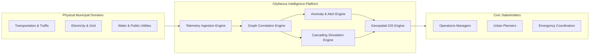
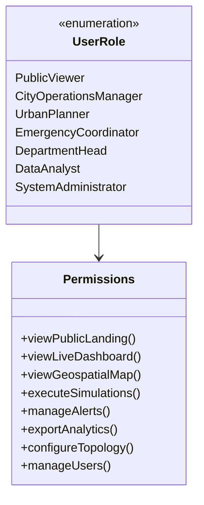
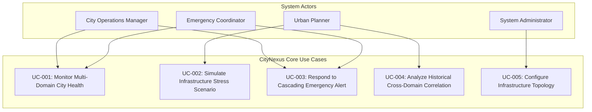
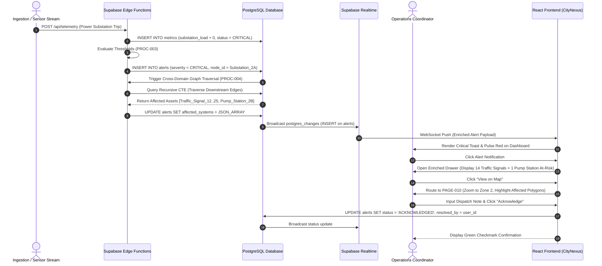
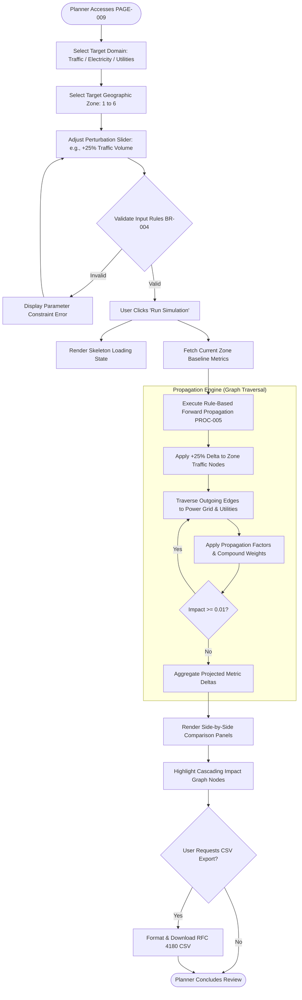
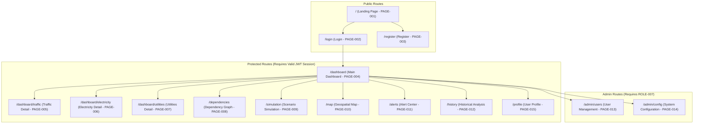
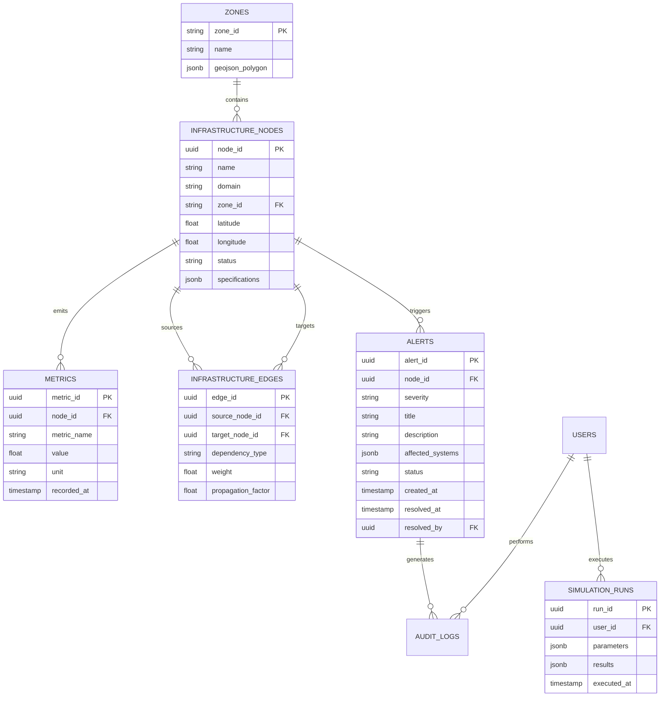

# Product Requirements Document (PRD)

## CityNexus — Urban Infrastructure Intelligence Platform

---

## 1. Document Overview

### 1.1 Document Metadata
| Attribute | Detail |
|---|---|
| **Document Title** | Product Requirements Document (PRD) — CityNexus |
| **Project Name** | CityNexus — Urban Infrastructure Intelligence Platform |
| **Document Purpose** | Establish the definitive, implementation-ready product requirements specification translating the approved proposed solution into functional, non-functional, behavioral, and architectural boundaries. |
| **Document Scope** | Complete product requirements for MVP release and future roadmap definition, covering system modules, functional specifications, acceptance criteria, workflows, pages, data models, error states, and traceability. |
| **Document Version** | 1.0.0 |
| **Document Status** | Approved for Architecture, UI/UX Design, and Engineering Execution |
| **Source Document** | `proposed_solution.md` (Version 1.0.0) |
| **Target Audience** | Software Engineers, Solution Architects, UI/UX Designers, QA Engineers, Product Managers, Hackathon Evaluators |

### 1.2 Document Conventions
- **Requirement Normative Keywords:** In accordance with RFC 2119, the keywords **SHALL**, **SHALL NOT**, **SHOULD**, **SHOULD NOT**, and **MAY** indicate mandatory, prohibited, recommended, discouraged, or optional behavior respectively.
- **Measurability Standard:** All targets notated with `[Proposed Target: Requires Validation]` represent calibrated hackathon engineering baselines subject to network benchmark validation.

### 1.3 Requirement ID Taxonomy
| Identifier Prefix | Requirement Domain | Sequence Format | Example |
|---|---|---|---|
| **FR-xxx** | Functional Requirements | FR-001 to FR-099 | `FR-001` |
| **NFR-xxx** | Non-Functional Requirements | NFR-001 to NFR-099 | `NFR-001` |
| **US-xxx** | User Stories | US-001 to US-099 | `US-001` |
| **UC-xxx** | Use Cases | UC-001 to UC-099 | `UC-001` |
| **PAGE-xxx** | Web Application Pages | PAGE-001 to PAGE-099 | `PAGE-001` |
| **IN-xxx** | System Inputs | IN-001 to IN-099 | `IN-001` |
| **OUT-xxx** | System Outputs | OUT-001 to OUT-099 | `OUT-001` |
| **BR-xxx** | Business Rules & Logic | BR-001 to BR-099 | `BR-001` |
| **INT-xxx** | Data & External Integrations | INT-001 to INT-099 | `INT-001` |
| **ERR-xxx** | Error & Exception Scenarios | ERR-001 to ERR-099 | `ERR-001` |
| **AC-xxx** | Testable Acceptance Criteria | AC-001 to AC-099 | `AC-001` |

---

## 2. Product Overview

### 2.1 Product Name & Description
**CityNexus** is a cloud-native, web-based Urban Infrastructure Intelligence Platform engineered to synthesize, correlate, and simulate cross-domain telemetry across municipal transportation networks, electrical power grids, and public water/utility services.

### 2.2 Product Purpose & Vision
Cities operate as non-linear "systems of systems," yet municipal management remains fundamentally compartmentalized. CityNexus eliminates operational silos by establishing an integrated cyber-physical digital twin of urban infrastructure. Its vision is to empower civic operators and urban planners with pre-incident situational awareness, automated cross-domain correlation, and predictive impact simulations to preserve public safety, reduce utility losses, and maximize infrastructure resilience.

### 2.3 Core Value Proposition
- **Unified Situational Awareness:** Replaces disparate monitoring tools with a centralized operational dashboard.
- **Interdependent Topology Mapping:** Models intra- and inter-layer infrastructure couplings via a directed dependency graph.
- **Pre-Emptive Cascading Analysis:** Identifies downstream secondary and tertiary points of failure before physical disruptions propagate.
- **Frictionless "What-If" Simulation:** Evaluates municipal interventions and planned disruptions within a deterministic sandbox environment.

### 2.4 High-Level System Concept

---

## 3. Problem Statement and Background

### 3.1 Problem Statement
> *An urban area struggles to manage its interconnected infrastructure as traffic, electricity consumption, and public utilities constantly fluctuate. A change in one system often creates unexpected consequences in another, making conventional planning ineffective. How can the city understand these interconnected changes and make better decisions before problems escalate?*

### 3.2 Problem Hierarchy & Root Causes
| Problem ID | Problem Description | Classification | Root Cause Analysis | Real-World Operational Impact |
|---|---|---|---|---|
| **PS-001** | Fragmented Infrastructure Visibility | Primary | Organizational separation between Traffic Authorities, DISCOMs, and Water Boards. | Operators switch between unlinked systems; no holistic status view exists. |
| **PS-002** | Hidden Cascading Interdependencies | Primary | Absence of cross-domain topological coupling maps. | Power grid trips inadvertently shut down traffic signals and water pump pressure. |
| **PS-003** | Ineffective Static Planning Models | Primary | Municipal reliance on periodic surveys and static historical spreadsheets. | Inability to respond to dynamic fluctuations or high-frequency telemetry shifts. |
| **PS-004** | Reactive Failure Mitigation | Primary | Absence of predictive multi-system propagation models. | Incidents are managed only after severe civic escalation and citizen outage reports. |
| **PS-005** | Departmental Data Siloing | Secondary | Disparate proprietary SCADA/IT protocols with zero unified schemas. | Incompatible telemetry prevents coordinated inter-departmental action. |
| **PS-006** | Inability to Simulate Interventions | Secondary | Lack of accessible sandbox environments for municipal testing. | Infrastructure repairs trigger unplanned traffic gridlock and localized utility cutoffs. |
| **PS-007** | Uncorrelated Emergency Alerting | Secondary | Independent threshold alerts generate notification fatigue without context. | Responders dispatched to symptoms rather than systemic root causes. |
| **PS-008** | Uncaptured Cross-Domain Trends | Secondary | Ephemeral logs discarded without inter-domain longitudinal linking. | Recurring multi-system bottlenecks repeat during seasonal demand cycles. |

---

## 4. Product Objectives and Success Criteria

| Objective ID | Objective Description | Problem Addressed | Expected Business Outcome | Key Performance Indicator (KPI) | Target Measurement Method |
|---|---|---|---|---|---|
| **OBJ-001** | Deliver a Single-Pane-of-Glass Operational Interface | PS-001, PS-005 | Unified monitoring across traffic, electrical, and water networks. | Time-to-situational-awareness for operators. | Dashboard displays metrics across all 3 domains with UI load < 2.0s; auto-refresh < 30s. |
| **OBJ-002** | Model Cross-System Topological Couplings | PS-002 | Complete visual and computational representation of asset dependencies. | Dependency query traversal latency. | Recursive graph traversal identifies downstream blast radius in < 500ms for up to 500 nodes. |
| **OBJ-003** | Provide Correlated Multi-Domain Alerting | PS-004, PS-007 | Early warning alert enriched with cross-system affected asset listings. | Mean time to detect (MTTD) cascading risks. | Automated alert generation with dependent asset enrichment within 3s of threshold breach. |
| **OBJ-004** | Enable Deterministic "What-If" Simulation | PS-004, PS-006 | Virtual testing of municipal parameter shifts prior to physical rollout. | Simulation computation turnaround. | Scenario impact calculated and rendered across all affected zones within 5.0s of input execution. |
| **OBJ-005** | Provide Longitudinal Multi-Domain Correlation | PS-003, PS-008 | Historical data visualization comparing correlated timeline trends. | Multi-series query response time. | Render synchronized time-series across 3 domains for up to 90 days in < 1.5s. |
| **OBJ-006** | Project Infrastructure on Geospatial Layers | PS-001, PS-002 | Geographic visualization of municipal assets and zone health. | Map layer render and frame stability. | Smooth map navigation (>= 45 FPS) with togglable traffic, power, and utility layer polygons. |
| **OBJ-007** | Enforce Role-Based Governance | PS-001 | Secure multi-tenant operational boundaries matching civic ranks. | Unauthorized access breach rate. | 100% enforcement of access control across routes, mutations, and administrative APIs. |

---

## 5. Target Users and User Roles

### 5.1 Role Definitions & Permission Matrix
| Role ID | Role Name | Description & Mandate | Typical User Title | Permissions Granted | Access Restrictions |
|---|---|---|---|---|---|
| **ROLE-001** | **Public Viewer** | Unauthenticated guest exploring public municipal platform capabilities. | Citizen, Journalist, Visitor | View Landing Page (PAGE-001), Login (PAGE-002), Register (PAGE-003). | Zero access to operational telemetry, internal maps, or control settings. |
| **ROLE-002** | **City Operations Manager** | High-level municipal commander overseeing aggregate city health. | Shift Commander, Municipal Commissioner | Read all dashboards, map layers, graph views; acknowledge alerts; view historical trends. | Read-only access to system topology configuration. |
| **ROLE-003** | **Urban Planner** | Infrastructure development strategist modeling longitudinal growth. | Urban Design Officer, Civil Planning Engineer | Read dashboards; full access to Scenario Builder (PAGE-009) and Historical Analysis (PAGE-012). | Cannot acknowledge live emergency alerts or modify active alert thresholds. |
| **ROLE-004** | **Emergency Response Coordinator** | First-responder dispatcher handling critical infrastructure failures. | Disaster Management Director, Emergency Ops Chief | Full access to Alert Center (PAGE-011), Impact Chain Trace, Map View (PAGE-010). | Cannot edit long-term topology mappings or alter user roles. |
| **ROLE-005** | **Department Head** | Specialized domain manager focusing on one infrastructure sector. | Traffic Police Chief, Chief Electrical Engineer, Water Works Director | Deep access to respective Domain Detail (PAGE-005, PAGE-006, PAGE-007); cross-domain read access. | Cannot modify configurations outside their respective administrative domain. |
| **ROLE-006** | **Data Analyst** | Technical researcher mining civic data for correlations and trends. | Civic Data Scientist, BI Specialist | Read-only access to all telemetry, full query/export on Historical Analysis (PAGE-012). | Cannot trigger active operational overrides or modify alert rules. |
| **ROLE-007** | **System Administrator** | Technical custodian managing platform integrity, auth, and topology. | Municipal IT Lead, DevOps Engineer | Full administrative control: User Management (PAGE-013), System Configuration (PAGE-014). | Subject to audit logging on all configuration mutations. |

---

## 6. Product Scope

### 6.1 In-Scope (MVP Release)
- **Unified Multi-Domain Dashboard:** Real-time KPI summary cards, domain status indicators, and live ticker across traffic, electricity, and water utilities.
- **Domain Detail Breakdowns:** Specialized analytical views for Traffic (congestion index, flow, speed), Electricity (grid load, consumption, substation status), and Utilities (water pressure, pump operational health, reservoir level).
- **Interactive Topological Dependency Graph:** Visual node-edge representation of municipal assets utilizing React Flow, supporting zoom, pan, node selection, and downstream dependency highlighting.
- **Rule-Based Cascading Simulation Engine:** Sandbox scenario builder permitting parameter manipulation (+/- percentage adjustments) to project cross-system impacts with compounding edge weights.
- **Cross-Domain Anomaly Detection & Alerting:** Automatic threshold evaluations emitting WARNING and CRITICAL alerts enriched with downstream blast-radius lists.
- **Geospatial GIS Health Mapping:** Interactive Leaflet map displaying municipal zones, status-colored polygons, and interactive infrastructure asset markers.
- **Historical Multi-Series Correlation:** Synchronized time-series charts rendering multi-domain comparisons over 7, 30, and 90-day timeframes.
- **Role-Based Access Control & Auth:** User authentication (email/password, OAuth) backed by Supabase Auth with Row-Level Security (RLS) enforcement.
- **Administrative Configuration Console:** UI forms allowing administrators to register infrastructure nodes, establish directed dependency edges, and set alert thresholds.

### 6.2 Out-of-Scope (Explicitly Excluded from MVP)
- Physical SCADA/IoT hardware deployment or direct hardware serial interfacing.
- Automated closed-loop municipal actuator controls (e.g., physically tripping breakers or overriding traffic signal hardware).
- Black-box deep learning / neural network models for unsupervised anomaly detection.
- Full 3D WebGL digital twin mesh rendering of building interiors or subsurface pipe scans.
- Multi-city federation or multi-tenant municipal partitioning outside a single metropolitan demonstration footprint.
- Native mobile applications (iOS/Android) — superseded by responsive progressive web architecture.

---

## 7. Product Modules and Core Capabilities

| Module ID | Module Name | Purpose & Scope | Core Capabilities Delivered | Related Features | Primary User Roles |
|---|---|---|---|---|---|
| **MOD-001** | **Unified Monitoring & Dashboard** | Central operational telemetry synthesis and presentation. | Real-time multi-system KPI aggregation, domain status badges, live ticker. | F-001, F-002, F-003, F-004 | ROLE-002, ROLE-005 |
| **MOD-002** | **Topological Graph & Correlation** | Graph modeling of structural and functional asset dependencies. | Node-edge visualization, BFS dependency traversal, blast-radius calculation. | F-005, F-006, F-007 | ROLE-002, ROLE-003, ROLE-004 |
| **MOD-003** | **Cascading Scenario Simulation** | "What-if" deterministic impact projection sandbox. | Forward-propagation parameter engine, scenario comparison, baseline delta metrics. | F-008, F-009, F-010 | ROLE-003, ROLE-002 |
| **MOD-004** | **Anomaly Detection & Alerting** | Automated threshold monitoring and contextual alert distribution. | Multi-tier threshold evaluation, cross-domain alert enrichment, audit logging. | F-011, F-012, F-013 | ROLE-002, ROLE-004 |
| **MOD-005** | **Geospatial GIS Mapping** | Location-based visualization of infrastructure health. | Zone health polygons, layer filtering, interactive asset drawer. | F-014, F-015, F-016 | ROLE-002, ROLE-003, ROLE-004 |
| **MOD-006** | **Historical Analytics & Reporting** | Longitudinal data aggregation and multi-domain correlation. | Time-series charting, date-bucket aggregation, synchronized timeline views. | F-017, F-018, F-019 | ROLE-003, ROLE-006 |
| **MOD-007** | **Identity, Governance & Configuration** | Security boundaries, user lifecycle, and system topology setup. | Supabase authentication, RBAC enforcement, node/edge CRUD, threshold tuning. | F-020, F-021, F-022, F-023 | ROLE-007 |

---

## 8. Functional Requirements

### 8.1 Module 1: Unified Monitoring & Dashboard

#### FR-001: Multi-Domain Telemetry Aggregation
- **Description:** The system shall aggregate and display real-time operational metrics across Transportation, Electricity, and Water Utilities in a unified interface.
- **Actor:** City Operations Manager (ROLE-002), Department Head (ROLE-005), Data Analyst (ROLE-006).
- **Trigger:** Navigation to PAGE-004 or automated periodic refresh.
- **Preconditions:** User is authenticated and possesses valid session token.
- **Input:** Filter selections (e.g., Selected Zone, Time Horizon).
- **Expected System Behavior:** The system shall query the latest telemetry records from `metrics` table and render KPI cards for all three domains simultaneously.
- **Processing Logic:** 
  1. Retrieve latest metric per domain per zone (`ORDER BY recorded_at DESC LIMIT 1`).
  2. Compute percentage change relative to the preceding 60-minute moving average.
  3. Map composite status to semantic badges: NORMAL (green), WARNING (yellow), CRITICAL (red) per BR-003.
- **Output:** Rendered dashboard view displaying 3 domain summary cards and active alerts ticker.
- **Postconditions:** Dashboard state updated in client-side cache via TanStack Query.
- **Priority:** Must Have (MVP).
- **Related Feature:** F-001.
- **Related User Story:** US-001.
- **Acceptance Criteria:** AC-001.

#### FR-002: Domain Detail Inspection
- **Description:** The system shall provide dedicated drill-down views displaying deep telemetry, sub-component health, and local historical charts for an individual municipal sector.
- **Actor:** Department Head (ROLE-005), Operations Manager (ROLE-002).
- **Trigger:** User clicks on a specific domain card on PAGE-004 or navigates via sidebar.
- **Preconditions:** Domain exists in system taxonomy (Traffic, Electricity, Utilities).
- **Input:** Domain identifier parameter (`/dashboard/traffic`, `/dashboard/electricity`, `/dashboard/utilities`).
- **Expected System Behavior:** The system shall render domain-specific telemetry panels, zone breakdowns, and component health tables.
- **Processing Logic:** Filter metric table records where `domain = :target_domain` grouped by `zone_id`.
- **Output:** Rendered Domain Detail Page (PAGE-005, PAGE-006, or PAGE-007).
- **Postconditions:** Active domain state saved in Zustand store.
- **Priority:** Must Have (MVP).
- **Related Feature:** F-002.
- **Related User Story:** US-002.
- **Acceptance Criteria:** AC-002.

#### FR-003: Real-Time Telemetry Streaming
- **Description:** The system shall dynamically update dashboard telemetry in real time without requiring manual browser refreshes.
- **Actor:** System (Automated), All Authenticated Users.
- **Trigger:** Database `INSERT` or `UPDATE` event on `metrics` or `alerts` table.
- **Preconditions:** Active WebSocket connection established to Supabase Realtime channel.
- **Input:** Realtime PostgreSQL replication payload.
- **Expected System Behavior:** The UI components shall update their values, status colors, and chart data points within 1 second of event reception.
- **Processing Logic:** Client receives payload via `supabase.channel('dashboard_changes')`, invalidates relevant TanStack Query cache keys, and triggers React state reconciliation.
- **Output:** Updated UI component values with subtle Framer Motion pulse animation.
- **Postconditions:** Dashboard displays current telemetry timestamp.
- **Priority:** Must Have (MVP).
- **Related Feature:** F-003.
- **Related User Story:** US-003.
- **Acceptance Criteria:** AC-003.

#### FR-004: Status Indicator and KPI Card Computation
- **Description:** The system shall compute and present visual KPI cards representing critical health thresholds for each infrastructure domain.
- **Actor:** City Operations Manager (ROLE-002).
- **Trigger:** Dashboard load or metric stream update.
- **Preconditions:** Threshold configurations exist in `threshold_configs` table.
- **Input:** Metric values (Traffic Congestion Index 0-100%, Electrical Grid Load %, Water Pressure PSI).
- **Expected System Behavior:** Each card shall display current value, unit, status indicator badge, and 24-hour sparkline trend.
- **Processing Logic:** Implement business rule BR-003 to categorize value into NORMAL, WARNING, or CRITICAL.
- **Output:** Formatted KPI summary card components.
- **Postconditions:** None.
- **Priority:** Must Have (MVP).
- **Related Feature:** F-004.
- **Related User Story:** US-001.
- **Acceptance Criteria:** AC-004.

---

### 8.2 Module 2: Topological Graph & Correlation

#### FR-005: Interactive Dependency Graph Rendering
- **Description:** The system shall render an interactive directed graph representing physical and logical dependencies between infrastructure assets across all municipal domains.
- **Actor:** All Authenticated Users.
- **Trigger:** Navigation to PAGE-008.
- **Preconditions:** Nodes and edges are defined in `infrastructure_nodes` and `infrastructure_edges` tables.
- **Input:** Filter criteria (Domain filter, Zone filter).
- **Expected System Behavior:** The system shall display a responsive React Flow canvas rendering nodes categorized by domain color-coding, connected by directed directional arrows indicating flow of dependency.
- **Processing Logic:** 
  1. Fetch active nodes and edges.
  2. Compute layout positions using standard dagre/hierarchical graph layout.
  3. Render custom node components with health status icons.
- **Output:** Interactive canvas supporting pan, zoom, click-to-focus, and node inspection.
- **Postconditions:** Graph viewport state preserved in local component state.
- **Priority:** Must Have (MVP).
- **Related Feature:** F-005.
- **Related User Story:** US-005.
- **Acceptance Criteria:** AC-005.

#### FR-006: Cross-Domain Dependency Highlighting
- **Description:** The system shall visually highlight all downstream and upstream dependent assets when a user selects a specific infrastructure node.
- **Actor:** Operations Manager (ROLE-002), Emergency Coordinator (ROLE-004), Planner (ROLE-003).
- **Trigger:** User clicks on an infrastructure node in the graph or selects it from an alert drawer.
- **Preconditions:** Node exists on active graph canvas.
- **Input:** Selected `node_id`.
- **Expected System Behavior:** The system shall dim unrelated nodes and edges, highlight direct and indirect dependency chains with distinct edge colors, and display an asset metadata drawer.
- **Processing Logic:** Execute client-side or database BFS traversal (PROC-004) to collect all connected node IDs up to 4 hops deep.
- **Output:** Visual highlight of affected dependency subgraph and side-drawer detail view.
- **Postconditions:** Selected node ID stored in URL search parameters (`?node=...`).
- **Priority:** Must Have (MVP).
- **Related Feature:** F-006.
- **Related User Story:** US-006.
- **Acceptance Criteria:** AC-006.

#### FR-007: Impact Chain Blast-Radius Calculation
- **Description:** The system shall compute and display the complete downstream failure path and cumulative blast-radius impact score when a component suffers a critical disruption.
- **Actor:** Emergency Response Coordinator (ROLE-004).
- **Trigger:** User clicks "Calculate Blast Radius" on a node or an active CRITICAL alert.
- **Preconditions:** Selected node is in WARNING or CRITICAL state.
- **Input:** `origin_node_id`, initial disruption magnitude (0.0 to 1.0).
- **Expected System Behavior:** The system shall compute cascading attenuation across downstream edges and present a prioritized list of at-risk assets grouped by domain.
- **Processing Logic:** 
  1. Initiate recursive CTE traversal traversing outgoing edges (`source_node_id -> target_node_id`).
  2. Compute propagated impact: $Score_{child} = Score_{parent} \times Weight_{edge}$.
  3. Halt traversal if $Score_{child} < 0.05$ or hop count > 5 per BR-005.
- **Output:** Ranked table of at-risk downstream components and visual highlighted path on canvas.
- **Postconditions:** Blast-radius computation logged for incident audit.
- **Priority:** Should Have (MVP).
- **Related Feature:** F-007.
- **Related User Story:** US-007.
- **Acceptance Criteria:** AC-007.

---

### 8.3 Module 3: Cascading Scenario Simulation

#### FR-008: Scenario Parameter Definition
- **Description:** The system shall provide an intuitive simulation interface allowing users to define hypothetical municipal stress events via parameter sliders.
- **Actor:** Urban Planner (ROLE-003), Operations Manager (ROLE-002).
- **Trigger:** Navigation to PAGE-009.
- **Preconditions:** Baseline metrics exist for target zones.
- **Input:** Target Domain (Traffic, Electricity, Utilities), Target Zone (e.g., Zone 1 through Zone 6), Perturbation Variable (e.g., Volume, Capacity, Demand), Adjustment Slider (-50% to +100%).
- **Expected System Behavior:** System shall capture parameter states in real time, validate inputs, and present a "Run Simulation" trigger button.
- **Processing Logic:** Validate inputs against BR-004; compute parameter delta payload.
- **Output:** Active scenario parameter configuration summary card.
- **Postconditions:** Scenario draft saved in Zustand store.
- **Priority:** Must Have (MVP).
- **Related Feature:** F-008.
- **Related User Story:** US-008.
- **Acceptance Criteria:** AC-008.

#### FR-009: Forward-Propagation Simulation Execution
- **Description:** The system shall execute rule-based impact propagation across the dependency graph and output predicted metric shifts for all affected municipal zones.
- **Actor:** Urban Planner (ROLE-003).
- **Trigger:** User clicks "Run Simulation" on PAGE-009.
- **Preconditions:** Valid scenario parameter payload defined.
- **Input:** Scenario configuration payload.
- **Expected System Behavior:** The system shall run propagation algorithms (PROC-005) and render before-and-after metric comparisons within 5 seconds.
- **Processing Logic:** 
  1. Apply initial delta to root nodes.
  2. For each outgoing edge, propagate change: $\Delta Metric_{target} = \Delta Metric_{source} \times Factor_{propagation}$.
  3. Update predicted values for connected traffic congestion, electrical load, and water pump pressure.
  4. Aggregate predicted values into zone-level summaries.
- **Output:** Simulation Results view showing Baseline vs. Predicted values, percentage variance badges, and affected asset count.
- **Postconditions:** Simulation run stored in `simulation_runs` table with unique run ID.
- **Priority:** Must Have (MVP).
- **Related Feature:** F-009.
- **Related User Story:** US-009.
- **Acceptance Criteria:** AC-009.

#### FR-010: Multi-Scenario Comparative Analysis
- **Description:** The system shall permit users to save and compare outcomes from multiple simulation runs side-by-side.
- **Actor:** Urban Planner (ROLE-003).
- **Trigger:** User selects two or more past simulation runs and clicks "Compare Scenarios".
- **Preconditions:** At least two completed simulation runs exist.
- **Input:** Selection of `simulation_run_id_A` and `simulation_run_id_B`.
- **Expected System Behavior:** The system shall render a split-screen or dual-column comparative table highlighting differential impacts across zones.
- **Processing Logic:** Join outputs of both runs on `zone_id` and compute difference delta: $\Delta = Value_B - Value_A$.
- **Output:** Comparative visualization with color-coded advantage/risk indicators.
- **Postconditions:** Comparison exportable to CSV.
- **Priority:** Could Have (Future Scope).
- **Related Feature:** F-010.
- **Related User Story:** US-010.
- **Acceptance Criteria:** AC-010.

---

### 8.4 Module 4: Anomaly Detection & Alerting

#### FR-011: Multi-Tier Threshold Anomaly Evaluation
- **Description:** The system shall continuously monitor incoming infrastructure metrics against configured operational bounds and generate discrete alerts upon threshold breach.
- **Actor:** System (Automated Background Process / Supabase Edge Function).
- **Trigger:** Ingestion of new metric record or scheduled cron evaluation (every 60 seconds).
- **Preconditions:** Active threshold configurations exist in `threshold_configs`.
- **Input:** Latest telemetry records from `metrics` table.
- **Expected System Behavior:** When a metric breaches a warning or critical threshold, an alert record shall be inserted into `alerts` table and broadcast via Realtime channel.
- **Processing Logic:** 
  - If $Metric \ge Critical\_Threshold \rightarrow$ Emit Severity = `CRITICAL`.
  - Else if $Metric \ge Warning\_Threshold \rightarrow$ Emit Severity = `WARNING`.
  - Else if alert was active and $Metric < Warning\_Threshold \times 0.95 \rightarrow$ Auto-resolve alert (hysteresis).
- **Output:** Inserted row in `alerts` table; toast notification emitted to connected clients.
- **Postconditions:** Alert counter on navbar badge incremented.
- **Priority:** Must Have (MVP).
- **Related Feature:** F-011.
- **Related User Story:** US-011.
- **Acceptance Criteria:** AC-011.

#### FR-012: Cross-Domain Alert Enrichment
- **Description:** The system shall automatically append a list of potentially impacted dependent components across other municipal domains to every generated alert.
- **Actor:** System (Automated), Operations Manager (ROLE-002), Emergency Coordinator (ROLE-004).
- **Trigger:** Generation of an alert record in `alerts` table.
- **Preconditions:** Originating asset node mapped in `infrastructure_edges`.
- **Input:** Generated alert ID and originating `node_id`.
- **Expected System Behavior:** The alert modal/drawer shall display an "Associated Impacted Systems" section detailing secondary systems at risk.
- **Processing Logic:** Trigger PROC-004 to traverse outgoing edges from originating node, extract all child nodes having different `domain` classifications, and serialize as JSON array in `alerts.affected_systems`.
- **Output:** Enriched alert object containing array of `{ node_id, node_name, domain, zone, risk_score }`.
- **Postconditions:** Realtime broadcast includes enriched payload.
- **Priority:** Should Have (MVP).
- **Related Feature:** F-012.
- **Related User Story:** US-012.
- **Acceptance Criteria:** AC-012.

#### FR-013: Alert Lifecycle Management & Audit Log
- **Description:** The system shall provide an audit-logged alert management workflow allowing operators to acknowledge, investigate, and resolve alerts.
- **Actor:** City Operations Manager (ROLE-002), Emergency Response Coordinator (ROLE-004).
- **Trigger:** User interaction with alert item on PAGE-011 (Alert Center).
- **Preconditions:** Alert status is `ACTIVE`.
- **Input:** Alert ID, Action (`ACKNOWLEDGE` or `RESOLVE`), Operator Comment.
- **Expected System Behavior:** System shall update alert status, stamp operator user ID and timestamp, and remove item from active banner.
- **Processing Logic:** Validate user permission ROLE-002 or ROLE-004; update `alerts.status = :action`, `alerts.resolved_by = auth.uid()`, `alerts.resolved_at = NOW()`.
- **Output:** Updated alert record; UI status badge changes from "ACTIVE" to "ACKNOWLEDGED" or "RESOLVED".
- **Postconditions:** Audit log entry created in `audit_logs` table.
- **Priority:** Should Have (MVP).
- **Related Feature:** F-013.
- **Related User Story:** US-013.
- **Acceptance Criteria:** AC-013.

---

### 8.5 Module 5: Geospatial GIS Mapping

#### FR-014: Interactive Multi-Layer City Map
- **Description:** The system shall render an interactive geographic map of the urban environment featuring togglable infrastructure layers.
- **Actor:** All Authenticated Users.
- **Trigger:** Navigation to PAGE-010.
- **Preconditions:** OpenStreetMap tile provider available; zone GeoJSON coordinates loaded.
- **Input:** Layer toggles: [x] Traffic Corridors, [x] Power Grid Substations, [x] Water Utility Mains.
- **Expected System Behavior:** Map renders centered on metropolitan coordinates, with vector layers and marker clusters corresponding to active toggles.
- **Processing Logic:** Render React Leaflet `<MapContainer>` with OpenStreetMap tile layer; dynamically add/remove GeoJSON feature layers based on user selection.
- **Output:** Interactive map supporting pan, pinch-zoom, and layer filtering.
- **Postconditions:** Map center and zoom level preserved in session storage.
- **Priority:** Must Have (MVP).
- **Related Feature:** F-014.
- **Related User Story:** US-014.
- **Acceptance Criteria:** AC-014.

#### FR-015: Geographic Zone Health Status Overlay
- **Description:** The system shall render color-coded geographic boundary polygons representing the aggregated health of each municipal zone.
- **Actor:** City Operations Manager (ROLE-002), Urban Planner (ROLE-003).
- **Trigger:** Map load or telemetry update.
- **Preconditions:** Zone polygons defined in GeoJSON schema.
- **Input:** Aggregated zone health score (0-100).
- **Expected System Behavior:** Zone boundary polygons shall be filled with dynamic translucent colors: Green (Good: Health >= 80), Yellow (Degraded: 60 <= Health < 80), Red (Critical: Health < 60).
- **Processing Logic:** 
  1. Calculate average health score per zone: $H_{zone} = \frac{1}{3}(100 - TrafficCongestion) + \frac{1}{3}(100 - GridStrain) + \frac{1}{3}(WaterPressureIndex)$.
  2. Map $H_{zone}$ to polygon fill color with 0.35 opacity.
- **Output:** Colorized choropleth layer overlaid on city basemap.
- **Postconditions:** None.
- **Priority:** Must Have (MVP).
- **Related Feature:** F-015.
- **Related User Story:** US-015.
- **Acceptance Criteria:** AC-015.

#### FR-016: Map Asset Drill-Down & Inspection Drawer
- **Description:** The system shall open an asset inspection drawer displaying live metrics, active alerts, and immediate dependencies when a user clicks an infrastructure map marker.
- **Actor:** All Authenticated Users.
- **Trigger:** User clicks on an asset marker or zone polygon on PAGE-010.
- **Preconditions:** Marker represents a registered entity in `infrastructure_nodes`.
- **Input:** Click event with `node_id`.
- **Expected System Behavior:** An inspection side-drawer shall slide into view showing asset specifications, current sensor readings, active alerts, and a button to view in Dependency Graph.
- **Processing Logic:** Query node metadata, join with latest telemetry row, and count active alerts where `node_id = :clicked_id`.
- **Output:** Rendered shadcn/ui sheet/drawer component with live telemetry.
- **Postconditions:** Selected node highlighted on map canvas.
- **Priority:** Should Have (MVP).
- **Related Feature:** F-016.
- **Related User Story:** US-016.
- **Acceptance Criteria:** AC-016.

---

### 8.6 Module 6: Historical Analytics & Reporting

#### FR-017: Multi-Domain Time-Series Charting
- **Description:** The system shall render interactive historical time-series charts displaying trends across traffic, electricity, and water systems over user-defined intervals.
- **Actor:** Urban Planner (ROLE-003), Data Analyst (ROLE-006).
- **Trigger:** Navigation to PAGE-012 and selection of date parameters.
- **Preconditions:** Historical records exist in `metrics` table.
- **Input:** Date Range (Last 24 Hours, Last 7 Days, Last 30 Days, Custom Range), Granularity (Hourly, Daily).
- **Expected System Behavior:** System shall query aggregated time-series buckets and render Recharts area/line charts with hover tooltips and metric value axes.
- **Processing Logic:** Execute SQL aggregation utilizing PostgreSQL `date_trunc(:granularity, recorded_at)` computing `AVG(value)`, `MIN(value)`, `MAX(value)` grouped by time bucket.
- **Output:** Rendered Recharts `<ResponsiveContainer>` displaying trend curves.
- **Postconditions:** Chart data cached in TanStack Query for 5 minutes.
- **Priority:** Must Have (MVP).
- **Related Feature:** F-017.
- **Related User Story:** US-017.
- **Acceptance Criteria:** AC-017.

#### FR-018: Synchronized Correlated Timeline View
- **Description:** The system shall synchronize cursor crosshairs and tooltips across multiple vertically stacked charts representing different municipal domains.
- **Actor:** Data Analyst (ROLE-006), Urban Planner (ROLE-003).
- **Trigger:** User hovers cursor over any point on a time-series chart on PAGE-012.
- **Preconditions:** At least two domain charts rendered simultaneously with matching time axes.
- **Input:** Cursor hover coordinate on time axis $T$.
- **Expected System Behavior:** All rendered domain charts shall simultaneously display vertical cursor guides and tooltips at timestamp $T$, permitting instant visual cross-correlation.
- **Processing Logic:** Assign identical `syncId="citynexus_temporal_sync"` property across Recharts chart components.
- **Output:** Synchronized visual crosshair across Traffic, Electricity, and Utility charts.
- **Postconditions:** None.
- **Priority:** Should Have (MVP).
- **Related Feature:** F-018.
- **Related User Story:** US-018.
- **Acceptance Criteria:** AC-018.

#### FR-019: Analytical Report Data Export
- **Description:** The system shall allow users to export aggregated historical telemetry and incident summaries as downloadable CSV or structured JSON files.
- **Actor:** Data Analyst (ROLE-006), Urban Planner (ROLE-003).
- **Trigger:** User clicks "Export Data" button on PAGE-012.
- **Preconditions:** Query results rendered on screen.
- **Input:** Format selection (CSV, JSON).
- **Expected System Behavior:** System shall format active dataset and trigger browser file download with descriptive filename (e.g., `citynexus_telemetry_zone3_2026-11-17.csv`).
- **Processing Logic:** Convert JSON memory array to RFC 4180 compliant CSV string; trigger client-side Blob download.
- **Output:** Downloaded flat file on client filesystem.
- **Postconditions:** Export action logged in audit log.
- **Priority:** Could Have (Future Scope).
- **Related Feature:** F-019.
- **Related User Story:** US-019.
- **Acceptance Criteria:** AC-019.

---

### 8.7 Module 7: Identity, Governance & Configuration

#### FR-020: Secure User Authentication
- **Description:** The system shall authenticate users via email/password credentials and OAuth providers (Google, GitHub) using Supabase Auth.
- **Actor:** All Users.
- **Trigger:** Submission on PAGE-002 (Login) or PAGE-003 (Register).
- **Preconditions:** User account exists or OAuth provider approves handshake.
- **Input:** Email address and password, or OAuth redirect response.
- **Expected System Behavior:** System shall validate credentials, establish a secure encrypted JWT session, persist refresh token in secure HTTP-only cookies, and route user to PAGE-004.
- **Processing Logic:** Invoke `supabase.auth.signInWithPassword()` or `signInWithOAuth()`; receive JWT payload; decode user claims.
- **Output:** Active user session; user profile avatar rendered in top navbar.
- **Postconditions:** Authentication state synced across application.
- **Priority:** Must Have (MVP).
- **Related Feature:** F-020.
- **Related User Story:** US-020.
- **Acceptance Criteria:** AC-020.

#### FR-021: Role-Based Authorization Enforcement
- **Description:** The system shall restrict navigation, page viewing, and database mutations based on the authenticated user's assigned role.
- **Actor:** All Authenticated Users.
- **Trigger:** Navigation to protected route or execution of API mutation.
- **Preconditions:** User is authenticated.
- **Input:** Requested route or database operation; User JWT claims.
- **Expected System Behavior:** If user lacks required role permissions per Permission Matrix (Section 5), navigation is blocked with a 403 Forbidden notice, and database operations are rejected by PostgreSQL Row Level Security (RLS).
- **Processing Logic:** React Router route guard checks `user.role`; Supabase RLS policies enforce `auth.jwt() ->> 'role' = 'admin'`.
- **Output:** Permitted view rendered or Access Denied notification displayed.
- **Postconditions:** Unauthorized access attempts logged in `security_events`.
- **Priority:** Should Have (MVP).
- **Related Feature:** F-021.
- **Related User Story:** US-021.
- **Acceptance Criteria:** AC-021.

#### FR-022: Infrastructure Topology & Threshold Configuration Console
- **Description:** The system shall provide an administrative interface to create, update, and delete infrastructure components, define dependency edges, and set alert thresholds.
- **Actor:** System Administrator (ROLE-007).
- **Trigger:** Navigation to PAGE-014.
- **Preconditions:** Authenticated user holds ROLE-007.
- **Input:** Node definitions (Name, Domain, Zone, Lat/Lng), Edge definitions (Source Node, Target Node, Weight, Type), Thresholds (Metric, Warning Level, Critical Level).
- **Expected System Behavior:** System validates inputs against business rules and updates `infrastructure_nodes`, `infrastructure_edges`, and `threshold_configs` tables.
- **Processing Logic:** Form validation via Zod; transactional upsert into Supabase PostgreSQL; invalidation of graph cache.
- **Output:** Success toast notification; updated table view in admin console.
- **Postconditions:** Updated topology immediately reflected across Dependency Graph and Simulation engines.
- **Priority:** Should Have (MVP).
- **Related Feature:** F-022.
- **Related User Story:** US-022.
- **Acceptance Criteria:** AC-022.

#### FR-023: User Preferences & Theme Customization
- **Description:** The system shall allow users to toggle between dark and light UI themes and set default dashboard landing preferences.
- **Actor:** All Authenticated Users.
- **Trigger:** User interaction on PAGE-015 or navbar theme toggle.
- **Preconditions:** Authenticated session.
- **Input:** Theme mode selection (`dark`, `light`, `system`), default zone selection.
- **Expected System Behavior:** UI immediately re-renders using corresponding Tailwind CSS class mappings and persists settings to local storage.
- **Processing Logic:** Update `document.documentElement.classList`; write preference to `user_preferences` table.
- **Output:** Visual UI theme transition without full page reload.
- **Postconditions:** User settings loaded automatically on subsequent logins.
- **Priority:** Could Have (Future Scope).
- **Related Feature:** F-023.
- **Related User Story:** US-023.
- **Acceptance Criteria:** AC-023.

---

## 9. Non-Functional Requirements

### 9.1 Performance Requirements
| NFR ID | Category | Requirement Specification | Priority | Verification Method | Target System Area |
|---|---|---|---|---|---|
| **NFR-001** | Performance | **Dashboard Initial Load Time:** The primary operational dashboard (PAGE-004) shall reach First Contentful Paint (FCP) in $\le 1.2\text{s}$ and Time to Interactive (TTI) in $\le 2.0\text{s}$ on standard broadband connections (>= 15 Mbps). | Must Have | Lighthouse Audit & Web Vitals Telemetry | PAGE-004 |
| **NFR-002** | Performance | **Real-Time Latency:** Database mutation events shall propagate to the client UI via Supabase Realtime WebSockets in $\le 1000\text{ms}$ under standard network conditions. | Must Have | Automated WebSocket latency benchmark script | Realtime Streaming / MOD-001 |
| **NFR-003** | Performance | **Graph Traversal Response:** Recursive dependency graph traversals (PROC-004) up to 4 hops deep across 500 nodes shall execute in $\le 350\text{ms}$ in PostgreSQL. | Must Have | `EXPLAIN ANALYZE` query execution benchmarking | PostgreSQL / MOD-002 |
| **NFR-004** | Performance | **Simulation Turnaround:** Execution of forward-propagation simulation (PROC-005) across all municipal zones shall complete and render in $\le 5.0\text{s}$. | Must Have | Client-side performance timing profiling | PAGE-009 / MOD-003 |
| **NFR-005** | Performance | **Map Rendering Frame Rate:** Leaflet map pan and zoom operations shall maintain a minimum of 45 FPS with 150 markers and 10 zone polygons rendered. | Should Have | Chrome DevTools Performance FPS monitor | PAGE-010 / MOD-005 |

### 9.2 Security & Privacy Requirements
| NFR ID | Category | Requirement Specification | Priority | Verification Method | Target System Area |
|---|---|---|---|---|---|
| **NFR-006** | Security | **Transport Encryption:** 100% of network traffic (HTTP, WebSocket) shall be strictly encrypted using TLS 1.3 with automated HTTPS redirection. | Must Have | SSL Labs Server Test (Score: A) | Network / Vercel Edge |
| **NFR-007** | Security | **Database Access Control:** All PostgreSQL tables shall enforce Row-Level Security (RLS) ensuring non-admin users cannot write or mutate infrastructure topologies or configuration records. | Must Have | Automated security integration test suite executing unauthorized mutations | PostgreSQL / Supabase |
| **NFR-008** | Security | **Credential Protection:** User passwords shall be hashed using bcrypt/Argon2 via Supabase Auth; no raw credentials shall ever appear in logs, local storage, or network payloads. | Must Have | Code audit and penetration testing scan | Auth / MOD-007 |
| **NFR-009** | Privacy | **Minimal Data Collection:** The platform shall store only municipal operational telemetry and operator authentication metadata; zero citizen personally identifiable information (PII) shall be ingested. | Must Have | Data privacy compliance audit | Data Layer / All Modules |

### 9.3 Reliability, Availability & Error Recovery
| NFR ID | Category | Requirement Specification | Priority | Verification Method | Target System Area |
|---|---|---|---|---|---|
| **NFR-010** | Reliability | **Graceful Degradation:** If external API data sources (e.g., OpenWeatherMap) become unavailable, the system shall fall back to cached telemetry and display a non-blocking "Data Stale" indicator without throwing uncaught exceptions. | Must Have | Simulated external network disconnection test | Edge Functions / MOD-001 |
| **NFR-011** | Reliability | **WebSocket Reconnection:** Upon WebSocket disconnection, the client shall automatically attempt exponential-backoff reconnection with maximum interval of 30 seconds. | Must Have | Network throttling disconnect/reconnect test | Realtime / Client State |
| **NFR-012** | Availability | **Target Platform Uptime:** The platform shall target 99.5% operational availability during evaluation periods, excluding scheduled maintenance windows. `[Proposed Target: Requires Validation]` | Should Have | Uptime monitoring service ping logs | Hosting / Vercel + Supabase |

### 9.4 Usability & Accessibility
| NFR ID | Category | Requirement Specification | Priority | Verification Method | Target System Area |
|---|---|---|---|---|---|
| **NFR-013** | Accessibility | **WCAG Compliance:** Core operational interfaces shall comply with WCAG 2.1 Level AA standards, including keyboard navigability and minimum color contrast ratio of 4.5:1 for text against backgrounds. | Should Have | Axe Accessibility automated test suite | All UI Components |
| **NFR-014** | Usability | **Responsive Viewport Support:** The application layout shall fluidly adapt to desktop viewports (1920x1080, 1440x900) and tablet devices (>= 768px width) without horizontal overflow. | Must Have | Multi-device viewport matrix testing | All Pages |
| **NFR-015** | Usability | **Clarity of Semantic Colors:** Semantic status colors shall strictly align across all modules: Green for Normal, Amber/Yellow for Warning, Red for Critical, Blue for Informational. | Must Have | Visual UI audit | Design System / Tailwind |

### 9.5 Maintainability & Code Quality
| NFR ID | Category | Requirement Specification | Priority | Verification Method | Target System Area |
|---|---|---|---|---|---|
| **NFR-016** | Maintainability | **Type Safety Standard:** 100% of frontend codebase shall be written in TypeScript under `strict: true` compiler configuration with zero allowable `any` type escapes in core business logic. | Must Have | TypeScript compilation check (`tsc --noEmit`) | Frontend Codebase |
| **NFR-017** | Maintainability | **Component Architecture:** UI code shall follow modular component architecture using shadcn/ui primitives with co-located unit tests and Zod schema validation for all form submissions. | Must Have | ESLint and static analysis code review | Frontend Codebase |

---

## 10. User Stories

| Story ID | User Role | User Story Statement | Business Value / Outcome | Priority | Related FRs | Related Page | Acceptance Criteria |
|---|---|---|---|---|---|---|---|
| **US-001** | City Operations Manager | As a City Operations Manager, I want to view real-time summary cards for traffic, power, and water on a single dashboard, so that I can instantly evaluate overall city health without switching tools. | Drastically reduces time to detect multi-system stress; provides immediate situational awareness. | Must Have | FR-001, FR-004 | PAGE-004 | AC-001, AC-004 |
| **US-002** | Department Head | As a Department Head, I want to drill into a domain detail view showing zone-by-zone metrics, so that I can investigate specific bottlenecks within my department's infrastructure. | Enables deep sectoral diagnosis while retaining cross-domain context. | Must Have | FR-002 | PAGE-005, PAGE-006, PAGE-007 | AC-002 |
| **US-003** | Operations Manager | As an Operations Manager, I want telemetry to refresh in real time via live push, so that I never make emergency decisions based on stale data. | Eliminates human polling error and ensures sub-second awareness during rapid fluctuations. | Must Have | FR-003 | PAGE-004 | AC-003 |
| **US-004** | Urban Planner | As an Urban Planner, I want to adjust infrastructure parameters via sliders and run "what-if" simulations, so that I can predict cascading secondary impacts before approving physical civil projects. | Prevents costly municipal mistakes and unplanned secondary infrastructure failures. | Must Have | FR-008, FR-009 | PAGE-009 | AC-008, AC-009 |
| **US-005** | All Authenticated Users | As a user, I want to explore an interactive dependency graph connecting city assets, so that I can understand which power lines and water stations support specific traffic corridors. | Makes complex physical interdependencies visually intelligible to cross-functional teams. | Must Have | FR-005 | PAGE-008 | AC-005 |
| **US-006** | Operations Manager | As an Operations Manager, I want to click any asset in the graph to highlight its direct upstream and downstream dependencies, so that I can trace vulnerability chains. | Accelerates root-cause tracing and pinpoints single points of failure. | Must Have | FR-006 | PAGE-008 | AC-006 |
| **US-007** | Emergency Coordinator | As an Emergency Coordinator, I want to calculate the blast radius of a failing substation, so that I know exactly which traffic lights and water pumps will fail downstream. | Enables targeted emergency pre-positioning of generators and traffic police. | Should Have | FR-007 | PAGE-008, PAGE-011 | AC-007 |
| **US-008** | Emergency Coordinator | As an Emergency Coordinator, I want every alert to list affected systems in other domains, so that my dispatch crews understand the full cross-domain threat environment. | Prevents isolated response dispatch; improves cross-agency crisis coordination. | Should Have | FR-012 | PAGE-011 | AC-012 |
| **US-009** | Operations Manager | As an Operations Manager, I want to acknowledge and log resolution notes on active alerts, so that the shift team maintains an accountable audit trail of incident handling. | Ensures organizational compliance and historical transparency. | Should Have | FR-013 | PAGE-011 | AC-013 |
| **US-010** | All Authenticated Users | As a user, I want to view infrastructure health on a geographic city map with color-coded zone polygons, so that I can spatially correlate issues with physical geography. | Provides geographical intuition that numerical dashboards cannot convey. | Must Have | FR-014, FR-015 | PAGE-010 | AC-014, AC-015 |
| **US-011** | All Authenticated Users | As a user, I want to click on a map marker to open an inspection drawer showing live telemetry, so that I can investigate field assets directly from the map. | Provides seamless spatial-to-telemetry navigation without context loss. | Should Have | FR-016 | PAGE-010 | AC-016 |
| **US-012** | Data Analyst | As a Data Analyst, I want to view synchronized historical charts with shared crosshairs, so that I can determine whether past traffic surges directly caused substation power spikes. | Verifies empirical hypotheses about urban interdependency patterns. | Must Have | FR-017, FR-018 | PAGE-012 | AC-017, AC-018 |
| **US-013** | System Administrator | As a System Administrator, I want a configuration console to add infrastructure nodes and draw dependency edges, so that the digital twin accurately mirrors physical expansion. | Keeps platform topology synchronized with ongoing municipal capital works. | Should Have | FR-022 | PAGE-014 | AC-022 |
| **US-014** | System Administrator | As a System Administrator, I want to manage user roles and permissions, so that only authorized personnel can access sensitive operational dashboards. | Protects critical municipal infrastructure data from unauthorized tampering. | Should Have | FR-021 | PAGE-013 | AC-021 |

---

## 11. Use Cases

### 11.1 Use Case Summary Diagram

### 11.2 Detailed Use Case Specifications

#### UC-001: Monitor Multi-Domain City Health
- **Use Case ID:** UC-001
- **Primary Actor:** City Operations Manager (ROLE-002)
- **Secondary Actors:** Department Heads (ROLE-005), Emergency Coordinator (ROLE-004)
- **Preconditions:** Operator has authenticated and navigated to PAGE-004.
- **Trigger:** Start of operational shift or ongoing monitoring duty.
- **Main Success Flow:**
  1. Operator views Multi-Domain Dashboard (PAGE-004).
  2. System queries and displays current KPI summary cards: Traffic Congestion (%), Grid Load (%), Water Pressure (PSI).
  3. System establishes WebSocket subscription to Supabase Realtime channel.
  4. System renders live ticker listing active civic notices and latest telemetry timestamps.
  5. Operator observes all domain badges in green "NORMAL" state.
  6. Operator toggles zone filter to review Zone 3; dashboard dynamically updates metrics to reflect Zone 3 telemetry.
  7. Operator completes review with situational confirmation.
- **Alternative Flow (Warning Detected):**
  - 5a. Electricity card displays amber "WARNING" (Grid Load at 92% in Zone 3).
  - 5b. Operator clicks Electricity card; system navigates to Electricity Detail (PAGE-006).
  - 5c. Operator reviews sub-station load breakdown and clicks "View in Dependency Graph" to inspect at-risk traffic signals.
- **Exception Flow:**
  - 3a. WebSocket connection fails; system displays non-blocking toast "Live sync interrupted. Operating in polling mode" and initiates HTTP polling every 30 seconds.
- **Postconditions:** Operational state verified; operator situational log updated.
- **Related Requirements:** FR-001, FR-002, FR-003, FR-004, NFR-001, NFR-002.
- **Related Pages:** PAGE-004, PAGE-005, PAGE-006, PAGE-007.

#### UC-002: Simulate Infrastructure Stress Scenario
- **Use Case ID:** UC-002
- **Primary Actor:** Urban Planner (ROLE-003)
- **Secondary Actors:** Operations Manager (ROLE-002)
- **Preconditions:** Authenticated user holds ROLE-003 or ROLE-002; baseline metrics loaded.
- **Trigger:** Planner tasked with assessing impact of planned commercial development or major road closure.
- **Main Success Flow:**
  1. Planner navigates to Scenario Simulation (PAGE-009).
  2. System loads default baseline parameters and active dependency topology.
  3. Planner selects domain "Traffic", selects target "Zone 5", and shifts Traffic Volume slider to "+30%".
  4. System validates parameter range and enables "Run Simulation" button.
  5. Planner clicks "Run Simulation".
  6. System executes rule-based forward propagation (PROC-005) across connected electricity and water assets.
  7. System renders Simulation Output view within 5 seconds:
     - Predicted Traffic Congestion: 62% $\rightarrow$ 88% (+26% delta)
     - Predicted Electricity Demand: 68% $\rightarrow$ 77% (+9% delta via EV charging & signal load)
     - Predicted Water Demand: 45 PSI $\rightarrow$ 41 PSI (-4 PSI delta via commercial draw)
  8. System renders a cascading flow diagram illustrating the affected dependency path.
  9. Planner reviews results and exports scenario summary report.
- **Alternative Flow (Severe Failure Threshold Exceeded):**
  - 7a. Predicted Grid Load exceeds 95% in Substation 5B.
  - 7b. System displays high-severity warning banner: "Critical Cascade Warning: Substation 5B exceeds failure threshold under this scenario."
  - 7c. Planner reduces parameter adjustment to +15% and re-runs simulation to identify safe operational thresholds.
- **Exception Flow:**
  - 6a. Target zone contains disconnected graph nodes with zero mapped dependencies.
  - 6b. System displays informational alert: "Notice: Zone contains unmapped dependency edges. Results represent partial intra-domain projection only."
- **Postconditions:** Scenario run recorded in `simulation_runs` with parameters and output delta.
- **Related Requirements:** FR-008, FR-009, NFR-004, BR-004, BR-005.
- **Related Pages:** PAGE-009.

#### UC-003: Respond to Cascading Emergency Alert
- **Use Case ID:** UC-003
- **Primary Actor:** Emergency Response Coordinator (ROLE-004)
- **Secondary Actors:** City Operations Manager (ROLE-002)
- **Preconditions:** System background process detects critical threshold breach.
- **Trigger:** Automated CRITICAL alert emitted by Anomaly Engine (PROC-003).
- **Main Success Flow:**
  1. Visual and auditory toast notification fires on coordinator's active screen: "CRITICAL: Primary Substation 2A Failure — Zone 2".
  2. Coordinator clicks alert notification; system navigates to Alert Center (PAGE-011) and opens enriched alert drawer.
  3. Alert drawer displays root failure details and automatically populated "Cross-Domain Impacted Systems" list:
     - 14 Traffic Signals in Corridor 2 disconnected (Projected Gridlock Risk: HIGH).
     - Water Booster Pump Station 2B unpowered (Projected Pressure Drop: -65%).
  4. Coordinator clicks "View on Map"; system routes to Geospatial Map (PAGE-010) centered on Zone 2 with impacted assets pulsing in red.
  5. Coordinator clicks "Calculate Blast Radius"; system computes upstream/downstream containment routes.
  6. Coordinator clicks "Acknowledge Alert" and inputs dispatch note: "Mobile diesel generator dispatched to Pump Station 2B; Traffic Police Unit 4 deployed for manual intersection control."
  7. System marks alert as ACKNOWLEDGED and logs audit trail record.
- **Alternative Flow (False Alarm / Flapping Metric):**
  - 3a. Metric returns to normal range within 60 seconds.
  - 3b. System transitions alert badge to "AUTO-RESOLVED (TRANSIENT)" in accordance with hysteresis rule BR-003.
- **Exception Flow:**
  - 6a. Database write collision occurs during simultaneous acknowledgment by two operators.
  - 6b. System enforces optimistic concurrency, notifies second operator "Alert was acknowledged by Operator Jones at 10:14:02", and updates UI state.
- **Postconditions:** Incident response logged; emergency units dispatched with multi-domain context.
- **Related Requirements:** FR-011, FR-012, FR-013, FR-014, FR-016, NFR-002.
- **Related Pages:** PAGE-011, PAGE-010, PAGE-008.

#### UC-004: Analyze Historical Cross-Domain Correlation
- **Use Case ID:** UC-004
- **Primary Actor:** Data Analyst (ROLE-006)
- **Secondary Actors:** Urban Planner (ROLE-003)
- **Preconditions:** At least 30 days of continuous telemetry data exists in database.
- **Trigger:** Scheduled empirical research to investigate recurring Friday evening power outages.
- **Main Success Flow:**
  1. Analyst navigates to Historical Analysis (PAGE-012).
  2. Analyst selects date range "Last 30 Days" and granularity "Hourly".
  3. Analyst selects metrics: "Traffic Congestion Index (Zone 1)" and "Grid Load % (Zone 1 Substation)".
  4. System executes bucketed aggregation query (PROC-006) and renders synchronized Recharts time-series graphs.
  5. Analyst scrubs cursor across the timeline; system renders synchronized vertical crosshair across both charts simultaneously.
  6. Analyst visually identifies recurring pattern: every Friday at 17:30, a 40% spike in traffic volume precedes an 18% power surge by exactly 45 minutes (EV fast-charging commuter surge).
  7. Analyst clicks on peak timestamp; system opens correlated alert history drawer for that timestamp.
  8. Analyst clicks "Export CSV" to download correlated dataset for inclusion in municipal policy brief.
- **Alternative Flow (No Data for Selected Window):**
  - 4a. Target time window contains zero records.
  - 4b. System renders empty state illustration with message: "No telemetry records found for selected date range. Please broaden your filter parameters."
- **Exception Flow:**
  - 4c. Query exceeds memory threshold due to excessive date range.
  - 4d. System automatically steps up granularity from "Hourly" to "Daily", notifies analyst via toast, and completes query successfully.
- **Postconditions:** Empirical correlation documented; data exported to flat file.
- **Related Requirements:** FR-017, FR-018, FR-019, NFR-005.
- **Related Pages:** PAGE-012.

#### UC-005: Configure Infrastructure Topology
- **Use Case ID:** UC-005
- **Primary Actor:** System Administrator (ROLE-007)
- **Secondary Actors:** None
- **Preconditions:** Administrator authenticated with valid ROLE-007 claims.
- **Trigger:** Commissioning of a newly installed municipal water pumping facility.
- **Main Success Flow:**
  1. Administrator navigates to System Configuration (PAGE-014) and selects "Infrastructure Nodes" tab.
  2. Administrator clicks "Add Node" and inputs: Name: "Booster Pump 4C", Domain: "Utilities", Zone: "Zone 4", Lat: 12.9716, Lng: 77.5946, Rated Capacity: "2500 L/min".
  3. System validates input against Zod schema and inserts row into `infrastructure_nodes`.
  4. Administrator switches to "Dependency Edges" tab and clicks "Create Dependency Edge".
  5. Administrator inputs: Source: "Substation 4A (Electricity)", Target: "Booster Pump 4C (Utilities)", Dependency Type: "Powers", Weight: 0.90, Propagation Factor: 0.75.
  6. System validates edge to ensure no circular self-reference per BR-001.
  7. System commits edge into `infrastructure_edges` and invalidates topology cache.
  8. Administrator navigates to Dependency Graph (PAGE-008) and confirms visual appearance of new directed link.
- **Alternative Flow (Invalid Coordinates):**
  - 3a. Latitude/Longitude outside bounding box of metropolitan area.
  - 3b. System blocks submission and displays inline validation error: "Coordinates must lie within metropolitan boundaries."
- **Exception Flow:**
  - 6a. Administrator attempts to create an edge introducing an unresolvable cyclic infinite loop.
  - 6b. System detects cycle via topological sort check, rejects transaction, and displays: "Cycle detected: Edge violates acyclic hierarchy constraints."
- **Postconditions:** Digital twin topology updated with new operational asset.
- **Related Requirements:** FR-021, FR-022, BR-001, BR-002.
- **Related Pages:** PAGE-014, PAGE-008.

---

## 12. End-to-End Product Workflows

### 12.1 Operational Incident Detection and Cascading Response Workflow

### 12.2 Scenario Simulation and Planning Workflow

---

## 13. Website Pages and Page-Level Requirements

### 13.1 Application Route Overview

### 13.2 Detailed Page Specifications

#### PAGE-001: Landing Page
- **Route:** `/`
- **Purpose:** Public-facing marketing and architectural overview explaining CityNexus capabilities.
- **Target User:** Public Viewer (ROLE-001), Municipal Evaluators.
- **Access Level:** Public (No authentication required).
- **Key Sections:** 
  1. Hero section featuring smooth GSAP ScrollTrigger intro and dynamic typography.
  2. "The Urban Dilemma" section illustrating cascading infrastructure failures.
  3. Interactive 3-way animated interdependency preview (Traffic $\leftrightarrow$ Power $\leftrightarrow$ Water).
  4. Feature showcase with Framer Motion cards highlighting Real-Time Graph, Simulation Engine, and Geospatial GIS.
  5. Call to Action (CTA) buttons: "Launch Platform (Login)" and "Request Access".
- **Interactions:** Lenis smooth scrolling, interactive cards, navbar links to login.
- **Empty / Loading / Error States:** Lightweight static SSG rendering; instant display with zero skeleton loaders.

#### PAGE-002: Login Page
- **Route:** `/login`
- **Purpose:** User authentication gateway.
- **Target User:** All registered users.
- **Access Level:** Public.
- **Key Sections:** Centered authentication card with CityNexus branding; Email/Password form; "Continue with Google" and "Continue with GitHub" OAuth buttons; "Forgot Password" link.
- **Interactions:** Form submission, OAuth provider redirect, client-side input validation.
- **Empty / Loading / Error States:**
  - *Loading:* Submit button displays spinning loader and disables repeated clicks.
  - *Error:* Form renders red alert banner on invalid credentials ("Invalid email or password").
  - *Success:* Instant redirect to `/dashboard`.

#### PAGE-003: Register Page
- **Route:** `/register`
- **Purpose:** Account creation for authorized municipal operators.
- **Target User:** New municipal staff.
- **Access Level:** Public (Registrations default to ROLE-001 until admin elevates).
- **Key Sections:** Registration form (Full Name, Department, Municipal Email, Password, Password Confirmation); Terms acceptance checkbox.
- **Interactions:** Real-time password strength meter; client-side Zod validation.
- **Empty / Loading / Error States:** Validation error tooltips on mismatched passwords or non-institutional email formats.

#### PAGE-004: Multi-Domain Dashboard
- **Route:** `/dashboard`
- **Purpose:** Primary operational command interface displaying synthesized municipal status.
- **Target User:** City Operations Manager (ROLE-002), Department Heads (ROLE-005).
- **Access Level:** Authenticated (ROLE-002 to ROLE-007).
- **Key Sections:**
  1. Top Header: Metropolitan weather widget (OpenWeatherMap live temp/conditions), live system clock, active alert badge.
  2. KPI Ribbon: 3 summary cards (Transportation Congestion Index %, Electrical Grid Utilization %, Water Distribution PSI).
  3. Domain Health Matrix: Zone-by-zone mini status table.
  4. Active Incident Ticker: Horizontal scrolling stream of active municipal notices.
  5. Mini Map & Top Graph preview widgets.
- **Interactions:** Card click navigates to respective Domain Detail (PAGE-005 to PAGE-007); Zone filter dropdown; Realtime streaming updates.
- **Empty / Loading / Error States:**
  - *Loading:* Skeleton card pulses while TanStack Query fetches initial payload.
  - *Error:* Error card with "Retry Connection" button if query fails.

#### PAGE-005: Traffic Domain Detail
- **Route:** `/dashboard/traffic`
- **Purpose:** Deep sectoral monitoring for municipal transportation networks.
- **Target User:** Traffic Department Head (ROLE-005), Operations Manager (ROLE-002).
- **Access Level:** Authenticated.
- **Key Sections:** Key Traffic Metrics (Average Flow Rate, Congestion Index, Signal Outage Count, Average Speed km/h); Zone-by-Zone Congestion Bar Chart; Signal Power Dependency Alert table.
- **Interactions:** Date-time filter; Corridor selector; "Inspect Power Link" button routing to Dependency Graph.
- **Empty / Loading / Error States:** Standard skeleton table and chart loader.

#### PAGE-006: Electricity Domain Detail
- **Route:** `/dashboard/electricity`
- **Purpose:** Deep sectoral monitoring for electrical grid and distribution substations.
- **Target User:** Power Department Head (ROLE-005), Operations Manager (ROLE-002).
- **Access Level:** Authenticated.
- **Key Sections:** Grid Load % vs. Peak Capacity; Substation Telemetry Table (Voltage, Temperature, Frequency, Status); EV Fast-Charging Station Aggregate Draw; 24-hour Demand Area Chart.
- **Interactions:** Substation row click opens transformer telemetry drawer; threshold alert highlights.
- **Empty / Loading / Error States:** Standard chart skeleton loaders.

#### PAGE-007: Utilities Domain Detail
- **Route:** `/dashboard/utilities`
- **Purpose:** Deep sectoral monitoring for municipal water distribution and pumping stations.
- **Target User:** Water Works Department Head (ROLE-005), Operations Manager (ROLE-002).
- **Access Level:** Authenticated.
- **Key Sections:** Water Distribution Pressure (PSI) by Zone; Main Pumping Station Status; Reservoir Level Gauges; Water-to-Power Dependency Risk Indicators.
- **Interactions:** Pump station toggle view; pressure threshold filter.
- **Empty / Loading / Error States:** Standard skeleton loaders.

#### PAGE-008: Dependency Graph View
- **Route:** `/dependencies`
- **Purpose:** Full-screen visual representation of cross-system infrastructure topology.
- **Target User:** All Authenticated Users.
- **Access Level:** Authenticated.
- **Key Sections:** React Flow canvas; Domain Legend (Traffic = Blue, Electricity = Amber, Utilities = Cyan); Top Toolbar (Domain Filter, Zone Filter, Layout Auto-Align, Zoom to Fit, Reset); Side Inspection Drawer (appears on node click).
- **Interactions:** Drag canvas, mouse-wheel zoom, node click (triggers dependency path highlighting per FR-006), "Trace Downstream Blast Radius" button.
- **Empty / Loading / Error States:** Full-screen canvas spinner during initial node/edge fetch; empty state alert if filters isolate zero nodes.

#### PAGE-009: Scenario Simulation
- **Route:** `/simulation`
- **Purpose:** Predictive sandbox environment to simulate infrastructure stress and cascading impacts.
- **Target User:** Urban Planner (ROLE-003), Operations Manager (ROLE-002).
- **Access Level:** Authenticated.
- **Key Sections:**
  1. Scenario Builder Panel: Domain dropdown, Zone selector, Parameter sliders (-50% to +100%), "Run Simulation" button.
  2. Baseline vs. Projected Comparison Card: Side-by-side metric tiles with variance indicators.
  3. Cascading Impact Flow Graph: Visual mini-flowchart showing propagated downstream effects.
  4. Impacted Infrastructure Inventory Table: List of assets projected to exceed safe operating thresholds.
- **Interactions:** Drag parameter sliders; click "Run Simulation"; export scenario results to CSV.
- **Empty / Loading / Error States:** Initial state displays "Configure parameters above and click Run Simulation"; calculation state displays animated propagation spinner for $\le 5\text{s}$.

#### PAGE-010: Geospatial Map View
- **Route:** `/map`
- **Purpose:** Geographic visualization of municipal assets, zone polygons, and live spatial health.
- **Target User:** All Authenticated Users.
- **Access Level:** Authenticated.
- **Key Sections:** Full-screen Leaflet map; Layer Toggle Control (Top Right); Zone Health Legend (Bottom Left); Metric Overlay Switcher; Asset Detail Sheet (Slide-over on marker click).
- **Interactions:** Pan, zoom, layer toggle checkboxes, marker click opens slide-over sheet displaying live telemetry and active alerts.
- **Empty / Loading / Error States:** Map tile placeholder loader; fallback message if OpenStreetMap tile server is slow.

#### PAGE-011: Alert Center
- **Route:** `/alerts`
- **Purpose:** Comprehensive incident management, alert history, and cross-domain impact triage.
- **Target User:** Emergency Response Coordinator (ROLE-004), Operations Manager (ROLE-002).
- **Access Level:** Authenticated.
- **Key Sections:** 
  1. Filter Bar: Status (All, Active, Acknowledged, Resolved), Severity (Critical, Warning, Informational), Domain, Zone.
  2. Active Alerts Table: Severity icon, Timestamp, Asset Name, Domain, Zone, Cross-Domain Impact Count, Action Button.
  3. Enriched Alert Drawer (on click): Full diagnostic breakdown, root cause metric, affected downstream systems, Operator notes input, Acknowledge/Resolve buttons.
- **Interactions:** Table search/sort, click row opens drawer, submit acknowledgment.
- **Empty / Loading / Error States:** Empty state shows green shield graphic: "All Systems Operational — Zero Unresolved Alerts".

#### PAGE-012: Historical Analysis
- **Route:** `/history`
- **Purpose:** Long-term empirical analysis and cross-domain time-series correlation.
- **Target User:** Data Analyst (ROLE-006), Urban Planner (ROLE-003).
- **Access Level:** Authenticated.
- **Key Sections:** Date Range Picker (presets: 24h, 7d, 30d, 90d, Custom); Metric Multi-Select Dropdown; Synchronized Recharts Stack; Correlation Coefficient Indicator; "Export CSV" Button.
- **Interactions:** Drag date sliders; hover across charts for synchronized crosshairs (FR-018); click Export button.
- **Empty / Loading / Error States:** Loading skeleton chart outlines; empty state prompt if date range has no records.

#### PAGE-013: Admin: User Management
- **Route:** `/admin/users`
- **Purpose:** Manage platform user accounts and RBAC permissions.
- **Target User:** System Administrator (ROLE-007).
- **Access Level:** Admin Only (ROLE-007).
- **Key Sections:** User Directory Table (Avatar, Name, Email, Department, Current Role, Status, Created Date); "Invite New User" button; Role Edit modal.
- **Interactions:** Change role dropdown; deactivate user account; filter by department.
- **Empty / Loading / Error States:** Paginated table loader; confirmation dialog before role changes.

#### PAGE-014: Admin: System Configuration
- **Route:** `/admin/config`
- **Purpose:** Platform configuration, topology editing, and alert threshold tuning.
- **Target User:** System Administrator (ROLE-007).
- **Access Level:** Admin Only (ROLE-007).
- **Key Sections:** Tabbed Interface:
  - *Tab 1: Infrastructure Nodes:* Form to register new physical assets (Name, Domain, Zone, Lat/Lng).
  - *Tab 2: Dependency Edges:* Form to link nodes (Source, Target, Dependency Type, Weight).
  - *Tab 3: Alert Thresholds:* Numerical inputs to set Warning and Critical triggers per metric.
  - *Tab 4: Data Connectors:* Status and API keys for external services (OpenWeatherMap).
- **Interactions:** Form validation, add/edit/delete rows, test API connection.
- **Empty / Loading / Error States:** Inline field validation errors; confirmation modals for destructive edge deletions.

#### PAGE-015: User Profile & Preferences
- **Route:** `/profile`
- **Purpose:** Personal account management and UI preference customization.
- **Target User:** All Authenticated Users.
- **Access Level:** Authenticated.
- **Key Sections:** User Profile Card (Name, Email, Assigned Role, Department); Password Change Form; Interface Theme Selection (Dark / Light / System); Notification Preferences.
- **Interactions:** Save profile form, toggle theme switch.
- **Empty / Loading / Error States:** Success toast upon profile update.

---

## 14. Input Requirements

| Input ID | Input Name | Source | Data Type | Format | Mandatory | Validation Rules & Constraints | Target Processing | Related FR |
|---|---|---|---|---|---|---|---|---|
| **IN-001** | Weather Telemetry | OpenWeatherMap API | JSON Object | REST API Payload | Yes (MVP) | Valid JSON; temperature in Celsius ($-40.0$ to $+60.0$); humidity $0-100\%$; precipitation $\ge 0.0\text{ mm}$. | PROC-001 | FR-001 |
| **IN-002** | Traffic Sensor Data | Seeded Data / Traffic API | JSON Array | Normalized Object | Yes (MVP) | `zone_id` exists in `zones`; `congestion_index` float $0.0-100.0$; `average_speed` float $0.0-150.0\text{ km/h}$. | PROC-001 | FR-001, FR-002 |
| **IN-003** | Electricity Grid Telemetry | Seeded Data / DISCOM Feed | JSON Array | Normalized Object | Yes (MVP) | `substation_id` exists; `grid_load_pct` float $0.0-150.0\%$; `voltage` float $200.0-250.0\text{ V}$. | PROC-001 | FR-001, FR-002 |
| **IN-004** | Water Utility Telemetry | Seeded Data / Water Board | JSON Array | Normalized Object | Yes (MVP) | `pump_id` exists; `pressure_psi` float $0.0-150.0\text{ PSI}$; `flow_rate` float $\ge 0.0\text{ L/s}$. | PROC-001 | FR-001, FR-002 |
| **IN-005** | Infrastructure Node Definition | Admin Console (PAGE-014) | JSON Object | Form Submission | Yes (MVP) | `name` string (3-100 chars); `domain` in `['traffic','electricity','utilities']`; `zone_id` valid; Lat $(-90, 90)$, Lng $(-180, 180)$. | PROC-002 | FR-022 |
| **IN-006** | Dependency Edge Mapping | Admin Console (PAGE-014) | JSON Object | Form Submission | Yes (MVP) | `source_id` != `target_id`; both IDs exist; `weight` float $0.01-1.0$; `propagation_factor` float $0.01-1.0$; No cyclic self-loops. | PROC-002 | FR-005, FR-022 |
| **IN-007** | Alert Threshold Configuration | Admin Console (PAGE-014) | JSON Object | Form Submission | Yes (MVP) | `warning_threshold` < `critical_threshold`; values positive floats; metric name recognized. | PROC-003 | FR-011, FR-022 |
| **IN-008** | Scenario Simulation Parameters | User Slider (PAGE-009) | JSON Object | State Payload | Yes (MVP) | `domain` valid; `zone_id` valid; `adjustment_pct` integer $-50$ to $+100\%$. | PROC-005 | FR-008, FR-009 |
| **IN-009** | User Auth Credentials | Login Form (PAGE-002) | String Pair | Form Data | Yes (MVP) | `email` valid RFC 5322 format; `password` string $\ge 8$ chars. | Supabase Auth | FR-020 |

---

## 15. Output Requirements

| Output ID | Output Name | Target Consumer | Format | Trigger Condition | Content Specification | Related Processing | Related FR |
|---|---|---|---|---|---|---|---|
| **OUT-001** | Multi-Domain Dashboard View | Operations Manager (ROLE-002) | Interactive DOM (React) | PAGE-004 render or Realtime event | 3 Domain summary cards, zone health badges, active alerts ticker, timestamp. | PROC-001 | FR-001, FR-004 |
| **OUT-002** | Sectoral Detail View | Department Heads (ROLE-005) | Interactive DOM (React) | PAGE-005, 006, 007 render | Domain-specific charts, sub-component table, active sector alerts. | PROC-001, PROC-006 | FR-002 |
| **OUT-003** | Interactive Dependency Canvas | All Authenticated Users | React Flow Canvas / SVG | PAGE-008 render | Color-coded nodes, directed directional edges, highlighted dependency paths. | PROC-002, PROC-004 | FR-005, FR-006 |
| **OUT-004** | Enriched Anomaly Alert | Operations / Emergency (ROLE-004) | Realtime WebSocket / Toast / DOM | Threshold breach evaluation | Alert ID, severity badge, origin asset, timestamp, list of impacted cross-domain systems. | PROC-003, PROC-004 | FR-011, FR-012 |
| **OUT-005** | Simulation Projection Results | Urban Planner (ROLE-003) | Interactive DOM / Recharts | Scenario execution completion | Baseline vs. Projected metric values, delta percentages, cascading flow tree. | PROC-005 | FR-009 |
| **OUT-006** | Geospatial GIS Map Canvas | All Authenticated Users | Leaflet Map View | PAGE-010 render | Base tiles, color-coded zone health polygons, interactive asset markers. | PROC-001 | FR-014, FR-015 |
| **OUT-007** | Synchronized Time-Series Charts | Data Analyst (ROLE-006) | Recharts Area / Line Charts | Date range selection on PAGE-012 | Synchronized multi-metric curves, crosshairs, tooltips, statistical averages. | PROC-006 | FR-017, FR-018 |
| **OUT-008** | CSV Export Dataset | Data Analyst (ROLE-006) | File Download (RFC 4180 CSV) | User clicks "Export CSV" | Comma-separated telemetry records with headers: timestamp, domain, zone, metric, value. | Client-side serialization | FR-019 |

---

## 16. Business Rules and Product Logic

### 16.1 Business Rule Inventory
| Rule ID | Rule Name | Rule Description & Logic | System Enforcement | Related Feature |
|---|---|---|---|---|
| **BR-001** | **Acyclic Edge Constraint** | Directed dependency edges must never create a direct circular self-loop ($A \rightarrow A$) or immediate bidirectional coupling ($A \rightarrow B$ and $B \rightarrow A$ with identical dependency types). | Admin Edge Form validation (Zod) & PostgreSQL check constraint. | F-022, F-005 |
| **BR-002** | **Edge Weight Boundaries** | All dependency edges must carry a calibrated `weight` and `propagation_factor` strictly bounded between $0.01$ and $1.00$. | Database constraint `CHECK (weight > 0 AND weight <= 1.0)`. | F-022, F-009 |
| **BR-003** | **Three-Tier Metric Thresholds & Hysteresis** | Metrics are evaluated against: NORMAL ($< Warning$), WARNING ($\ge Warning$ and $< Critical$), CRITICAL ($\ge Critical$). To prevent alert flapping, an alert resets to NORMAL only when metric falls below $Warning \times 0.95$. | Evaluated in PROC-003 Edge Function during anomaly checks. | F-011, F-004 |
| **BR-004** | **Scenario Perturbation Envelope** | Simulation input adjustments are constrained to a realistic envelope: $-50\%$ to $+100\%$ relative to current baseline metrics. | Slider UI component min/max properties and schema validation. | F-008, F-009 |
| **BR-005** | **Cascading Propagation Cutoff** | Cascading forward simulation halts traversal along a branch if propagated impact delta drops below $0.01$ ($1\%$) or traversal depth exceeds 5 hops. | Recursive propagation engine loop termination condition. | F-007, F-009 |
| **BR-006** | **Role-Based Mutation Boundaries** | Only users with ROLE-007 (Admin) can insert, update, or delete records in `infrastructure_nodes`, `infrastructure_edges`, and `threshold_configs`. | Supabase PostgreSQL Row Level Security (RLS) policies. | F-021, F-022 |
| **BR-007** | **Alert Acknowledgment Auditability** | Active alerts can only be acknowledged or resolved by ROLE-002 (Ops Manager) or ROLE-004 (Emergency Coordinator); action requires non-empty resolution note. | Form validation & database foreign key link to `auth.users`. | F-013 |
| **BR-008** | **Telemetry Data Retention** | Raw sensor telemetry is retained in full resolution for 90 days. Records older than 90 days are rolled into daily summary aggregates. | Scheduled PostgreSQL `pg_cron` aggregation and purge job. | F-017 |

### 16.2 Threshold Classification Decision Table
| Current Metric Value Range | Prior Alert State | Evaluated State | Action Taken | UI Presentation |
|---|---|---|---|---|
| $Value < Warning \times 0.95$ | ACTIVE (Warning/Critical) | NORMAL | Auto-resolve alert; record resolution timestamp | Green Badge ("Normal"); alert dismissed from ticker |
| $Value < Warning$ | NONE | NORMAL | None | Green Badge ("Normal") |
| $Warning \le Value < Critical$ | NONE | WARNING | Insert row in `alerts` (Severity = WARNING); emit Realtime event | Amber Badge ("Warning"); trigger warning toast |
| $Warning \le Value < Critical$ | ACTIVE (Warning) | WARNING | No new alert; update current value | Amber Badge ("Warning") |
| $Value \ge Critical$ | ANY | CRITICAL | Insert row in `alerts` (Severity = CRITICAL); trigger PROC-004 traversal | Red Badge ("Critical"); pulse animation; trigger modal |

---

## 17. Data and Integration Requirements

### 17.1 Conceptual Data Model (Entity-Relationship)

### 17.2 External Integration Specifications
| Integration ID | Provider / External Service | Purpose & Responsibility | Data Exchanged | Protocol & Authentication | Fallback Behavior on Failure | Scope |
|---|---|---|---|---|---|---|
| **INT-001** | **OpenWeatherMap API** | Ingest live metropolitan meteorological context (temp, humidity, rain). | Inbound: JSON weather object. Outbound: Lat/Lng query params. | HTTPS REST (JSON); API Key query parameter. | Return last cached weather row from database; display "Weather Data Offline" badge. | Mandatory (MVP) |
| **INT-002** | **OpenStreetMap Tile Service** | Provide geographic basemap raster tiles for Leaflet mapping. | Inbound: 256x256 PNG tiles. Outbound: Tile coordinate requests (`/{z}/{x}/{y}.png`). | HTTPS Tile Requests; Open Access with standard User-Agent header. | Fallback to cached browser tiles; display neutral gray background grid if offline. | Mandatory (MVP) |
| **INT-003** | **Supabase Auth Service** | Provide secure identity verification, OAuth handshakes, and JWT issuance. | Inbound: JWT tokens & user profiles. Outbound: Email/Password & OAuth tokens. | HTTPS REST / WSS; Supabase Anon / Service Role Keys. | User receives standard login failure notice; application halts access to protected routes. | Mandatory (MVP) |
| **INT-004** | **Supabase Realtime WSS** | Low-latency bi-directional WebSocket connection for instant data push. | Inbound/Outbound: PostgreSQL CDC replication JSON packets. | Secure WebSockets (`wss://`); JWT bearer token auth. | Auto-reconnect with exponential backoff; fall back to client HTTP polling every 30s. | Mandatory (MVP) |
| **INT-005** | **data.gov.in Portal** | Supplemental real municipal data points for Indian smart city benchmarks. | Inbound: Tabular civic statistics (CSV/JSON). Outbound: Dataset query params. | HTTPS REST; Government API Key. | Platform functions entirely on seeded internal datasets if API key unconfigured. | Optional (MVP) |
| **INT-006** | **Electricity Maps API** | Live grid carbon intensity and generation fuel mix data. | Inbound: Real-time $\text{gCO}_2\text{eq/kWh}$ metrics. Outbound: Zone coordinates. | HTTPS REST; Bearer Token. | Excluded from MVP baseline; reserved for future sustainability module. | Future Roadmap |

---

## 18. Error Handling and Exception Requirements

| Error ID | Trigger Scenario | System Detection Method | User-Facing Message / UI Response | System Recovery & Logging Action | Related Component |
|---|---|---|---|---|---|
| **ERR-001** | Invalid User Credentials on Login | Supabase Auth returns HTTP 400 `invalid_credentials` | "Invalid email or password. Please verify your credentials and try again." | Increment failed login counter; log IP in `security_events` table. | PAGE-002 |
| **ERR-002** | Unauthorized Route Access (RBAC Breach) | React Router route guard detects missing role claims | "Access Denied: You do not possess the required permissions to view this administrative module." | Redirect user to `/dashboard`; log unauthorized attempt in audit log. | Router Guard / MOD-007 |
| **ERR-003** | OpenWeatherMap API Timeout or 429 Rate Limit | Edge function HTTP fetch fails or returns HTTP 429 | "Weather feed temporarily unavailable. Displaying last cached conditions." | Fall back to last recorded weather row in database; suppress repeated requests for 15 mins. | INT-001 / PROC-001 |
| **ERR-004** | Realtime WebSocket Disconnection | WebSocket `onclose` or `onerror` event fires | Yellow status pill in navbar: "Live sync disconnected. Reconnecting..." | Client initiates exponential-backoff reconnection; switches to HTTP fallback polling. | INT-004 / Realtime |
| **ERR-005** | Cyclic Dependency Detected on Edge Creation | Admin submits edge creating circular graph loop | "Invalid Dependency: The requested link creates a circular dependency loop (violates rule BR-001)." | Reject database transaction; highlight offending source and target fields in red. | PAGE-014 / BR-001 |
| **ERR-006** | Empty Historical Query Result | Analyst selects date range containing zero metric rows | "No telemetry records found for selected date range. Please broaden your filter parameters." | Display clean empty state graphic; disable "Export CSV" button. | PAGE-012 |
| **ERR-007** | Parameter Range Violation in Simulation | User manipulates slider outside allowable bounds | "Parameter value must remain between -50% and +100%." | Clamp slider value to allowable boundary; disable "Run Simulation" button. | PAGE-009 / BR-004 |
| **ERR-008** | Database Connection Loss / Supabase Outage | TanStack Query receives network fetch error across endpoints | Global banner: "Unable to communicate with municipal database. Re-attempting connection..." | TanStack Query automatically retries 3 times with exponential jitter before displaying error modal. | Global Layout |

---

## 19. Acceptance Criteria

#### AC-001: Multi-Domain Telemetry Rendering (Related FR: FR-001)
- **Preconditions:** User is authenticated and navigates to `/dashboard`.
- **Action:** Dashboard finishes loading.
- **Expected Result:**
  - System renders 3 distinct KPI cards for Traffic, Electricity, and Water.
  - Each card displays current metric value, measurement unit, status badge, and 24h trend sparkline.
  - Page displays First Contentful Paint in $\le 1.2\text{s}$.
- **Validation Method:** Automated Playwright E2E test verifying DOM elements and Web Vitals metrics.

#### AC-002: Real-Time Live Push Update (Related FR: FR-003)
- **Preconditions:** User is on `/dashboard` with WebSocket channel active.
- **Action:** A new metric row is inserted into PostgreSQL database via test script.
- **Expected Result:**
  - Target KPI card updates its displayed value within $\le 1000\text{ms}$ of database insert.
  - Component triggers Framer Motion pulse transition without full page reload.
- **Validation Method:** Automated WebSocket injection test measuring timestamp delta between DB insert and DOM mutation.

#### AC-003: Cross-Domain Alert Enrichment (Related FR: FR-012)
- **Preconditions:** Substation 2A is mapped as powering Traffic Signals 12-18 and Water Pump 2B.
- **Action:** Substation 2A metric breaches critical threshold ($Load = 0\text{ MW}$).
- **Expected Result:**
  - Alert record generated in `alerts` table with Severity = `CRITICAL`.
  - Alert drawer displays "Affected Cross-Domain Systems" containing Traffic Signals 12-18 and Water Pump 2B.
- **Validation Method:** Integration test checking JSON structure of `alerts.affected_systems`.

#### AC-004: Simulation Execution within Envelope (Related FR: FR-009)
- **Preconditions:** User is on `/simulation` page.
- **Action:** User sets Traffic Volume to "+25%" in Zone 5 and clicks "Run Simulation".
- **Expected Result:**
  - System executes forward propagation and outputs projected metrics in $\le 5.0\text{s}$.
  - Results show projected increases in electricity grid load and decrease in water pressure.
  - Output displays side-by-side comparison table and highlighted dependency graph.
- **Validation Method:** E2E Playwright test measuring execution duration and verifying mathematical delta.

#### AC-005: Interactive Dependency Canvas Traversal (Related FR: FR-005, FR-006)
- **Preconditions:** User is on `/dependencies` page; at least 20 nodes rendered.
- **Action:** User clicks on an electrical substation node.
- **Expected Result:**
  - Selected node is highlighted with distinct halo.
  - Directly connected outgoing and incoming edges change color to primary blue.
  - Unrelated nodes in other zones dim to 30% opacity.
  - Side drawer slides open displaying node specifications and connected asset list.
- **Validation Method:** Visual regression and DOM state test verifying CSS class changes.

#### AC-006: Synchronized Historical Chart Scrubbing (Related FR: FR-018)
- **Preconditions:** User is on `/history` with Traffic and Electricity charts rendered.
- **Action:** User hovers cursor over timestamp `2026-11-10 17:30` on the Traffic chart.
- **Expected Result:**
  - A vertical indicator line renders at `2026-11-10 17:30` across both Traffic and Electricity charts simultaneously.
  - Tooltips open on both charts displaying respective metric values at that exact timestamp.
- **Validation Method:** Mouse move simulation test verifying active tooltip state across chart instances.

#### AC-007: Role-Based Route Guard Enforcement (Related FR: FR-021)
- **Preconditions:** User is authenticated with ROLE-002 (Operations Manager).
- **Action:** User attempts to navigate directly to `/admin/config`.
- **Expected Result:**
  - Route guard intercepts navigation.
  - User is redirected to `/dashboard` with an Access Denied toast notification.
  - HTTP network inspection confirms zero calls to administrative API endpoints.
- **Validation Method:** E2E route guard test validating unprivileged role restrictions.

---

## 20. Requirement Prioritization (MoSCoW)

| Requirement ID | Requirement Name | MoSCoW Priority | Technical & Business Justification | MVP Inclusion | Dependencies |
|---|---|---|---|---|---|
| **FR-001** | Multi-Domain Telemetry Aggregation | **Must Have** | Core foundational capability: eliminates municipal silos. | Yes | Database, Ingestion |
| **FR-002** | Domain Detail Inspection | **Must Have** | Essential for departmental deep-dive investigation. | Yes | FR-001 |
| **FR-003** | Real-Time Telemetry Streaming | **Must Have** | Problem statement explicitly mandates dynamic fluctuations. | Yes | Supabase Realtime |
| **FR-004** | Status Indicator & KPI Card Computation | **Must Have** | Core visual situational awareness for operators. | Yes | BR-003 |
| **FR-005** | Interactive Dependency Graph | **Must Have** | Core differentiator: visualizes physical infrastructure links. | Yes | React Flow |
| **FR-006** | Cross-Domain Dependency Highlighting | **Must Have** | Enables tracing of cascading failure paths. | Yes | FR-005 |
| **FR-008** | Scenario Parameter Definition | **Must Have** | Entry point for predictive "what-if" planning. | Yes | UI Sliders |
| **FR-009** | Forward-Propagation Simulation | **Must Have** | Primary problem solution: predicting changes before escalation. | Yes | FR-008, Graph |
| **FR-011** | Threshold Anomaly Evaluation | **Must Have** | Provides automated early warning detection. | Yes | Edge Function |
| **FR-014** | Interactive Multi-Layer City Map | **Must Have** | Essential geographic representation of municipal assets. | Yes | React Leaflet |
| **FR-015** | Zone Health Status Overlay | **Must Have** | At-a-glance geographic health identification. | Yes | FR-014 |
| **FR-017** | Multi-Domain Time-Series Charting | **Must Have** | Required for longitudinal trend analysis. | Yes | Recharts |
| **FR-020** | Secure User Authentication | **Must Have** | Baseline platform security requirement. | Yes | Supabase Auth |
| **FR-007** | Impact Chain Blast-Radius Calculation | **Should Have** | High-value emergency prioritization tool. | Yes | FR-006 |
| **FR-012** | Cross-Domain Alert Enrichment | **Should Have** | Essential contextual enhancement for emergency teams. | Yes | FR-011, Graph |
| **FR-013** | Alert Lifecycle Management & Audit Log | **Should Have** | Provides operational accountability. | Yes | FR-011 |
| **FR-016** | Map Asset Drill-Down Drawer | **Should Have** | Smooth UX bridge between map and detailed metrics. | Yes | FR-014 |
| **FR-018** | Synchronized Correlated Timeline View | **Should Have** | Critical for validating multi-system correlation hypotheses. | Yes | FR-017 |
| **FR-021** | Role-Based Access Control | **Should Have** | Multi-user governance standard. | Yes | FR-020 |
| **FR-022** | Topology & Threshold Admin Console | **Should Have** | Required for system maintainability. | Yes | Database |
| **FR-010** | Multi-Scenario Comparative Analysis | **Could Have** | Helpful planning feature, non-critical for initial demo. | No | FR-009 |
| **FR-019** | Analytical Report CSV Data Export | **Could Have** | Convenient data extraction feature. | No | FR-017 |
| **FR-023** | User Preferences & Theme Customization | **Could Have** | Visual polish feature. | No | LocalStorage |

---

## 21. Requirement Traceability Matrix

| Problem ID | Objective ID | Capability ID | Feature ID | Functional Req ID | User Story ID | Use Case ID | Page ID | MoSCoW Priority |
|---|---|---|---|---|---|---|---|---|
| **PS-001** | OBJ-001, OBJ-006 | CAP-001, CAP-005 | F-001, F-004, F-014 | FR-001, FR-004, FR-014 | US-001, US-010 | UC-001 | PAGE-004, PAGE-010 | Must Have |
| **PS-002** | OBJ-002, OBJ-003 | CAP-002, CAP-003 | F-005, F-006, F-012 | FR-005, FR-006, FR-012 | US-005, US-006, US-008 | UC-001, UC-003 | PAGE-008, PAGE-011 | Must Have |
| **PS-003** | OBJ-005 | CAP-007 | F-017, F-018 | FR-017, FR-018 | US-012 | UC-004 | PAGE-012 | Must Have |
| **PS-004** | OBJ-003, OBJ-004 | CAP-003, CAP-004 | F-007, F-009, F-011 | FR-007, FR-009, FR-011 | US-004, US-007 | UC-002, UC-003 | PAGE-009, PAGE-011 | Must Have |
| **PS-005** | OBJ-001 | CAP-001 | F-002, F-003 | FR-002, FR-003 | US-002, US-003 | UC-001 | PAGE-005, PAGE-006, PAGE-007 | Must Have |
| **PS-006** | OBJ-004 | CAP-004 | F-008, F-010 | FR-008, FR-010 | US-004 | UC-002 | PAGE-009 | Must Have |
| **PS-007** | OBJ-003 | CAP-006 | F-012, F-013 | FR-012, FR-013 | US-008, US-009 | UC-003 | PAGE-011 | Should Have |
| **PS-008** | OBJ-005 | CAP-007 | F-017, F-019 | FR-017, FR-019 | US-012 | UC-004 | PAGE-012 | Must Have |
| *Governance*| OBJ-007 | CAP-007 | F-020, F-021, F-022 | FR-020, FR-021, FR-022 | US-013, US-014 | UC-005 | PAGE-002, PAGE-013, PAGE-014 | Must Have / Should Have |

---

## 22. Constraints, Assumptions and Dependencies

### 22.1 System Constraints
| Constraint ID | Constraint Category | Description & Operational Boundary | Impact on Architecture / Delivery |
|---|---|---|---|
| **CON-001** | Technology Stack | Stack strictly constrained to user-provided specifications: React, Vite, TypeScript, Tailwind CSS, shadcn/ui, Lenis, Framer Motion, GSAP, Supabase, Vercel. | Must avoid introducing unauthorized custom servers or competing backend frameworks. |
| **CON-002** | Cloud Free-Tier Bounds | Supabase free tier enforces 500MB PostgreSQL storage, 50,000 monthly active users, and 500,000 Edge Function invocations. | Telemetry ingestion rate and demonstration dataset volume must be calibrated to avoid quota exhaustion. |
| **CON-003** | External API Rate Limits | OpenWeatherMap free tier enforces a strict cap of 60 calls/minute. | System must cache weather responses in PostgreSQL for 15-minute intervals. |
| **CON-004** | Hackathon Development Horizon | Product must be designed for rapid, reliable engineering delivery within hackathon timelines. | Complex distributed microservices rejected in favor of modular monolithic frontend + BaaS. |

### 22.2 Product Assumptions
| Assumption ID | Category | Description | Risk if Assumption Fails | Mitigation Strategy |
|---|---|---|---|---|
| **ASM-001** | Data Fidelity | Realistic synthetic seed datasets accurately model metropolitan infrastructure behaviors. | Demonstration appears ungrounded or artificial. | Base data generator on real municipal averages from Indian and international smart city portals. |
| **ASM-002** | Topology Scale | Graph topology of 50 to 200 nodes and 80 to 300 edges provides sufficient demonstration depth. | Performance degradation if over-scaled; overly trivial if under-scaled. | Implement graph viewport virtualization via React Flow and indexed recursive SQL queries. |
| **ASM-003** | Browser Capability | Municipal operators access the platform via modern Chromium or Firefox browsers supporting WebGL and WebSockets. | Failure to render Leaflet maps or maintain Realtime connections. | Enforce standard browser checks and provide clear warning banners for legacy browsers. |

### 22.3 Technical Dependencies
| Dependency ID | Entity Name | Type | Criticality | Dependency Role |
|---|---|---|---|---|
| **DEP-001** | Supabase Cloud | Backend-as-a-Service | Critical | Hosts PostgreSQL, Auth service, Realtime WebSocket gateway, and Edge Functions. |
| **DEP-002** | Vercel Platform | Edge Hosting Provider | Critical | Provides automated CI/CD deployment, global CDN, and HTTPS termination. |
| **DEP-003** | OpenStreetMap | Tile Provider | Medium | Serves geographic basemap tiles for interactive Leaflet map layer. |
| **DEP-004** | OpenWeatherMap | External Data API | Low | Supplies real-time ambient weather metrics to enrich urban operational context. |

---

## 23. Out of Scope

| Feature / Capability | Detailed Rationale for Exclusion | Future Reconsideration Phase |
|---|---|---|
| **Direct SCADA Actuation & Control** | Overriding physical breaker switches or traffic light controllers involves severe physical safety and regulatory hazards. CityNexus is purely an intelligence and decision-support platform. | Out of Scope Indefinitely (Safety Policy) |
| **Physical IoT Hardware Interfacing** | Procuring, configuring, and installing physical LoRaWAN/NB-IoT microcontrollers is infeasible within software hackathon parameters. | Phase 3 (Municipal Pilot Deployment) |
| **Computer Vision Camera Streams** | Real-time CCTV neural network video stream analysis requires costly GPU clusters and introduces privacy/surveillance complications. | Phase 2 (Advanced Traffic Analytics) |
| **3D Mesh Digital Twin Extrusions** | Rendering high-density 3D building meshes and subsurface subterranean pipe scans introduces severe browser WebGL memory overhead with low marginal decision value for an MVP. | Phase 3 (3D Digital Twin Module) |
| **Multi-Tenancy for Multiple Cities** | Partitioning database schemas and domain routing across multiple independent municipalities adds administrative overhead unnecessary for a single city demonstration. | Phase 2 (Enterprise Multi-City SaaS) |

---

## 24. Future Enhancements

| Enhancement ID | Enhancement Name | Comprehensive Description | Anticipated Business Value | Prerequisite Dependencies | Target Roadmap Phase |
|---|---|---|---|---|---|
| **FUT-001** | Machine Learning Anomaly Detection | Implement unsupervised Autoencoders or Isolation Forests (via ONNX web runtime) to detect rate-of-change anomalies and subtle multi-sensor drift. | Detects pre-failure signatures weeks before static threshold breaches occur. | 6+ months of continuous telemetry history. | Phase 2 |
| **FUT-002** | Automated Emergency Playbooks | Pre-configured operational workflow scripts triggered automatically when specific multi-system failure signatures are confirmed. | Automates inter-departmental dispatch notices and reduces crisis reaction time to seconds. | Mature alert engine and departmental approval. | Phase 2 |
| **FUT-003** | 3D WebGL Spatial Twin | GPU-accelerated 3D urban terrain and building extrusion visualization utilizing Deck.gl and MapLibre GL. | Immersive spatial intuition for flood water accumulation and urban heat island effects. | High-resolution LiDAR / CityGML open data. | Phase 3 |
| **FUT-004** | Citizen Feedback Integration | Public mobile reporting module allowing citizens to report water main leaks or traffic signal blackouts with GPS tags. | Crowdsourced sensor ground-truthing to validate automated anomaly alerts. | Public mobile web endpoint and anti-spam moderation. | Phase 2 |
| **FUT-005** | Carbon-Aware Grid Dispatch | Dynamic optimization recommending shifting energy-intensive municipal water pumping cycles to peak renewable hours. | Reduces municipal energy expenditure and shrinks city carbon emissions. | Integration with Electricity Maps API. | Phase 3 |

---

## 25. PRD Completeness and Validation

### 25.1 Completeness Verification Checklist
- [x] **Component Coverage:** All 25 mandatory PRD components defined with explicit technical depth.
- [x] **Traceability:** Every functional requirement traces backward to a problem statement (PS-xxx) and forward to acceptance criteria (AC-xxx).
- [x] **Technology Alignment:** 100% adherence to user-mandated technology stack (React, Vite, TypeScript, Tailwind, shadcn/ui, Lenis, Framer Motion, GSAP, Supabase, Vercel) plus calibrated additions (Recharts, React Flow, React Leaflet, Zustand, date-fns).
- [x] **Behavioral Specificity:** All functional requirements use normative "The system shall..." syntax detailing actor, trigger, preconditions, inputs, logic, outputs, and postconditions.
- [x] **Testability:** Acceptance criteria defined in Given-When-Then format with concrete verification methodologies.
- [x] **Scope Boundary:** Explicit separation between MVP Must-Haves, Should-Haves, Could-Haves, and Out-of-Scope items.

---

## 26. Open Questions and Decisions

| Item ID | Topic / Question | Impact on Product / Architecture | Working Assumption / Resolution | Action Required |
|---|---|---|---|---|
| **OQ-001** | Exact Hackathon Evaluation Duration | Determines database sizing and telemetry retention tuning for live demonstrations. | Working assumption: Evaluation window spans 2 to 4 days. Sample data generator pre-seeded with 30 days of historical data. | Confirm evaluator testing timeframe if possible. |
| **OQ-002** | External OpenWeatherMap API Key Provisioning | Determines whether live weather ingestion runs immediately during evaluator review. | Working assumption: Free-tier API key will be configured in Supabase environment secrets; fallback cached weather data provided. | Supply valid API key in `.env` or rely on bundled seed cache. |
| **OQ-003** | City Geographic Coordinate Baseline | Determines default map center and zone naming for presentation authenticity. | Default baseline configured to a representative metropolitan smart-city region (e.g., Bengaluru Metropolitan Area: $12.9716^\circ\text{ N}, 77.5946^\circ\text{ E}$). | Team may customize geographic bounding box in `zones` table. |

---

*This document represents the definitive Product Requirements Document (PRD) for CityNexus. It serves as the authoritative product specification for the subsequent creation of `architecture.md`, `design.md`, and `rules.md`.*
