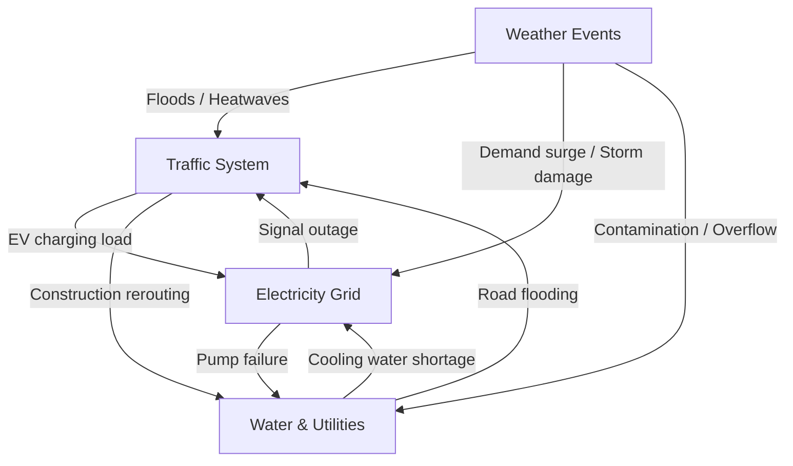
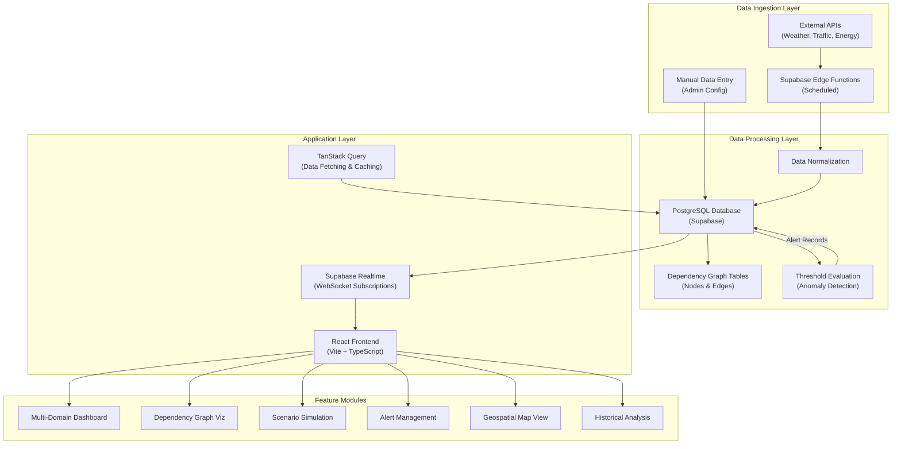
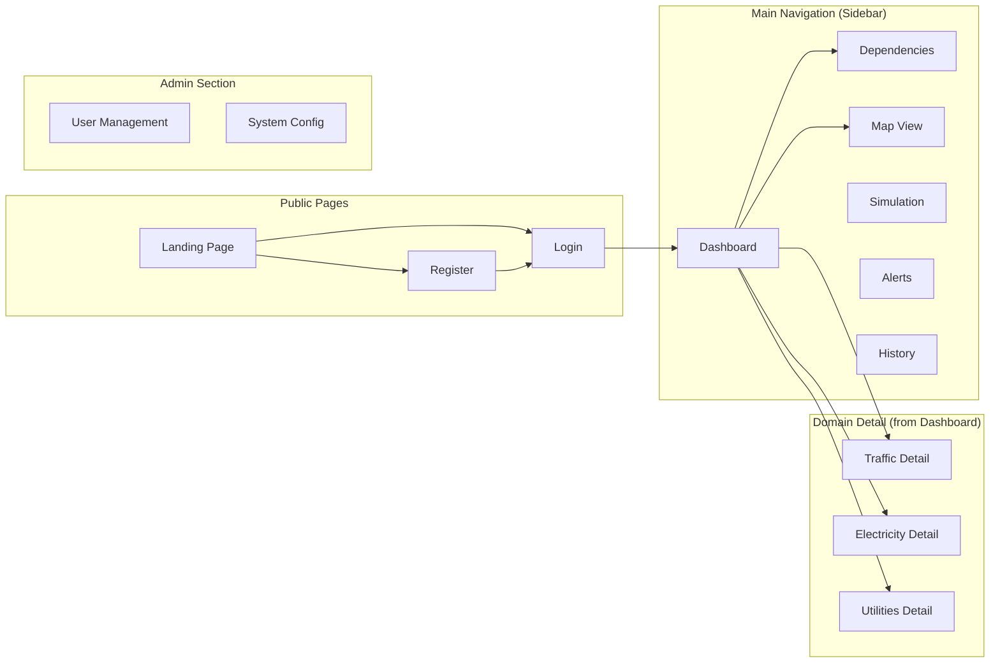
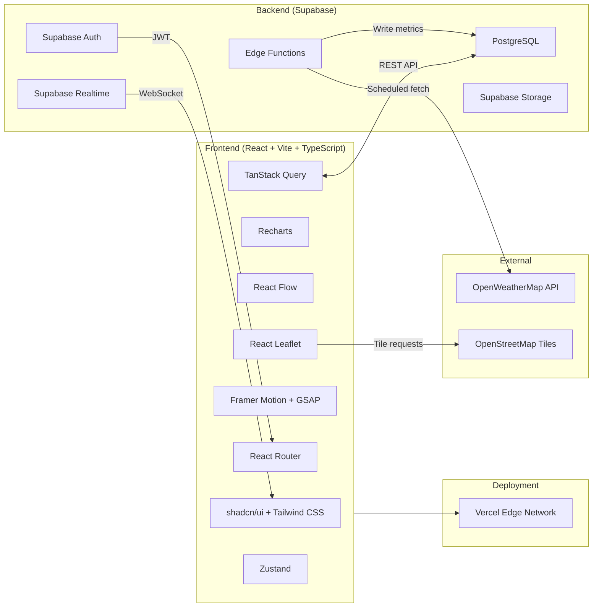

# Proposed Solution Document

## Urban Infrastructure Intelligence Platform — CityNexus

---

## Table of Contents

1. [Document Overview](#1-document-overview)
2. [Official Problem Statement](#2-official-problem-statement)
3. [Problem Background and Domain Context](#3-problem-background-and-domain-context)
4. [Problem Analysis and Root Causes](#4-problem-analysis-and-root-causes)
5. [Stakeholder Analysis](#5-stakeholder-analysis)
6. [Explicit and Implicit Requirements](#6-explicit-and-implicit-requirements)
7. [Research Methodology and Findings](#7-research-methodology-and-findings)
8. [Existing Solutions and Comparative Analysis](#8-existing-solutions-and-comparative-analysis)
9. [Identified Gaps and Opportunities](#9-identified-gaps-and-opportunities)
10. [Solution Overview](#10-solution-overview)
11. [Problem-to-Solution Mapping](#11-problem-to-solution-mapping)
12. [Target Users and Stakeholders](#12-target-users-and-stakeholders)
13. [Solution Objectives](#13-solution-objectives)
14. [Core Capabilities](#14-core-capabilities)
15. [Proposed Features](#15-proposed-features)
16. [Complete System Workflow](#16-complete-system-workflow)
17. [User Journeys](#17-user-journeys)
18. [Website Pages and Navigation Structure](#18-website-pages-and-navigation-structure)
19. [System Inputs](#19-system-inputs)
20. [Processing Methodology](#20-processing-methodology)
21. [Data Sources and Integrations](#21-data-sources-and-integrations)
22. [System Outputs](#22-system-outputs)
23. [Required Technology Stack](#23-required-technology-stack)
24. [Technology Responsibilities and Justification](#24-technology-responsibilities-and-justification)
25. [Technical Feasibility](#25-technical-feasibility)
26. [MVP Scope and Prioritization](#26-mvp-scope-and-prioritization)
27. [Constraints, Assumptions, and Dependencies](#27-constraints-assumptions-and-dependencies)
28. [Risks and Challenges](#28-risks-and-challenges)
29. [Future Enhancements](#29-future-enhancements)
30. [Solution Validation](#30-solution-validation)
31. [References and Research Sources](#31-references-and-research-sources)

---

## 1. Document Overview

This document presents a comprehensive, research-backed proposed solution for a hackathon problem statement focused on managing interconnected urban infrastructure. The solution — **CityNexus** — is an urban infrastructure intelligence platform that enables city administrators to understand cascading interdependencies between traffic, electricity, and public utility systems, and to make proactive, data-driven decisions before problems escalate.

**Purpose:** Serve as the foundational reference for generating `prd.md`, `architecture.md`, `design.md`, and `rules.md`.

**Scope:** Problem analysis, domain research, solution design, feature definition, technology stack validation, and MVP scoping.

**Repository State:** The project repository at the time of writing contains only a `resources.txt` file with the problem statement and technology stack. No prior source code, documentation, or configuration exists.

---

## 2. Official Problem Statement

> *An urban area struggles to manage its interconnected infrastructure as traffic, electricity consumption, and public utilities constantly fluctuate. A change in one system often creates unexpected consequences in another, making conventional planning ineffective. How can the city understand these interconnected changes and make better decisions before problems escalate?*

### Key Phrases Extracted

| Phrase | Implication |
|---|---|
| "interconnected infrastructure" | The system must model relationships between infrastructure domains |
| "traffic, electricity consumption, and public utilities" | Three explicit domains: transportation, energy, and utilities (water/waste/gas) |
| "constantly fluctuate" | Real-time or near-real-time monitoring is expected |
| "change in one system often creates unexpected consequences in another" | Cascading effects and cross-domain correlation must be visualized |
| "conventional planning ineffective" | A data-driven, predictive approach is required over static planning |
| "understand these interconnected changes" | The platform must provide insight and visibility into interdependencies |
| "make better decisions before problems escalate" | Predictive analytics, early warning, and scenario simulation capabilities |

---

## 3. Problem Background and Domain Context

### 3.1 Domain

**Smart City Infrastructure Management** — a subdomain of Urban Planning and Civic Technology.

### 3.2 Background

Modern cities operate as complex systems of systems. Traffic management, electrical grid operations, water supply networks, and waste management are historically managed by separate departments using isolated tools and siloed data. Each system is optimized independently, leading to a fragmented understanding of the city's overall operational state.

### 3.3 Why the Problem Exists

1. **Siloed Operations:** Traffic departments, power distribution companies (DISCOMs), and municipal water boards use separate monitoring systems with no data sharing protocols.
2. **Lack of Cross-Domain Visibility:** When traffic congestion increases fuel consumption in an area, or when a power outage disables traffic signals and water pumps, the cascading effects are only discovered reactively — after they have already caused damage.
3. **Static Planning Models:** Conventional urban planning relies on historical averages, manual surveys, and periodic reports rather than real-time data streams.
4. **Exponential Complexity:** As cities grow, the number of interdependencies between infrastructure systems increases non-linearly. A single substation failure can simultaneously affect traffic signals, water treatment plants, street lighting, and communication towers.

### 3.4 Why Solving It Matters

- **Public Safety:** Undetected cascading failures can endanger lives (e.g., traffic signal blackouts causing accidents, water pump failures during fire emergencies).
- **Economic Efficiency:** Reactive firefighting costs significantly more than proactive, coordinated intervention.
- **Resource Optimization:** Understanding cross-domain impacts enables better allocation of limited municipal budgets.
- **Climate Resilience:** As extreme weather events increase, the ability to simulate and prepare for multi-system impacts becomes critical.
- **Quality of Life:** Coordinated infrastructure directly impacts commute times, service reliability, and citizen satisfaction.

### 3.5 Real-World Interdependencies

---

## 4. Problem Analysis and Root Causes

### 4.1 Problem Hierarchy

| ID | Problem | Type | Root Cause |
|---|---|---|---|
| PS-001 | City infrastructure systems operate in isolation with no unified view | Primary | Organizational silos and incompatible monitoring tools |
| PS-002 | A change in one infrastructure system causes unexpected consequences in others | Primary | Lack of cross-domain dependency mapping and correlation analysis |
| PS-003 | Conventional planning methods cannot handle dynamic, interconnected systems | Primary | Reliance on static historical data rather than real-time analytics |
| PS-004 | Decision-makers cannot predict or prevent cascading failures | Primary | Absence of predictive models and early warning mechanisms |
| PS-005 | Infrastructure data is fragmented across departments and formats | Secondary | No standardized data integration layer |
| PS-006 | No mechanism to simulate the impact of changes before they occur | Secondary | Lack of "what-if" scenario planning tools |
| PS-007 | Emergency response coordination is reactive rather than proactive | Secondary | No cross-system alert correlation |
| PS-008 | Historical patterns of cross-domain impacts are not captured or analyzed | Secondary | No longitudinal data storage linking events across systems |

### 4.2 Symptoms vs. Root Causes

| Symptom | Root Cause |
|---|---|
| Traffic signals failing during power outages cause accidents | No real-time dependency awareness between power grid and traffic systems (PS-002) |
| Water pressure drops go undetected until citizen complaints | Siloed monitoring with no cross-referencing to power supply status (PS-001) |
| Road repairs disrupt utilities that were not mapped | No unified spatial view of overlapping infrastructure (PS-005) |
| Emergency services arrive late because alternate routes are not pre-calculated | No predictive scenario modeling for cascading events (PS-006) |
| Budget overruns on infrastructure projects | Static planning fails to account for dynamic interdependencies (PS-003) |

---

## 5. Stakeholder Analysis

### 5.1 Primary Stakeholders

| Stakeholder | Role | Needs | Pain Points |
|---|---|---|---|
| **City Operations Manager** | Oversees day-to-day city infrastructure operations | Unified dashboard showing all infrastructure health in real-time | Currently switches between 5+ tools with no correlation |
| **Urban Planner** | Plans long-term infrastructure development | Understand historical patterns and simulate future scenarios | Relies on outdated spreadsheet-based planning |
| **Emergency Response Coordinator** | Manages crisis situations | Instant visibility into cascading failures and affected areas | Receives fragmented alerts from different departments |

### 5.2 Secondary Stakeholders

| Stakeholder | Role | Needs |
|---|---|---|
| **Department Heads** (Traffic, Power, Water) | Manage individual domains | Understand how their system impacts and is impacted by others |
| **Data Analysts** | Extract insights from operational data | Centralized, queryable data across all infrastructure systems |
| **Elected Officials / Policy Makers** | Approve budgets and policies | Clear, visual reports on infrastructure performance and risks |

### 5.3 External Stakeholders

| Stakeholder | Relationship |
|---|---|
| **Citizens** | End beneficiaries of better infrastructure management |
| **Utility Companies** (DISCOMs, water boards) | Data providers and collaborative partners |
| **Weather Services** | External data providers for environmental context |

---

## 6. Explicit and Implicit Requirements

### 6.1 Explicit Requirements (Directly from Problem Statement)

| Req ID | Requirement | Source Phrase |
|---|---|---|
| REQ-001 | The system must provide visibility into interconnected infrastructure | "understand these interconnected changes" |
| REQ-002 | The system must cover traffic, electricity, and public utility domains | "traffic, electricity consumption, and public utilities" |
| REQ-003 | The system must handle constantly fluctuating data | "constantly fluctuate" |
| REQ-004 | The system must reveal cross-domain consequences of changes | "change in one system often creates unexpected consequences in another" |
| REQ-005 | The system must support proactive decision-making | "make better decisions before problems escalate" |
| REQ-006 | The system must improve upon conventional planning approaches | "making conventional planning ineffective" |

### 6.2 Implicit Requirements

| Req ID | Requirement | Rationale |
|---|---|---|
| REQ-007 | Real-time or near-real-time data ingestion and display | "constantly fluctuate" implies continuous monitoring |
| REQ-008 | Visual representation of infrastructure interdependencies | Understanding complex relationships requires visualization |
| REQ-009 | Alert and notification system for anomalies | Proactive decision-making requires timely alerts |
| REQ-010 | Historical data storage and trend analysis | Understanding patterns requires longitudinal data |
| REQ-011 | Scenario simulation capability | "before problems escalate" implies predictive planning |
| REQ-012 | Role-based access and multi-user support | City operations involve multiple departments |
| REQ-013 | Geospatial context for infrastructure data | Infrastructure is inherently location-based |
| REQ-014 | Secure data handling | Government infrastructure data requires security |

### 6.3 Classification

| Category | Requirements |
|---|---|
| **Core Functional** | REQ-001, REQ-002, REQ-003, REQ-004, REQ-005 |
| **Supporting Functional** | REQ-006, REQ-008, REQ-009, REQ-010, REQ-011 |
| **Data** | REQ-003, REQ-007, REQ-010 |
| **Technical** | REQ-007, REQ-013 |
| **Security** | REQ-012, REQ-014 |

---

## 7. Research Methodology and Findings

### 7.1 Research Areas Covered

1. Smart city infrastructure management platforms and digital twins
2. Infrastructure interdependency modeling and cascading failure analysis
3. Cross-domain correlation methodologies (graph-based, statistical)
4. Available open data sources for traffic, energy, and utilities
5. Geospatial visualization technologies for web applications
6. Real-time dashboard design patterns with React/Supabase
7. Data charting and time-series visualization libraries

### 7.2 Key Domain Findings

#### Cross-Domain Interdependencies Are Well-Documented

The relationship between traffic, electricity, and water systems follows established interdependency patterns:

- **Traffic ↔ Electricity:** EV charging impacts grid load; power outages disable traffic signals; smart street lighting responds to traffic density.
- **Electricity ↔ Water:** Water treatment plants are heavy electricity consumers; thermal power plants require cooling water; pump station failures cascade from grid issues.
- **Water ↔ Traffic:** Urban flooding disrupts road networks; road construction frequently damages buried water infrastructure.

**Source:** Research on urban infrastructure digital twins and cascading failure analysis (sustainableinfrastructure.org, Lehigh University research papers).

#### Graph-Based Modeling Is the Established Approach

Infrastructure interdependencies are mathematically modeled as heterogeneous directed graphs G = (V, E, L), where vertices represent infrastructure components, edges represent intra-system connections and inter-system dependencies, and layers represent distinct infrastructure sectors. This approach enables:

- Cascading failure simulation via percolation analysis
- Identification of single points of failure via centrality metrics
- Dynamic correlation and pattern matching

**Source:** Lehigh University infrastructure interdependency research; ResearchGate publications on graph-based correlation engines.

#### Digital Twins Are the Industry Standard

Leading smart city implementations (Virtual Singapore, Barcelona, IBM IOC in Rio de Janeiro) use digital twin approaches — virtual replicas of city infrastructure that model both individual assets and their interactions under normal and stress-tested conditions.

**Source:** sustainableinfrastructure.org; Siemens Advanta CityGraph documentation; IBM Intelligent Operations Center documentation.

### 7.3 Technical Methodology Research

| Methodology | Relevance | Application in CityNexus |
|---|---|---|
| **Dependency Graph Modeling** | Maps infrastructure relationships as directed graphs | Core data model for representing system interdependencies |
| **Threshold-Based Anomaly Detection** | Triggers alerts when metrics exceed defined bounds | Real-time alerting on individual system parameters |
| **Cross-Correlation Analysis** | Identifies statistical relationships between time series | Detecting when changes in one system correlate with changes in another |
| **Rule-Based Impact Propagation** | Predefined cascading rules simulate downstream effects | "What-if" scenario engine — if traffic increases by X%, electricity demand increases by Y% |
| **Weighted Scoring Models** | Assigns risk scores based on multiple weighted parameters | Infrastructure health scoring and risk ranking |
| **GeoJSON Overlay Mapping** | Renders infrastructure assets on spatial maps | Geospatial visualization of infrastructure components and their zones |
| **Time-Series Aggregation** | Compresses high-frequency data into meaningful intervals | Dashboard historical charts and trend analysis |

---

## 8. Existing Solutions and Comparative Analysis

### 8.1 Existing Solutions

| Solution | Provider | Focus | Strengths | Limitations | Opportunity for CityNexus |
|---|---|---|---|---|---|
| **IBM Intelligent Operations Center (IOC)** | IBM | Emergency response, cross-agency coordination | "Manager of managers" — integrates multiple municipal data sources; strong AI-driven analytics | Extremely expensive enterprise deployment; steep integration curve; overkill for mid-size cities | Provide accessible cross-domain visibility without enterprise-grade cost |
| **Siemens CityGraph / CyPT** | Siemens | Smart grid optimization, decarbonization, asset management | Deep OT integration; graph-based digital twins; native understanding of physical infrastructure | Primarily focused on energy/buildings; less focus on soft municipal workflows; requires Siemens hardware ecosystem | Cover traffic, energy, AND utilities in a unified, vendor-agnostic web platform |
| **Virtual Singapore** | Government of Singapore + Dassault Systèmes | National-scale urban digital twin | Comprehensive 3D city model; cross-sector simulation; climate resilience planning | Requires massive government investment and proprietary infrastructure; not transferable | Offer a simplified, deployable version of cross-system simulation |
| **CityPulse (EU Research Project)** | EU FP7 | Semantic data integration for smart cities | Open-source approach; semantic web standards; event detection | Research prototype; not production-ready; limited real-time performance | Build a production-ready platform using modern web technologies |
| **Open City Platforms** (e.g., FIWARE, SmartSDK) | Various / EU-funded | Open standard middleware for smart city data | Open APIs; standardized context management (NGSI-LD); strong on data interoperability | Complex to deploy; middleware focus rather than end-user application; steep learning curve | Provide an end-user-ready application rather than middleware |

### 8.2 Key Gaps in Existing Solutions

1. **Accessibility:** Enterprise platforms (IBM, Siemens) are prohibitively expensive for most municipalities.
2. **Unified View:** Most solutions optimize a single domain (energy OR traffic) rather than visualizing cross-domain interdependencies.
3. **End-User Focus:** Middleware solutions (FIWARE) provide APIs but no ready-to-use dashboards.
4. **Scenario Simulation:** Few platforms allow non-technical users to run "what-if" scenarios across multiple infrastructure domains.
5. **Modern Web Stack:** Existing solutions use legacy enterprise architectures; none leverage modern React-based stacks with BaaS backends.

---

## 9. Identified Gaps and Opportunities

### 9.1 Gaps

| Gap ID | Description | Impact |
|---|---|---|
| GAP-001 | No affordable, web-based platform that visualizes cross-domain infrastructure interdependencies | Municipalities lack tools to understand cascading effects |
| GAP-002 | Existing tools focus on single domains rather than the connection between them | Decision-makers cannot see the full picture |
| GAP-003 | No accessible "what-if" simulation tool for infrastructure managers | Changes are made without understanding downstream effects |
| GAP-004 | Real-time dashboards exist for individual systems but not for correlated cross-system views | Anomalies in one system are not correlated with causes in another |
| GAP-005 | Government open data exists but is not aggregated or visualized in context | Valuable data is underutilized |

### 9.2 Opportunities

1. **Leverage open data APIs** (weather, traffic, energy) to seed the platform with real-world data without costly IoT deployments.
2. **Use graph-based dependency modeling** implemented in a PostgreSQL database to map infrastructure relationships.
3. **Apply rule-based impact propagation** for deterministic "what-if" scenarios that do not require complex ML training.
4. **Build with modern web technologies** (React, Supabase) for rapid development and low operational cost.
5. **Target the "missing middle"** — municipalities too small for IBM/Siemens but too complex for spreadsheets.

---

## 10. Solution Overview

### COMPONENT 1 — Solution Overview

**Proposed Solution Name:** **CityNexus** — Urban Infrastructure Intelligence Platform

**Solution Concept:** CityNexus is a web-based platform that provides city administrators and infrastructure managers with a unified, real-time view of how traffic, electricity, and public utility systems interact and affect each other. It uses a graph-based dependency model to map infrastructure interconnections, provides real-time dashboards with geospatial context, detects anomalies, correlates cross-domain events, and enables "what-if" scenario simulations to support proactive decision-making.

**Core Purpose:** To transform how cities understand and manage their interconnected infrastructure by replacing siloed monitoring with an integrated, visual, and predictive platform.

**Main Capabilities:**

1. **Unified Infrastructure Dashboard** — Real-time monitoring of traffic, electricity, and utilities in a single view.
2. **Dependency Graph Visualization** — Interactive graph showing how infrastructure systems are connected.
3. **Cross-Domain Correlation** — Automatic detection and display of cascading effects across systems.
4. **Anomaly Detection & Alerts** — Threshold-based alerts with cross-system context.
5. **Scenario Simulation** — "What-if" analysis tool to predict the impact of changes before they occur.
6. **Geospatial Map View** — Infrastructure overlaid on an interactive city map.
7. **Historical Analysis** — Trend analysis and pattern recognition across time.

**How It Works (High Level):**

1. Data is ingested from external APIs (weather, sample traffic/energy datasets) and manual configuration.
2. Infrastructure components and their interdependencies are modeled as a directed graph stored in PostgreSQL.
3. The dependency graph engine propagates simulated changes through connected systems.
4. Real-time dashboards display current status, correlations, and alerts.
5. Users can run "what-if" scenarios by adjusting parameters and observing predicted cascading effects.

**Expected Benefits:**

- 360° visibility into infrastructure health and interdependencies
- Early warning of potential cascading failures
- Data-driven decision support replacing intuition-based planning
- Reduced response time to infrastructure incidents
- Better resource allocation through cross-domain understanding

---

## 11. Problem-to-Solution Mapping

### COMPONENT 2 — Problem-to-Solution Mapping

| Problem ID | Identified Problem | Root Cause | Proposed Solution | Expected Outcome |
|---|---|---|---|---|
| PS-001 | Infrastructure systems operate in isolation | Organizational silos and incompatible tools | Unified dashboard aggregating data from all three domains (traffic, electricity, utilities) with a single login | Single-pane-of-glass view eliminates the need to switch between multiple tools |
| PS-002 | Changes in one system cause unexpected consequences in others | Lack of cross-domain dependency mapping | Dependency graph model connecting infrastructure components across domains with visual edge representation | Users can see exactly which components depend on each other |
| PS-003 | Conventional planning is ineffective for dynamic systems | Reliance on static historical data | Real-time data ingestion with time-series dashboards and trend analysis | Planning is informed by current and historical dynamic data |
| PS-004 | Decision-makers cannot predict cascading failures | Absence of predictive models | "What-if" scenario simulation engine using rule-based impact propagation | Users can predict the downstream impact of any infrastructure change |
| PS-005 | Data is fragmented across departments | No standardized integration layer | Supabase PostgreSQL database as a centralized data store with normalized schema | All infrastructure data lives in one queryable location |
| PS-006 | No mechanism to simulate changes before they occur | Lack of scenario planning tools | Interactive scenario builder with parameter sliders and cascading impact visualization | Decision-makers can test interventions virtually before deploying them |
| PS-007 | Emergency response is reactive | No cross-system alert correlation | Anomaly detection with cross-domain alert correlation and severity scoring | Alerts include context about which other systems are affected |
| PS-008 | Historical cross-domain patterns not captured | No longitudinal linked data | Time-stamped event log correlating incidents across systems, with historical chart overlays | Patterns become visible through historical trend analysis |

---

## 12. Target Users and Stakeholders

### COMPONENT 3 — Target Users and Stakeholders

#### Primary Users

| User Group | Description | Goals | Needs | Interaction | Value Received |
|---|---|---|---|---|---|
| **City Operations Manager** | Day-to-day coordinator of municipal infrastructure | Maintain smooth operations across all systems | Real-time unified dashboard, instant alerts, one-click drill-down | Daily dashboard monitoring; alert response; weekly review | Reduced incident response time; proactive issue prevention |
| **Urban Planner** | Long-term infrastructure development strategist | Plan infrastructure investments with full interdependency context | Historical trends, scenario simulation, impact reports | Scenario simulation sessions; historical analysis; report generation | Data-backed planning decisions; reduced project overruns |
| **Emergency Response Coordinator** | Crisis management during infrastructure failures | Understand full scope of cascading failure instantly | Real-time map with affected zones, alert priority, impact chain visualization | Immediate response during incidents; post-incident review | Faster, better-informed emergency decisions |

#### Secondary Users

| User Group | Description | Goals | Interaction |
|---|---|---|---|
| **Department Heads** (Traffic/Power/Water) | Domain-specific infrastructure managers | Understand how their system impacts others | Weekly review; filtered domain-specific dashboards |
| **Data Analysts** | Extract insights for reporting | Access centralized, structured data | Query historical data; export reports |
| **System Administrator** | Manage platform configuration | Configure alerts, users, data sources | Admin panel for user/system management |

#### Institutional Stakeholders

| Stakeholder | Relationship | Interest |
|---|---|---|
| **Municipal Government** | Commissioning authority | ROI on infrastructure investments |
| **Utility Companies** | Data partners | Collaborative optimization |
| **Citizens** | End beneficiaries | Improved services and safety |

---

## 13. Solution Objectives

### COMPONENT 4 — Solution Objectives

| Obj ID | Objective | Problem Addressed | Expected Result | Success Indicator |
|---|---|---|---|---|
| OBJ-001 | Provide a unified, real-time view of all three infrastructure domains | PS-001 | Single dashboard displaying traffic, electricity, and utility status | All three domains visible on one screen with <30s data refresh |
| OBJ-002 | Visualize interdependencies between infrastructure systems | PS-002 | Interactive dependency graph showing all mapped connections | Users can trace the dependency chain between any two components |
| OBJ-003 | Detect and correlate anomalies across domains | PS-004, PS-007 | Automatic alert generation with cross-domain context | Alerts include "affected systems" information |
| OBJ-004 | Enable "what-if" scenario simulation | PS-004, PS-006 | Users can adjust a parameter and see predicted cascading effects | Scenario results display within 5 seconds of parameter change |
| OBJ-005 | Store and analyze historical cross-domain data | PS-003, PS-008 | Time-series charts with multi-domain overlays | Trend analysis available for minimum 30 days of data |
| OBJ-006 | Present infrastructure data in geospatial context | PS-001, PS-002 | Interactive map with infrastructure layers and status indicators | Map renders with zone-specific data overlays |
| OBJ-007 | Support role-based multi-user access | PS-001 | Different views for operators, planners, and administrators | Users see relevant data based on their role |

---

## 14. Core Capabilities

### COMPONENT 5 — Core Capabilities

| Cap ID | Capability | Purpose | Responsibilities | Problems Addressed | User Groups | Expected Outcome |
|---|---|---|---|---|---|---|
| CAP-001 | **Unified Infrastructure Monitoring** | Aggregate and display real-time data from all three domains | Ingest data, normalize formats, display on dashboard | PS-001, PS-005 | Operations Manager, Department Heads | Single source of truth for infrastructure status |
| CAP-002 | **Dependency Graph Engine** | Model and visualize infrastructure interdependencies | Store component relationships, traverse dependencies, render graph visualization | PS-002 | All users | Clear visual understanding of how systems connect |
| CAP-003 | **Cross-Domain Correlation** | Detect and display relationships between events in different systems | Match temporal and spatial patterns across domains, generate correlated alerts | PS-002, PS-007 | Operations Manager, Emergency Coordinator | Multi-domain context for every anomaly |
| CAP-004 | **Scenario Simulation Engine** | Enable "what-if" analysis of infrastructure changes | Accept parameter inputs, propagate impacts through dependency graph, display predicted outcomes | PS-004, PS-006 | Urban Planner, Operations Manager | Risk-free testing of interventions before deployment |
| CAP-005 | **Geospatial Visualization** | Display infrastructure on interactive maps | Render map layers for traffic, power, water zones; show status by location | PS-001, PS-002 | All users | Location-aware infrastructure understanding |
| CAP-006 | **Anomaly Detection & Alerting** | Identify and notify users of infrastructure anomalies | Monitor thresholds, generate alerts, prioritize by severity, deliver notifications | PS-004, PS-007 | Operations Manager, Emergency Coordinator | Early warning before failures cascade |
| CAP-007 | **Historical Analysis & Reporting** | Provide trend analysis and exportable reports | Store time-series data, generate charts, enable date-range queries, export summaries | PS-003, PS-008 | Urban Planner, Data Analyst, Policy Makers | Evidence-based planning and accountability |

---

## 15. Proposed Features

### COMPONENT 6 — Proposed Features

#### Module 1: Dashboard & Monitoring

| Feature ID | Feature Name | Description | Purpose | User | Priority | Scope |
|---|---|---|---|---|---|---|
| F-001 | **Multi-Domain Dashboard** | Real-time dashboard with cards showing key metrics for traffic, electricity, and water/utility systems | Provide unified at-a-glance infrastructure status | Operations Manager | Must Have | MVP |
| F-002 | **Domain-Specific Detail Views** | Drill-down panels for each infrastructure domain showing detailed metrics, charts, and component status | Enable deep investigation within a single domain | Department Heads, Data Analyst | Must Have | MVP |
| F-003 | **Real-Time Data Refresh** | Automatic refresh of dashboard data via Supabase Realtime subscriptions | Keep displayed data current | All users | Must Have | MVP |
| F-004 | **KPI Summary Cards** | At-a-glance metric cards (e.g., current traffic congestion index, grid load percentage, water pressure level) with status indicators (normal/warning/critical) | Instant situational awareness | Operations Manager | Must Have | MVP |

#### Module 2: Dependency Graph & Correlation

| Feature ID | Feature Name | Description | Purpose | User | Priority | Scope |
|---|---|---|---|---|---|---|
| F-005 | **Interactive Dependency Graph** | Visual node-and-edge graph showing infrastructure components and their interdependencies, with click-to-inspect | Visualize how systems are connected | All users | Must Have | MVP |
| F-006 | **Cross-Domain Event Correlation** | When an anomaly occurs, automatically highlight connected components in other domains that may be affected | Reveal cascading risk in real-time | Operations Manager, Emergency Coordinator | Must Have | MVP |
| F-007 | **Impact Chain Visualization** | Trace and display the chain of dependencies from a failing component to all downstream affected components | Understand the full blast radius of a failure | Emergency Coordinator | Should Have | MVP |

#### Module 3: Scenario Simulation

| Feature ID | Feature Name | Description | Purpose | User | Priority | Scope |
|---|---|---|---|---|---|---|
| F-008 | **Scenario Builder** | Interface with parameter sliders (e.g., "increase traffic volume by 30%", "reduce power supply by 20%") to define a hypothetical change | Enable creation of "what-if" scenarios | Urban Planner | Must Have | MVP |
| F-009 | **Cascading Impact Prediction** | Rule-based engine that propagates the scenario's parameter change through the dependency graph and calculates downstream effects | Show predicted consequences of a change | Urban Planner, Operations Manager | Must Have | MVP |
| F-010 | **Scenario Comparison** | Ability to save and compare multiple scenarios side by side | Evaluate different intervention strategies | Urban Planner | Could Have | Future |

#### Module 4: Alerts & Notifications

| Feature ID | Feature Name | Description | Purpose | User | Priority | Scope |
|---|---|---|---|---|---|---|
| F-011 | **Threshold-Based Alerts** | Configurable thresholds for each metric that trigger visual alerts when breached | Early warning of individual system anomalies | Operations Manager | Must Have | MVP |
| F-012 | **Cross-Domain Alert Context** | Each alert includes a "Related Systems" section showing which other domains may be affected | Provide multi-domain awareness with every alert | Operations Manager, Emergency Coordinator | Should Have | MVP |
| F-013 | **Alert History Log** | Searchable, filterable log of all past alerts with timestamps and resolution status | Post-incident analysis and audit trail | Data Analyst | Should Have | MVP |

#### Module 5: Geospatial Map

| Feature ID | Feature Name | Description | Purpose | User | Priority | Scope |
|---|---|---|---|---|---|---|
| F-014 | **Interactive Infrastructure Map** | City map with togglable layers for traffic zones, power grid zones, and utility zones | Spatial context for infrastructure data | All users | Must Have | MVP |
| F-015 | **Zone Status Overlay** | Color-coded zones on the map indicating health status (green/yellow/red) based on current metrics | At-a-glance spatial health view | Operations Manager | Must Have | MVP |
| F-016 | **Map Click Details** | Click on a zone/component on the map to view its current metrics, alert status, and dependencies | Drill-down from spatial view | All users | Should Have | MVP |

#### Module 6: Historical Analysis

| Feature ID | Feature Name | Description | Purpose | User | Priority | Scope |
|---|---|---|---|---|---|---|
| F-017 | **Time-Series Charts** | Multi-domain time-series charts with configurable date ranges showing historical metrics | Trend identification and pattern recognition | Urban Planner, Data Analyst | Must Have | MVP |
| F-018 | **Correlated Timeline View** | Synchronized time-series charts for different domains using shared time axis | Visually correlate events across domains over time | Data Analyst | Should Have | MVP |
| F-019 | **Report Export** | Export dashboard data and charts as PDF or CSV | Reporting for stakeholders and meetings | Urban Planner, Policy Makers | Could Have | Future |

#### Module 7: User Management & Settings

| Feature ID | Feature Name | Description | Purpose | User | Priority | Scope |
|---|---|---|---|---|---|---|
| F-020 | **User Authentication** | Secure login via email/password and OAuth (Google/GitHub) using Supabase Auth | Secure access control | All users | Must Have | MVP |
| F-021 | **Role-Based Access Control** | Admin, Operator, Planner, and Viewer roles with different permissions | Appropriate data access per role | System Administrator | Should Have | MVP |
| F-022 | **System Configuration Panel** | Admin interface to configure alert thresholds, data sources, infrastructure components, and dependency mappings | Platform customization | System Administrator | Should Have | MVP |
| F-023 | **User Preferences** | Dark/light mode, default dashboard view, notification preferences | Personalized experience | All users | Could Have | Future |

---

## 16. Complete System Workflow

### COMPONENT 7 — Complete System Workflow

#### End-to-End System Operation

1. **Data Ingestion:** External APIs (weather, simulated traffic/energy/water data) are fetched on schedule via Supabase Edge Functions and stored in PostgreSQL.
2. **Data Normalization:** Raw data is transformed into standardized metric formats and stored in domain-specific tables.
3. **Dependency Graph Maintenance:** Infrastructure components and their relationships are stored as nodes and edges in relational tables. The graph is maintained through the admin configuration panel.
4. **Real-Time Monitoring:** The React frontend subscribes to Supabase Realtime channels for dashboard metric updates.
5. **Anomaly Detection:** Supabase Edge Functions periodically evaluate current metrics against configured thresholds. Breached thresholds generate alert records.
6. **Cross-Domain Correlation:** When an alert fires, the system traverses the dependency graph to identify connected components in other domains and enriches the alert with cross-domain context.
7. **Dashboard Display:** The frontend renders current metrics, alerts, dependency graphs, and map views using Recharts, React Flow (for the dependency graph), and Leaflet (for maps).
8. **Scenario Simulation:** Users input parameter changes via the scenario builder. The system applies rule-based propagation through the dependency graph and displays predicted outcomes.
9. **Historical Storage:** All metrics and alerts are time-stamped and stored for historical analysis.
10. **User Interaction:** Users can drill down, filter, search alerts, run scenarios, and export reports.

#### System Workflow Diagram

---

## 17. User Journeys

### COMPONENT 8 — User Journeys

#### Journey 1: Daily Operations Monitoring

| Attribute | Detail |
|---|---|
| **Journey ID** | UJ-001 |
| **User Type** | City Operations Manager |
| **Goal** | Check the overall health of city infrastructure at the start of a shift |
| **Starting Point** | Login page |
| **Steps** | 1. User logs in with email/password → 2. Lands on Multi-Domain Dashboard → 3. Reviews KPI summary cards for traffic, electricity, and utilities → 4. Notices a "Warning" status on the electricity card → 5. Clicks to drill down into the electricity domain detail view → 6. Sees that grid load is at 92% in Zone 3 → 7. Clicks "View Dependencies" to see affected traffic signals and water pumps in Zone 3 → 8. Reviews the dependency graph highlighting the at-risk chain |
| **System Responses** | Dashboard loads with real-time data; KPI cards reflect current status; drill-down reveals detailed metrics; dependency graph highlights connected components |
| **Decision Points** | Whether to escalate the high grid load warning to the electricity department |
| **Success** | Manager has full situational awareness within 2 minutes of login |
| **Alternative Flow** | If no anomalies exist, manager reviews the dashboard and exits |
| **Failure Scenario** | External API data is stale — dashboard shows last-known values with a "Data Stale" indicator |

#### Journey 2: Scenario Planning for Infrastructure Change

| Attribute | Detail |
|---|---|
| **Journey ID** | UJ-002 |
| **User Type** | Urban Planner |
| **Goal** | Understand the cross-domain impact of a planned 25% traffic increase due to a new commercial development |
| **Starting Point** | Scenario Simulation page |
| **Steps** | 1. User navigates to Scenario Simulation → 2. Selects "Traffic" domain → 3. Adjusts the "Traffic Volume" slider to +25% for Zone 5 → 4. Clicks "Run Simulation" → 5. System propagates the change through the dependency graph → 6. Results show: electricity demand in Zone 5 increases by ~8% (more signal cycles, EV charging), water demand increases by ~3% (commercial use) → 7. User reviews the cascading impact visualization → 8. User notes the findings for the planning committee report |
| **System Responses** | Scenario builder accepts parameters; propagation engine calculates downstream effects; results displayed with visual indicators and percentage changes |
| **Decision Points** | Whether the predicted electricity increase exceeds Zone 5's grid capacity |
| **Success** | Planner has quantitative cross-domain impact data for the committee |
| **Alternative Flow** | Planner adjusts parameters and re-runs with different values |
| **Failure Scenario** | Dependency graph has incomplete mappings for Zone 5 — system warns "Partial coverage: some dependencies may be unmapped" |

#### Journey 3: Emergency Cascading Failure Response

| Attribute | Detail |
|---|---|
| **Journey ID** | UJ-003 |
| **User Type** | Emergency Response Coordinator |
| **Goal** | Understand the full scope of a power grid failure in Zone 2 |
| **Starting Point** | Alert notification in the dashboard |
| **Steps** | 1. User sees a "Critical" alert: "Power Grid Failure — Zone 2" → 2. Clicks the alert to view details → 3. Alert detail shows the cross-domain impact: 12 traffic signals in Zone 2 are without power, 2 water pump stations are affected → 4. User switches to the geospatial map view → 5. Map highlights Zone 2 with affected traffic signals and water pumps marked → 6. User uses this information to dispatch emergency teams to the most critical points |
| **System Responses** | Alert generated with cross-domain context; impact chain visualization shows all downstream affected components; map highlights affected zone |
| **Decision Points** | Priority of dispatch: traffic signal backup vs. water pump generator deployment |
| **Success** | Coordinator knows the full blast radius within 60 seconds of the alert |
| **Alternative Flow** | If the failure is contained and does not cascade, the alert shows "No cross-domain impact detected" |
| **Failure Scenario** | Real-time data feed is interrupted — system relies on last-known state with timestamp warning |

#### Journey 4: Historical Incident Analysis

| Attribute | Detail |
|---|---|
| **Journey ID** | UJ-004 |
| **User Type** | Data Analyst |
| **Goal** | Investigate whether last month's traffic spike correlated with the grid overload on the same dates |
| **Starting Point** | Historical Analysis page |
| **Steps** | 1. User navigates to Historical Analysis → 2. Selects date range: last 30 days → 3. Selects metrics: "Traffic Congestion Index" and "Grid Load %" → 4. Correlated timeline view renders both time-series charts with a shared time axis → 5. User visually identifies that traffic spikes on 3 dates align with grid load peaks → 6. User clicks on a peak to see the alert log for that timestamp → 7. Confirms that an EV charging surge during peak traffic hours caused the correlation |
| **System Responses** | Date picker filters data; Recharts renders synchronized time-series; clicking data points cross-references with alert history |
| **Decision Points** | Whether to recommend EV charging rate limits during peak traffic hours |
| **Success** | Analyst identifies and documents the cross-domain correlation |

---

## 18. Website Pages and Navigation Structure

### COMPONENT 9 — Website Pages and Navigation Structure

#### Page Inventory

| Page ID | Page Name | Purpose | Target User | Main Functionality | Access |
|---|---|---|---|---|---|
| PG-001 | **Landing Page** | Public marketing page explaining CityNexus | Visitors, potential adopters | Product overview, feature highlights, CTA to sign up/login | Public |
| PG-002 | **Login Page** | User authentication | All users | Email/password login, OAuth login (Google/GitHub) | Public |
| PG-003 | **Register Page** | New user registration | New users | Account creation form | Public |
| PG-004 | **Multi-Domain Dashboard** | Primary operations view | Operations Manager, All authenticated users | KPI summary cards, domain status indicators, quick alerts ticker, real-time metrics | Authenticated |
| PG-005 | **Traffic Domain Detail** | Detailed traffic infrastructure view | Operations Manager, Traffic Dept Head | Traffic metrics, zone-level breakdown, charts, component status | Authenticated |
| PG-006 | **Electricity Domain Detail** | Detailed electrical grid view | Operations Manager, Power Dept Head | Grid load, consumption metrics, zone breakdown, charts | Authenticated |
| PG-007 | **Utilities Domain Detail** | Detailed water/utilities view | Operations Manager, Water Dept Head | Water pressure, flow rates, utility metrics, zone breakdown | Authenticated |
| PG-008 | **Dependency Graph View** | Interactive infrastructure dependency visualization | All authenticated users | Full dependency graph, node selection, impact highlighting, filtering by domain | Authenticated |
| PG-009 | **Scenario Simulation** | "What-if" analysis tool | Urban Planner, Operations Manager | Parameter sliders, run simulation, view cascading results | Authenticated |
| PG-010 | **Geospatial Map View** | Infrastructure on a city map | All authenticated users | Interactive map with togglable infrastructure layers, zone status overlays | Authenticated |
| PG-011 | **Alert Center** | Alert management and history | Operations Manager, Emergency Coordinator | Active alerts list, alert history, filter/search, alert details with cross-domain context | Authenticated |
| PG-012 | **Historical Analysis** | Time-series data analysis | Urban Planner, Data Analyst | Date range selector, metric selector, correlated timeline charts | Authenticated |
| PG-013 | **Admin: User Management** | Manage platform users | System Administrator | User list, role assignment, invite new users, deactivate accounts | Admin only |
| PG-014 | **Admin: System Configuration** | Configure platform settings | System Administrator | Alert threshold settings, infrastructure component management, dependency mapping editor | Admin only |
| PG-015 | **User Profile & Preferences** | Personal settings | All authenticated users | Profile info, password change, notification preferences | Authenticated |

#### Navigation Structure

#### Navigation Definitions

- **Primary Navigation (Sidebar):** Dashboard, Dependencies, Map View, Simulation, Alerts, History
- **Secondary Navigation:** Domain Detail pages accessed from the Dashboard via click-through
- **Admin Navigation:** Visible only to Admin-role users, nested under a settings icon
- **User Menu:** Profile & Preferences accessible from a user avatar dropdown in the top bar

---

## 19. System Inputs

### COMPONENT 10 — System Inputs

| Input ID | Input Name | Description | Data Type | Source | Required | Validation | Purpose | Related Features |
|---|---|---|---|---|---|---|---|---|
| IN-001 | Weather Data | Current weather conditions and forecast for the city | JSON (temperature, humidity, wind, precipitation, conditions) | OpenWeatherMap API | Yes (MVP) | API response schema validation | Environmental context for infrastructure behavior | F-001, F-017 |
| IN-002 | Traffic Metrics | Simulated or ingested traffic volume, congestion index, average speed per zone | JSON / CSV | Seeded sample data or public traffic APIs | Yes (MVP) | Numeric range validation, zone ID validation | Traffic domain monitoring | F-001, F-002, F-005, F-017 |
| IN-003 | Electricity Metrics | Grid load percentage, consumption per zone, generation capacity, outage status | JSON / CSV | Seeded sample data | Yes (MVP) | Numeric range validation, zone ID validation | Electricity domain monitoring | F-001, F-002, F-005, F-017 |
| IN-004 | Utility Metrics | Water pressure, flow rates, reservoir levels, pump station status | JSON / CSV | Seeded sample data | Yes (MVP) | Numeric range validation, zone ID validation | Utilities domain monitoring | F-001, F-002, F-005, F-017 |
| IN-005 | Infrastructure Component Definition | Names, types, locations, zones, and capacities of infrastructure components | JSON (via admin form) | Manual entry by System Administrator | Yes (MVP) | Required fields validation, unique ID | Populating the dependency graph | F-005, F-022 |
| IN-006 | Dependency Mapping | Directed edges connecting infrastructure components with relationship type and impact weight | JSON (via admin form) | Manual entry by System Administrator | Yes (MVP) | Valid source/target node IDs, weight 0-1 | Building the dependency graph | F-005, F-006, F-009 |
| IN-007 | Alert Threshold Configuration | Per-metric thresholds for warning and critical levels | Numeric values (via admin form) | Manual entry by System Administrator | Yes (MVP) | Min < Warning < Critical < Max | Anomaly detection | F-011, F-022 |
| IN-008 | Scenario Parameters | User-defined adjustments (e.g., "+25% traffic volume in Zone 5") | Numeric adjustments with domain/zone scope | User input via scenario builder UI | Yes (MVP) | Valid domain, valid zone, numeric range | Scenario simulation | F-008, F-009 |
| IN-009 | User Credentials | Email, password, OAuth tokens | String | User input via login/register forms | Yes (MVP) | Email format, password strength | Authentication | F-020 |

---

## 20. Processing Methodology

### COMPONENT 11 — Processing Methodology

#### PROC-001: Data Ingestion and Normalization

| Attribute | Detail |
|---|---|
| **Purpose** | Transform raw external data into a standardized internal format |
| **Input** | Raw API responses (IN-001), raw metric data (IN-002, IN-003, IN-004) |
| **Processing Steps** | 1. Supabase Edge Function fetches data from external APIs on a scheduled interval (e.g., every 5 minutes) → 2. Response is validated against expected schema → 3. Relevant fields are extracted and mapped to internal metric schema (metric_name, value, unit, zone_id, timestamp, domain) → 4. Normalized records are upserted into the `metrics` table in PostgreSQL |
| **Output** | Normalized metric records in the database |
| **Dependencies** | External API availability, Supabase Edge Functions |
| **Limitations** | Data freshness depends on API update frequency and scheduled fetch interval |

#### PROC-002: Dependency Graph Construction and Maintenance

| Attribute | Detail |
|---|---|
| **Purpose** | Model infrastructure components and their relationships as a queryable graph |
| **Input** | Infrastructure component definitions (IN-005), dependency mappings (IN-006) |
| **Processing Steps** | 1. Admin creates/updates infrastructure nodes (components) via the configuration panel → 2. Admin defines directed edges (dependencies) between nodes, specifying relationship type (e.g., "powers", "feeds", "controls") and impact weight (0 to 1) → 3. System stores nodes in `infrastructure_nodes` table and edges in `infrastructure_edges` table → 4. Referential integrity is enforced by PostgreSQL foreign keys |
| **Algorithm** | Directed Acyclic Graph (DAG) or directed cyclic graph stored in adjacency list format in PostgreSQL. Graph traversal uses recursive Common Table Expressions (CTEs) for ancestor/descendant queries |
| **Output** | Persistent graph structure queryable via SQL |
| **Dependencies** | Admin data entry |
| **Limitations** | Graph accuracy depends on administrator knowledge; incomplete mapping results in partial coverage warnings |

#### PROC-003: Anomaly Detection (Threshold-Based)

| Attribute | Detail |
|---|---|
| **Purpose** | Identify when infrastructure metrics deviate from acceptable ranges |
| **Input** | Current metric values (from `metrics` table), threshold configurations (IN-007) |
| **Processing Steps** | 1. Supabase Edge Function (or database trigger) evaluates the latest metric value for each monitored parameter → 2. Compares value against configured warning and critical thresholds → 3. If value > warning threshold → generate WARNING alert → 4. If value > critical threshold → generate CRITICAL alert → 5. Alert record is inserted into `alerts` table with timestamp, metric reference, severity, and zone |
| **Decision Logic** | Simple threshold comparison: `value >= warning_threshold → WARNING; value >= critical_threshold → CRITICAL` |
| **Output** | Alert records in the `alerts` table; real-time notification via Supabase Realtime |
| **Dependencies** | Threshold configuration by admin, metric data freshness |
| **Limitations** | Threshold-based detection does not capture subtle anomalies or rate-of-change patterns (future enhancement: trend-based detection) |

#### PROC-004: Cross-Domain Impact Correlation

| Attribute | Detail |
|---|---|
| **Purpose** | When an alert fires, determine which components in other domains are potentially affected |
| **Input** | Alert record (from PROC-003), dependency graph (from PROC-002) |
| **Processing Steps** | 1. Identify the infrastructure node associated with the alerting metric → 2. Traverse the dependency graph outward (downstream) from that node using a recursive CTE → 3. Collect all reachable downstream nodes across all domains → 4. For each downstream node, calculate a propagated impact score = `parent_impact × edge_weight` → 5. Enrich the alert record with a list of affected components, their domains, and their impact scores → 6. Store the enriched alert; push to Realtime channel |
| **Algorithm** | Breadth-First Search (BFS) on the dependency graph using recursive CTEs in PostgreSQL. Impact score attenuates at each hop: `impact(n) = impact(parent) × weight(edge)` |
| **Output** | Enriched alert with cross-domain impact list |
| **Dependencies** | Dependency graph completeness |
| **Limitations** | Accuracy depends on graph completeness and weight calibration |

#### PROC-005: Scenario Simulation (Rule-Based Propagation)

| Attribute | Detail |
|---|---|
| **Purpose** | Predict the cascading effects of a hypothetical infrastructure change |
| **Input** | Scenario parameters (IN-008), dependency graph (from PROC-002), current baseline metrics |
| **Processing Steps** | 1. User defines a hypothetical change (e.g., "Traffic volume in Zone 5 increases by 25%") → 2. System identifies the affected node(s) in the dependency graph → 3. Applies predefined impact rules: each outgoing edge has a `propagation_factor` (e.g., "25% traffic increase × 0.3 factor = 7.5% electricity demand increase") → 4. Propagation continues through the graph, with factors compounding at each hop → 5. Collects all affected nodes and their predicted metric changes → 6. Returns the predicted state as a comparison against the current baseline |
| **Algorithm** | Rule-based forward propagation through the dependency graph. Each edge carries a `propagation_factor` defining the percentage of the parent's change that propagates to the child. Propagation stops when the propagated change falls below a minimum significance threshold (e.g., 1%) |
| **Output** | Predicted metric changes for all affected infrastructure components |
| **Dependencies** | Dependency graph, propagation factors (admin-configured) |
| **Limitations** | Rule-based propagation is deterministic and simplified; real-world cascading effects are non-linear. This provides directional estimates, not precise predictions |

#### PROC-006: Time-Series Aggregation

| Attribute | Detail |
|---|---|
| **Purpose** | Aggregate high-frequency metric data into displayable time-series intervals |
| **Input** | Raw metric records from `metrics` table, user-selected date range and granularity |
| **Processing Steps** | 1. User selects date range and display granularity (hourly, daily, weekly) → 2. PostgreSQL query groups metrics by time bucket using `date_trunc()` → 3. Calculates average, min, max for each bucket → 4. Returns aggregated data for Recharts rendering |
| **Output** | Aggregated time-series data arrays |
| **Dependencies** | Sufficient historical data in the database |
| **Limitations** | Granularity limited by data ingestion frequency |

---

## 21. Data Sources and Integrations

### COMPONENT 12 — Data Sources and Integrations

| Source ID | Name | Provider | Type | Purpose | Data Obtained | Access Method | Auth | Availability | Usage Restrictions | Scope |
|---|---|---|---|---|---|---|---|---|---|---|
| DS-001 | **OpenWeatherMap API** | OpenWeather Ltd. | External REST API | Weather context for infrastructure behavior | Current conditions, 5-day forecast, temperature, humidity, wind, precipitation | HTTPS REST (JSON) | API key (free tier) | **Verified — Free tier available** | 60 calls/min on free tier | **Mandatory MVP** |
| DS-002 | **Sample Traffic Dataset** | Self-generated / Kaggle open datasets | Seeded data | Traffic metrics for dashboard and simulation | Traffic volume, congestion index, average speed per zone per time interval | Loaded into Supabase PostgreSQL | None (bundled with app) | **Verified — Self-generated** | None | **Mandatory MVP** |
| DS-003 | **Sample Electricity Dataset** | Self-generated / OpenEI reference data | Seeded data | Electricity metrics for dashboard and simulation | Grid load %, consumption per zone, peak/off-peak patterns | Loaded into Supabase PostgreSQL | None (bundled with app) | **Verified — Self-generated** | None | **Mandatory MVP** |
| DS-004 | **Sample Utility Dataset** | Self-generated | Seeded data | Water/utility metrics for dashboard and simulation | Water pressure, flow rates, reservoir %, pump station status | Loaded into Supabase PostgreSQL | None (bundled with app) | **Verified — Self-generated** | None | **Mandatory MVP** |
| DS-005 | **OpenStreetMap Tiles** | OpenStreetMap Foundation | Map tile service | Base map for geospatial view | Map tiles (raster/vector) | HTTPS tile URLs | None | **Verified — Free and open** | Attribution required; usage policy compliance | **Mandatory MVP** |
| DS-006 | **data.gov.in** | Government of India | Open Data Portal | Real government datasets for Indian cities | Urban development indicators, municipal infrastructure data | REST API (JSON/CSV) | API key (free) | **Publicly available — access requires verification** | Government open data license | **Optional MVP** |
| DS-007 | **Electricity Maps API** | Electricity Maps | External REST API | Real-time grid carbon intensity and generation mix | Carbon intensity (gCO₂/kWh), renewable share | HTTPS REST (JSON) | API key (free for personal/non-commercial) | **Verified — Free personal tier** | Non-commercial use on free tier | **Future Enhancement** |
| DS-008 | **GTFS Transit Feeds** | Metropolitan transit agencies | Standard data feed | Real public transit data | Routes, stops, schedules, real-time vehicle positions | HTTPS download / REST | Varies by agency | **Publicly available — varies by city** | Per-agency terms | **Future Enhancement** |

> [!NOTE]
> For the MVP, the platform will primarily use **self-generated sample datasets** (DS-002, DS-003, DS-004) that simulate realistic urban infrastructure metrics. This eliminates external data dependency for the hackathon demonstration. The **OpenWeatherMap API** (DS-001) provides real-time weather data to add authenticity. Future versions can integrate with government data portals and real-time APIs as they become available.

---

## 22. System Outputs

### COMPONENT 13 — System Outputs

| Output ID | Name | Description | Format | Generated By | Recipient | Purpose | Related Features |
|---|---|---|---|---|---|---|---|
| OUT-001 | **Multi-Domain Dashboard View** | Real-time display of KPI cards, status indicators, and summary charts for all three domains | Interactive web UI (React components) | PROC-001 → Frontend rendering | Operations Manager, all authenticated users | Primary situational awareness interface | F-001, F-003, F-004 |
| OUT-002 | **Domain Detail View** | Detailed metrics, charts, and component status for a single infrastructure domain | Interactive web UI | PROC-001, PROC-006 → Frontend rendering | Department Heads, Operations Manager | Deep investigation within a domain | F-002 |
| OUT-003 | **Dependency Graph Visualization** | Interactive node-and-edge diagram showing infrastructure components and their relationships | Interactive SVG/Canvas graph (React Flow or similar) | PROC-002 → Frontend rendering | All authenticated users | Visual understanding of system interdependencies | F-005, F-006, F-007 |
| OUT-004 | **Alert Notification** | Real-time alert displayed in the UI with severity, affected metric, zone, and cross-domain impact list | Toast notification + Alert Center entry | PROC-003, PROC-004 → Supabase Realtime → Frontend | Operations Manager, Emergency Coordinator | Early warning and cross-domain awareness | F-011, F-012 |
| OUT-005 | **Scenario Simulation Results** | Predicted metric changes for all affected infrastructure components based on a hypothetical input change | Interactive result panel with before/after metrics and cascading impact graph | PROC-005 → Frontend rendering | Urban Planner, Operations Manager | Decision support for infrastructure planning | F-008, F-009 |
| OUT-006 | **Geospatial Map View** | City map with color-coded infrastructure zones, component markers, and status overlays | Interactive Leaflet map | PROC-001 → Frontend rendering | All authenticated users | Spatial context for infrastructure data | F-014, F-015, F-016 |
| OUT-007 | **Historical Time-Series Charts** | Multi-domain time-series charts with configurable date ranges | Interactive Recharts graphs | PROC-006 → Frontend rendering | Urban Planner, Data Analyst | Trend identification and cross-domain pattern recognition | F-017, F-018 |
| OUT-008 | **Alert History Log** | Searchable, filterable table of past alerts with resolution status | Interactive data table (shadcn/ui) | PROC-003 storage → Frontend rendering | Data Analyst, Operations Manager | Post-incident analysis, audit trail | F-013 |

---

## 23. Required Technology Stack

### COMPONENT 14 — Technical Feasibility and Required Technology Stack

### A. Required Technologies (User-Specified)

| # | Technology | Category | Purpose |
|---|---|---|---|
| 1 | **React** | Frontend UI Framework | Core library for building component-based user interfaces |
| 2 | **Vite** | Build Tool & Dev Server | Fast development server with HMR; production bundling |
| 3 | **TypeScript** | Programming Language | Static typing for type-safe frontend development |
| 4 | **React Router** | Routing | Client-side page navigation without full page reloads |
| 5 | **TanStack Query (React Query)** | Data Fetching & Caching | Server state management with caching, background refresh, loading/error states |
| 6 | **Tailwind CSS** | Styling | Utility-first CSS framework for rapid UI development |
| 7 | **shadcn/ui** | Component Library | Accessible, customizable UI components (tables, modals, dropdowns, cards) |
| 8 | **Lenis** | Smooth Scrolling | Momentum-based smooth scrolling for the landing page and content pages |
| 9 | **Framer Motion** | Animation (Micro-interactions) | Component-level animations, layout transitions, hover effects |
| 10 | **GSAP (with ScrollTrigger)** | Animation (Scroll-driven) | Scroll-based animations, section pinning, parallax effects for the landing page |
| 11 | **Supabase** | Backend-as-a-Service | PostgreSQL database, auto-generated REST/GraphQL APIs, authentication, file storage, realtime subscriptions, edge functions |
| 12 | **Vercel** | Hosting & Deployment | Edge-network hosting with automatic GitHub-based CI/CD |

### B. Recommended Supporting Technologies

These technologies are **not in the user's specified stack** but are necessary to implement specific capabilities of the proposed solution. They are categorized as **recommended additions**.

| # | Technology | Category | Purpose | Required Capability | Why Existing Stack Needs It | Integration | Classification |
|---|---|---|---|---|---|---|---|
| 1 | **Recharts** | Data Visualization | Render time-series charts, bar charts, area charts on dashboards | REQ-003, REQ-010 — Historical and real-time data charts | The specified stack has no charting library. Recharts is React-native, built on D3, and declarative | npm package; JSX components in React | **Recommended (MVP)** |
| 2 | **React Flow** | Graph Visualization | Render the interactive dependency graph (nodes and edges) | REQ-001, REQ-004 — Dependency graph visualization | The specified stack has no graph/network visualization library. React Flow is purpose-built for node-based editors and diagrams in React | npm package; JSX components in React | **Recommended (MVP)** |
| 3 | **React Leaflet** (Leaflet.js wrapper) | Geospatial Mapping | Render the interactive city map with infrastructure overlays | REQ-013 — Geospatial context for infrastructure data | The specified stack has no mapping library. Leaflet is open-source, lightweight, and free with OpenStreetMap tiles | npm package; JSX components in React | **Recommended (MVP)** |
| 4 | **Zustand** | Client-Side State Management | Manage local UI state (selected zones, active filters, scenario parameters) that spans multiple components | Complex UI state shared across dashboard, graph, and simulation views | TanStack Query handles server state but not complex local UI state | npm package; lightweight React hooks-based store | **Recommended (MVP)** |
| 5 | **date-fns** | Date/Time Utilities | Format, parse, and manipulate timestamps for time-series data | Consistent date handling across dashboard charts, alert logs, and historical analysis | No date utility library in the specified stack | npm package | **Recommended (MVP)** |

### C. Optional Future Technologies

| # | Technology | Purpose | When Needed |
|---|---|---|---|
| 1 | **Apache ECharts** (via echarts-for-react) | High-performance charting for massive datasets | When historical data volume exceeds Recharts' SVG rendering performance |
| 2 | **Deck.gl + MapLibre GL** | WebGL-accelerated 3D geospatial rendering | When the map needs to handle thousands of real-time IoT sensor markers or 3D building extrusions |
| 3 | **Supabase Edge Functions (Deno)** | Serverless compute for data processing | When more complex data transformations or external API integrations are needed beyond client-side queries |
| 4 | **PostGIS Extension** | Advanced geospatial queries within PostgreSQL | When spatial queries (e.g., "find all infrastructure within 500m of this point") become necessary |
| 5 | **TensorFlow.js or ONNX Runtime (Web)** | Client-side ML inference | When pattern-based anomaly detection replaces threshold-based detection |

---

## 24. Technology Responsibilities and Justification

### Technology Responsibility Table

| Technology | Category | Purpose | Responsibilities | Related Features |
|---|---|---|---|---|
| **React** | Frontend Framework | UI rendering | Component lifecycle, JSX rendering, state management, event handling | All features |
| **Vite** | Build Tool | Development and production builds | Dev server with HMR, TypeScript compilation, production bundling and optimization | All features (development) |
| **TypeScript** | Language | Type safety | Static type checking, interface definitions for data models, API contracts | All features |
| **React Router** | Routing | Page navigation | Route definitions, URL parameters, nested layouts, route guards for auth | PG-001 through PG-015 |
| **TanStack Query** | Data Fetching | Server state management | API call orchestration, response caching, background refetch, loading/error states | F-001, F-002, F-003, F-017 |
| **Tailwind CSS** | Styling | UI styling | Responsive design, component styling, dark/light theming | All features |
| **shadcn/ui** | Components | Reusable UI elements | Pre-built accessible components: tables, cards, modals, dropdowns, forms, buttons, tabs | All features |
| **Lenis** | Scrolling | Smooth scroll UX | Momentum-based scroll on landing page and content areas | PG-001 |
| **Framer Motion** | Animation | Micro-interactions | Component enter/exit animations, layout transitions, hover effects, loading transitions | F-001, F-004, F-005 |
| **GSAP + ScrollTrigger** | Animation | Scroll-driven effects | Landing page hero animations, section pinning, parallax effects, timeline scrubbing | PG-001 |
| **Supabase (PostgreSQL)** | Database | Data persistence | Store metrics, alerts, infrastructure nodes/edges, user data, configuration | All features |
| **Supabase (Auth)** | Authentication | User management | Email/password auth, OAuth (Google/GitHub), session management, JWT tokens | F-020, F-021 |
| **Supabase (Realtime)** | Real-time Updates | Live data push | WebSocket channels for metric updates, alert notifications, dashboard refresh | F-003, F-011 |
| **Supabase (Storage)** | File Storage | Asset management | Store exported reports, user uploads (future) | F-019 (Future) |
| **Supabase (Edge Functions)** | Serverless Compute | Background processing | Scheduled data ingestion, threshold evaluation, API proxying | PROC-001, PROC-003 |
| **Vercel** | Hosting | Deployment | CI/CD from GitHub, edge network deployment, environment variables | All features (deployment) |
| **Recharts** *(Recommended)* | Charting | Data visualization | Time-series line/area charts, bar charts, synchronized charts, responsive containers | F-001, F-002, F-017, F-018 |
| **React Flow** *(Recommended)* | Graph Visualization | Dependency graph | Interactive node-edge diagram, zoom/pan, node selection, edge highlighting | F-005, F-006, F-007 |
| **React Leaflet** *(Recommended)* | Mapping | Geospatial view | Map rendering, tile layers, GeoJSON overlays, marker clusters, zone polygons | F-014, F-015, F-016 |
| **Zustand** *(Recommended)* | State Management | Local UI state | Shared filter state, selected zone, active domain, scenario parameters | F-008, cross-component state |
| **date-fns** *(Recommended)* | Date Utilities | Time formatting | Timestamp formatting, date range calculations, relative time display | F-013, F-017, F-018 |

### How Technologies Work Together

---

## 25. Technical Feasibility

### 25.1 Feasibility Assessment

| Aspect | Assessment | Detail |
|---|---|---|
| **Technology Compatibility** | ✅ High | All specified and recommended technologies are mature, well-documented, and commonly used together in React/Supabase projects |
| **Integration Feasibility** | ✅ High | Supabase provides a unified backend (DB + Auth + Realtime + Edge Functions), eliminating complex multi-service integration |
| **Development Complexity** | ⚠️ Medium | The dependency graph engine and scenario simulation require careful data modeling, but no advanced algorithms beyond recursive CTEs in SQL |
| **Deployment Feasibility** | ✅ High | Vercel + Supabase is a standard deployment pattern with minimal DevOps overhead |
| **Performance** | ⚠️ Medium | Real-time updates via Supabase Realtime are well-suited; graph traversal performance depends on graph size (should be fine for city-scale — hundreds to low thousands of nodes) |
| **Security** | ✅ High | Supabase provides Row Level Security (RLS), JWT-based auth, and HTTPS by default |
| **Cost** | ✅ Low | Supabase free tier includes 500MB database, 50K monthly active users, 500K Edge Function invocations. Vercel free tier includes 100GB bandwidth. Sufficient for MVP/hackathon |
| **External Dependencies** | ✅ Low | Only OpenWeatherMap API (free tier, 60 calls/min) and OpenStreetMap tiles (free, open) are external dependencies in MVP |

### 25.2 Identified Technical Risks

| Risk | Likelihood | Impact | Mitigation |
|---|---|---|---|
| Supabase free tier limits exceeded during demo | Low | Medium | Pre-calculate demo data volumes; seed data rather than continuous ingestion |
| Recursive CTE performance on large dependency graphs | Low | Medium | Limit graph traversal depth; optimize with indexes on node/edge tables |
| OpenWeatherMap API rate limiting | Low | Low | Cache responses in Supabase; refresh every 10-15 minutes instead of per-request |
| React Flow rendering performance with many nodes | Low | Medium | Implement viewport culling; limit visible nodes; use lazy loading |

---

## 26. MVP Scope and Prioritization

### COMPONENT 15 — MVP Scope and Prioritization

### MVP Objectives

1. Demonstrate unified monitoring of three infrastructure domains in a single dashboard.
2. Visualize infrastructure interdependencies using an interactive dependency graph.
3. Show cross-domain impact when an anomaly occurs in one system.
4. Enable basic "what-if" scenario simulation with cascading effect prediction.
5. Display infrastructure data on a geospatial map with zone status overlays.
6. Provide historical time-series analysis with multi-domain overlay.

### Feature Priority Classification

| Feature ID | Feature Name | Priority | MVP/Future | Justification |
|---|---|---|---|---|
| F-001 | Multi-Domain Dashboard | **Must Have** | MVP | Core value proposition — unified view |
| F-002 | Domain-Specific Detail Views | **Must Have** | MVP | Essential drill-down capability |
| F-003 | Real-Time Data Refresh | **Must Have** | MVP | "Constantly fluctuate" — real-time requirement |
| F-004 | KPI Summary Cards | **Must Have** | MVP | At-a-glance awareness |
| F-005 | Interactive Dependency Graph | **Must Have** | MVP | Core differentiator — interdependency visualization |
| F-006 | Cross-Domain Event Correlation | **Must Have** | MVP | Directly addresses PS-002 — cascading effects |
| F-007 | Impact Chain Visualization | **Should Have** | MVP | Enhances dependency graph with failure tracing |
| F-008 | Scenario Builder | **Must Have** | MVP | Core differentiator — "what-if" analysis |
| F-009 | Cascading Impact Prediction | **Must Have** | MVP | Directly addresses PS-004, PS-006 |
| F-010 | Scenario Comparison | **Could Have** | Future | Nice-to-have; not essential for core demo |
| F-011 | Threshold-Based Alerts | **Must Have** | MVP | Proactive decision-making support |
| F-012 | Cross-Domain Alert Context | **Should Have** | MVP | Enriches alerts with interdependency context |
| F-013 | Alert History Log | **Should Have** | MVP | Audit trail and historical reference |
| F-014 | Interactive Infrastructure Map | **Must Have** | MVP | Geospatial context is fundamental |
| F-015 | Zone Status Overlay | **Must Have** | MVP | At-a-glance spatial health |
| F-016 | Map Click Details | **Should Have** | MVP | Drill-down from map |
| F-017 | Time-Series Charts | **Must Have** | MVP | Historical analysis requirement |
| F-018 | Correlated Timeline View | **Should Have** | MVP | Cross-domain pattern analysis |
| F-019 | Report Export | **Could Have** | Future | Not essential for hackathon demo |
| F-020 | User Authentication | **Must Have** | MVP | Security baseline |
| F-021 | Role-Based Access Control | **Should Have** | MVP | Multi-user support |
| F-022 | System Configuration Panel | **Should Have** | MVP | Admin setup capability |
| F-023 | User Preferences | **Could Have** | Future | Personalization — not critical for MVP |

### MVP Summary

| Aspect | Included |
|---|---|
| **Essential Modules** | Dashboard & Monitoring, Dependency Graph & Correlation, Scenario Simulation, Alerts, Geospatial Map, Historical Analysis, User Authentication |
| **Core Workflows** | Daily monitoring, scenario simulation, emergency response (alert investigation), historical analysis |
| **Required Pages** | PG-001 through PG-012, PG-014, PG-015 (13 of 15 pages; PG-013 simplified, PG-010 as integrated view) |
| **Required Inputs** | IN-001 through IN-009 (all system inputs) |
| **Required Processing** | PROC-001 through PROC-006 (all processing stages) |
| **Required Outputs** | OUT-001 through OUT-008 (all system outputs) |
| **Mandatory Data Sources** | DS-001 (OpenWeatherMap), DS-002/003/004 (sample data), DS-005 (OpenStreetMap) |
| **Mandatory Integrations** | Supabase (backend), OpenWeatherMap API, OpenStreetMap tiles |

### Explicit Exclusions (Won't Have in MVP)

| Exclusion | Reason |
|---|---|
| Real IoT sensor integration | Requires physical hardware beyond hackathon scope |
| Machine learning-based anomaly detection | Threshold-based detection is sufficient and more predictable for MVP |
| Real-time traffic camera feeds | Requires specialized infrastructure |
| Multi-city support | MVP focuses on a single city demonstration |
| Native mobile application | Web-responsive design is sufficient |
| Advanced 3D visualization | 2D map with overlays is sufficient; 3D adds complexity without proportional value |
| Payment/billing features | Not relevant to the problem domain |

---

## 27. Constraints, Assumptions, and Dependencies

### 27.1 Constraints

| Constraint | Impact |
|---|---|
| Hackathon development timeline (assumed days, not months) | MVP must be achievable with focused scope |
| Free tier limits on Supabase and Vercel | Data volume and API call frequency must be managed |
| No access to real city infrastructure data for hackathon | Sample/simulated datasets must be used |
| No IoT hardware available | All data is sourced from APIs or seeded databases |
| Browser-based only (no native apps) | Responsive web design must cover mobile use cases |

### 27.2 Assumptions

| ID | Assumption | Risk if Wrong |
|---|---|---|
| A-001 | Supabase free tier provides sufficient database storage, Realtime connections, and Edge Function invocations for the hackathon demo | May need to upgrade to paid tier or reduce data volume |
| A-002 | OpenWeatherMap free tier (60 calls/min) is adequate for weather data needs | Implement aggressive caching to stay within limits |
| A-003 | Sample datasets can realistically represent urban infrastructure metrics for demonstration purposes | Demo may lack authenticity; mitigate by basing sample data on published urban statistics |
| A-004 | A graph of 50-200 infrastructure nodes is sufficient to demonstrate interdependency concepts | Smaller graphs may appear simplistic; larger graphs may cause performance issues |
| A-005 | The team has proficiency in React, TypeScript, and Supabase | Learning curve could slow development if stack is new |

### 27.3 Dependencies

| Dependency | Type | Criticality |
|---|---|---|
| Supabase service availability | External Service | Critical — entire backend depends on it |
| Vercel service availability | External Service | Critical — hosting platform |
| OpenWeatherMap API availability | External API | Medium — cached fallback available |
| OpenStreetMap tile server availability | External Service | Medium — map rendering depends on it |
| npm package availability | External | Medium — required for build |

---

## 28. Risks and Challenges

| Risk | Probability | Impact | Mitigation Strategy |
|---|---|---|---|
| **Scope creep** — trying to build too many features | High | High | Strictly adhere to MVP feature list; defer "Could Have" and "Future" features |
| **Data authenticity** — sample data may not feel realistic | Medium | Medium | Base sample data on published urban statistics and real-world patterns; include weather API for genuine data |
| **Dependency graph complexity** — building the graph engine may take longer than expected | Medium | High | Start with a simple adjacency list model; implement basic BFS traversal first; add sophistication incrementally |
| **UI/UX ambition** — advanced animations (GSAP, Framer Motion) may consume disproportionate time | Medium | Medium | Prioritize functionality over animation; limit GSAP to the landing page only; use Framer Motion sparingly |
| **Supabase Edge Function limitations** — cold starts, execution time limits | Low | Medium | Keep functions lightweight; prefer client-side computation where possible |
| **Team coordination** — parallel development on interconnected features | Medium | Medium | Define clear module boundaries; use TypeScript interfaces as contracts between modules |

---

## 29. Future Enhancements

| Enhancement | Description | Value | Dependency |
|---|---|---|---|
| **Real IoT Integration** | Connect to actual city sensors (traffic loops, smart meters, SCADA) via MQTT or webhook | Real-time, genuine data | IoT infrastructure availability |
| **ML-Based Anomaly Detection** | Replace threshold-based detection with trained models that identify rate-of-change and pattern anomalies | Catch subtle anomalies missed by static thresholds | Sufficient historical data for training |
| **Predictive Forecasting** | Time-series forecasting (ARIMA, Prophet) for predicting future metric values | Truly predictive, not just reactive | Historical data depth |
| **3D Digital Twin** | WebGL-rendered 3D city model with infrastructure overlays using Deck.gl + MapLibre GL | Immersive visualization | Performance optimization |
| **Government Data Integration** | Connect to data.gov.in, state DISCOM portals, water board APIs | Real government data | API availability and authentication |
| **Citizen Reporting Module** | Allow citizens to report infrastructure issues that feed into the platform | Crowdsourced data input | Mobile-friendly UI |
| **Multi-City Support** | Support multiple cities within a single platform instance | Scalability and broader deployment | Database schema redesign |
| **Scenario Comparison Mode** | Save and compare multiple scenario results side by side | Better decision support | F-009 stability |
| **Automated Response Playbooks** | Pre-defined automated actions triggered by specific alert patterns | Faster incident response | Alert system maturity |
| **Report Generation** | Automated PDF/CSV report generation with charts and summaries | Stakeholder communication | Supabase Storage + PDF library |

---

## 30. Solution Validation

### 30.1 Problem-Solution Consistency

| Check | Result |
|---|---|
| Every problem (PS-001 through PS-008) has a corresponding solution | ✅ Verified — See Section 11 (Problem-to-Solution Mapping) |
| Every objective (OBJ-001 through OBJ-007) addresses an identified problem | ✅ Verified — Each objective references specific PS-IDs |
| Every core capability (CAP-001 through CAP-007) supports at least one objective | ✅ Verified — Capabilities map to objectives via problem coverage |
| Every feature (F-001 through F-023) supports a capability or requirement | ✅ Verified — Features are grouped by capability module |

### 30.2 Feature-Workflow Consistency

| Check | Result |
|---|---|
| All MVP features appear in at least one user journey | ✅ Verified — UJ-001 through UJ-004 cover all major feature modules |
| No workflow depends on an undefined feature | ✅ Verified — All referenced features are defined in Section 15 |
| Each feature has a clear user or system purpose | ✅ Verified — Every feature specifies target user and purpose |

### 30.3 Page-Navigation Consistency

| Check | Result |
|---|---|
| Every user journey has appropriate pages | ✅ Verified — Journeys map to pages PG-004 through PG-012 |
| Every major page supports one or more features | ✅ Verified — Page inventory includes related features |
| Navigation relationships are logical | ✅ Verified — Mermaid diagram in Section 18 |
| No unnecessary pages exist | ✅ Verified — All 15 pages serve defined purposes |

### 30.4 Input-Output Consistency

| Check | Result |
|---|---|
| Every input (IN-001 through IN-009) has a processing destination | ✅ Verified — Inputs map to PROC-001 through PROC-006 |
| Every processing stage produces a defined output | ✅ Verified — Outputs OUT-001 through OUT-008 trace to processing stages |
| Data sources support processing requirements | ✅ Verified — DS-001 through DS-005 provide all required MVP data |

### 30.5 Technology Consistency

| Check | Result |
|---|---|
| All 12 user-specified technologies are preserved | ✅ Verified — None replaced or removed |
| Every recommended technology has a justified need | ✅ Verified — 5 recommended additions with explicit capability gaps |
| No technology introduced without a clear need | ✅ Verified — Each addition addresses a missing capability |
| Proposed features are technically feasible with the stack | ✅ Verified — Feasibility assessment in Section 25 |

### 30.6 MVP Consistency

| Check | Result |
|---|---|
| MVP addresses the central problem (interconnected infrastructure management) | ✅ Verified — All 8 problem statements addressed |
| Essential workflows covered (monitoring, simulation, alerts, historical analysis) | ✅ Verified — 4 user journeys cover core workflows |
| Required integrations are feasible (Supabase free tier, OpenWeatherMap free tier) | ✅ Verified — Free tiers sufficient for hackathon |
| Future enhancements are clearly separated | ✅ Verified — Section 29 lists 10 future enhancements |
| MVP is not unnecessarily complex | ✅ Verified — 15 Must-Have features, 8 Should-Have, 3 Could-Have (deferred) |

---

## 31. References and Research Sources

### Domain Research

| Source | Topic | URL |
|---|---|---|
| Sustainable Infrastructure Organization | Urban digital twin simulation and infrastructure interdependencies | sustainableinfrastructure.org |
| Siemens Advanta | CityGraph — graph-based digital twins for smart cities | siemens-advanta.com |
| Siemens CyPT | City Performance Tool for infrastructure investment modeling | siemens.com/cypt |
| IBM IOC | Intelligent Operations Center for Cities documentation | ibm.com |
| URENIO | IBM IOC smart city platform analysis | urenio.org |

### Technical Research

| Source | Topic | URL |
|---|---|---|
| Lehigh University | Cascading failure and infrastructure interdependency modeling | lehigh.edu |
| ResearchGate | Graph-based correlation engines for infrastructure networks | researchgate.net |
| Recharts Documentation | React charting library | recharts.org |
| React Flow Documentation | React library for node-based graph editors | reactflow.dev |
| Leaflet.js Documentation | Open-source interactive map library | leafletjs.com |
| Supabase Documentation | Backend-as-a-Service platform (database, auth, realtime, edge functions) | supabase.com/docs |

### Data Sources

| Source | Topic | URL |
|---|---|---|
| OpenWeatherMap | Weather API documentation and free tier | openweathermap.org/api |
| OpenStreetMap | Open-source map tiles | openstreetmap.org |
| data.gov.in | Government of India open data portal | data.gov.in |
| India Data Portal (ISB) | Centralized Indian public data platform | indiadataportal.com |
| Electricity Maps | Grid carbon intensity API | electricitymaps.com |
| OpenEI | Open energy information and datasets | openei.org |
| GTFS | General Transit Feed Specification | gtfs.org |

### Technology Documentation

| Source | Topic | URL |
|---|---|---|
| React | UI library documentation | react.dev |
| Vite | Build tool documentation | vite.dev |
| TypeScript | Language documentation | typescriptlang.org |
| TanStack Query | Data fetching library | tanstack.com/query |
| Tailwind CSS | Utility-first CSS framework | tailwindcss.com |
| shadcn/ui | Component library | ui.shadcn.com |
| Framer Motion | Animation library | motion.dev |
| GSAP | Animation platform | gsap.com |
| Supabase | BaaS platform | supabase.com |
| Vercel | Hosting platform | vercel.com |

---

*Document generated as the foundational reference for CityNexus. This document serves as the primary input for generating `prd.md`, `architecture.md`, `design.md`, and `rules.md`.*
