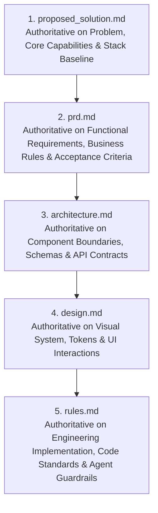
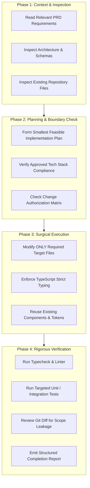
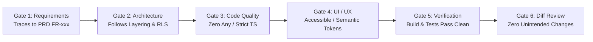

# Engineering Standards, Development Constraints, and AI Coding Agent Rules

## CityNexus — Urban Infrastructure Intelligence Platform

---

## 1. Document Overview

### 1.1 Document Metadata
| Attribute | Detail |
|---|---|
| **Document Title** | Engineering Standards, Development Constraints, and AI Coding Agent Rules |
| **Project Name** | CityNexus — Urban Infrastructure Intelligence Platform |
| **Document Purpose** | Establish a definitive, binding, and unambiguous single source of truth for all software engineering practices, architectural boundaries, coding standards, security guardrails, quality gates, and AI coding agent instructions for the CityNexus project. |
| **Document Version** | 1.0.0 |
| **Status** | Active & Strictly Enforced |
| **Primary Reference Documents** | `proposed_solution.md` (v1.0.0), `prd.md` (v1.0.0), `architecture.md` (v1.0.0), `resources.txt` |
| **Target Audience** | AI Coding Agents, Software Engineers, DevOps Engineers, QA Engineers, Technical Leads |

### 1.2 Normative Language & Conventions
This document adheres to **RFC 2119** key terminology:
- **MUST** / **REQUIRED** / **SHALL**: Absolute mandatory requirement. Violation blocks commit, PR merge, and quality sign-off.
- **MUST NOT** / **SHALL NOT**: Absolute prohibition.
- **SHOULD** / **RECOMMENDED**: Strong architectural recommendation. Valid exceptions require documented technical justification.
- **SHOULD NOT** / **NOT RECOMMENDED**: Practice that must be avoided unless under explicitly documented constraints.
- **MAY** / **OPTIONAL**: Permitted discretionary implementation choice within defined boundaries.

---

## 2. Purpose and Scope of Engineering Rules

### 2.1 Core Purpose
These engineering rules exist to eliminate architectural drift, prevent unauthorized scope creep, ensure strict adherence to the user-mandated technology stack, maintain mathematical and topological data integrity, and guarantee that both human developers and autonomous AI coding agents produce deterministic, verifiable, type-safe, and secure code.

### 2.2 Scope of Applicability
These rules apply universally to:
1. All client-side code (`src/` directory, React components, hooks, stores, styles).
2. All database code (SQL migrations, table definitions, RLS policies, recursive CTE functions).
3. All serverless edge compute (Supabase Deno Edge Functions).
4. All configuration files (Vite, Tailwind, TypeScript, ESLint, Git, CI/CD).
5. All test suites (Unit, Component, Integration, End-to-End).
6. All automated AI agent actions, workspace inspections, refactoring tasks, and commit workflows.

---

## 3. Source Documents and Authority

### 3.1 Document Authority Hierarchy
In the event of an ambiguity or conflict during implementation, the following precedence order **SHALL** govern:



| Source Document | Authoritative Domain | Conflict Resolution Principle |
|---|---|---|
| `proposed_solution.md` | Core problem statement, product capabilities, approved tech stack, high-level scope boundaries. | Cannot be overridden by downstream assumptions. Stack choices are frozen. |
| `prd.md` | Detailed functional requirements (FR-xxx), non-functional requirements (NFR-xxx), business rules (BR-xxx), and acceptance criteria (AC-xxx). | Governs product behavior. If a code feature contradicts `prd.md`, the code is defective. |
| `architecture.md` | Layer responsibilities, PostgreSQL relational/graph schemas, RPC contracts, RLS policies, folder structure. | Governs technical structure. Bypassing documented components or layers is prohibited. |
| `design.md` *(Baseline in PRD/Arch)* | Design tokens, color palettes, spacing, typography, motion physics, and component states. | Governs visual and interaction presentation. Arbitrary CSS styling is prohibited. |
| `rules.md` | Implementation mechanics, coding standards, safety constraints, quality gates, and AI agent execution rules. | Governs how code is authored, validated, and merged. |

*Note on `design.md`:* While a standalone `design.md` file is slated for dedicated expansion, the visual tokens, semantic color mappings (Blue = Traffic, Amber = Electricity, Cyan = Utilities), layout rules, and accessibility standards established in `prd.md` and `architecture.md` serve as the binding UI/UX authority.

---

## 4. Rule Priority and Enforcement Language

Rules are categorized into three distinct priority tiers:

### 4.1 CRITICAL (P0) — Must Never Be Violated
- Violations represent critical security vulnerabilities, data corruption risks, unauthorized architectural deviations, or broken tech stack mandates.
- **Enforcement:** Zero tolerance. Automated pre-commit hooks and CI gates **SHALL** reject any commit containing a P0 violation. Immediate remediation is mandatory.

### 4.2 MANDATORY (P1) — Must Be Followed
- Violations represent code smells, missing error states, improper state management, broken test coverage, or deviations from naming and structure conventions.
- **Enforcement:** PR reviews and automated linters **SHALL** block merges until P1 violations are resolved.

### 4.3 RECOMMENDED (P2) — Should Be Followed
- Best practices regarding code elegance, minor performance micro-optimizations, and maintainability improvements.
- **Enforcement:** Flagged during code review; discretionary approval permitted if documented.

---

## 5. Approved Technology Stack

### 5.1 Technology Restriction Matrix
The technology stack is strictly governed by user mandates and approved architectural additions. Developers and AI agents **MUST NOT** install or introduce competing or alternative libraries.

| Category | Approved Technology | Permitted Usage | Prohibited Alternatives & Restrictions | Rule ID |
|---|---|---|---|---|
| **Frontend Framework** | **React 18.x** | Core SPA component lifecycle and DOM rendering | Vue, Angular, Svelte, Solid, Next.js, Remix (MUST remain pure Vite SPA) | `TECH-001` |
| **Build & Tooling** | **Vite 5.x** | Development server, HMR, production bundling | Create React App, Webpack, Parcel, Turbopack | `TECH-002` |
| **Language** | **TypeScript 5.x** | 100% of frontend and Edge Function logic (`strict: true`) | Plain JavaScript (`.js`, `.jsx`), untyped code, `any` type escapes | `TECH-003` |
| **Routing** | **React Router v6** | Client-side routing, protected route guards, navigation | TanStack Router, Wouter, native window routing | `TECH-004` |
| **Server State** | **TanStack Query v5** | Telemetry caching, background updates, query invalidation | Redux Toolkit, SWR, Apollo Client, Axios (use native `fetch`) | `TECH-005` |
| **CSS & Styling** | **Tailwind CSS v3** | Utility classes, responsive design, dark mode theming | Bootstrap, MUI, Chakra UI, styled-components, CSS modules, raw `.css` | `TECH-006` |
| **UI Components** | **shadcn/ui** | Copy-pasted Radix UI accessible primitives in `components/ui/` | Ant Design, Mantine, PrimeReact, custom un-accessible components | `TECH-007` |
| **Smooth Scroll** | **Lenis** | Smooth momentum-based scrolling on Landing Page | Locomotive Scroll, native scroll overrides outside marketing views | `TECH-008` |
| **Micro-Animations** | **Framer Motion** | UI micro-interactions, layout transitions, alert badge pulses | React Spring, anime.js, raw CSS keyframes for complex layouts | `TECH-009` |
| **Scroll Animation** | **GSAP + ScrollTrigger** | Landing page section pinning, parallax, timeline scrubbing | FullPage.js, ScrollMagic, superscrollorama | `TECH-010` |
| **Backend & BaaS** | **Supabase Managed Cloud** | PostgreSQL 15, Auth, Realtime WebSockets, Storage, Edge Functions | Express.js, NestJS, FastAPI, Django, Firebase, AWS Amplify | `TECH-011` |
| **Hosting & CI/CD** | **Vercel** | Edge Network deployment, preview URLs, Git webhooks | AWS S3/CloudFront, Netlify, Heroku, self-hosted Docker | `TECH-012` |
| **Charting (Approved)** | **Recharts** | Time-series line/area/bar charts with synchronized crosshairs | Chart.js, ApexCharts, CanvasJS, Highcharts | `TECH-013` |
| **Graph Visualization** | **React Flow** | Interactive node-edge dependency graph canvas | Vis.js, Cytoscape.js, D3 force-directed standalone canvases | `TECH-014` |
| **Geospatial GIS** | **React Leaflet + Leaflet** | 2D city map tiles, GeoJSON zone polygons, asset markers | Mapbox GL JS (paid), Google Maps API, OpenLayers | `TECH-015` |
| **Client UI State** | **Zustand** | Transient UI state (active filters, simulation sliders, drawers) | Redux, MobX, React Context for high-frequency state | `TECH-016` |
| **Date Utilities** | **date-fns** | Timestamp formatting, time bucketing, date calculations | Moment.js (deprecated), Day.js, Luxon | `TECH-017` |
| **Schema Validation** | **Zod** | Form validation, API payload validation, environment checking | Yup, Joi, Superstruct, manual if-else validation | `TECH-018` |

---

## 6. Architecture Preservation Rules

### 6.1 Architectural Boundary Guardrails
- **`ARCH-001` (CRITICAL): Pure Client-BaaS Boundary.** The client application **MUST** communicate exclusively with Supabase PostgREST, Supabase RPCs, Supabase Auth, and Supabase Realtime. Developers **MUST NOT** stand up a standalone custom Express, Node.js, or Python API server.
- **`ARCH-002` (CRITICAL): Zero Direct Hardware Actuation.** CityNexus is strictly an Intelligence and Decision-Support Platform. The system **MUST NOT** implement physical actuator overrides (e.g., tripping grid breakers or modifying traffic light controller hardware).
- **`ARCH-003` (CRITICAL): Graph Processing Location.** Directed dependency graph traversals (BFS blast-radius calculations) **MUST** execute within PostgreSQL stored procedures (`fn_traverse_dependencies`) using recursive CTEs, or via lightweight read-only graph utilities in React Flow. Heavy graph traversal logic **MUST NOT** be duplicated across multiple client components.
- **`ARCH-004` (MANDATORY): Layer Separation.** Code **SHALL** strictly honor architectural layering:
  1. *Presentation Layer (`src/components/`, `src/features/`):* Pure UI rendering, local input capture, accessibility.
  2. *Application / State Layer (`src/stores/`, `src/hooks/`):* Orchestrates queries, mutations, and local state.
  3. *Data Access Layer (`src/services/`):* Direct Supabase client invocations, typed queries, RPC executions.
  4. *Persistence Layer (PostgreSQL):* Enforces data integrity, RLS security, and relational/graph relationships.
- **`ARCH-005` (MANDATORY): Dependency Inversion.** UI components **MUST NOT** import raw Supabase client instances directly. All queries and mutations **MUST** flow through custom hooks (`useMetrics`, `useAlerts`, `useSimulation`) backed by TanStack Query.

---

## 7. Project Structure and File Organization

### 7.1 Canonical Directory Layout
All source code and assets **MUST** reside within the following approved directory structure:

```text
c:\Users\Bhuvan A\OneDrive\Desktop\project\Hackathon\
├── public/                           # Static public assets (zero build transformation)
│   ├── favicon.ico
│   ├── assets/
│   └── geojson/                      # GeoJSON boundary files (bengaluru_zones.json)
├── src/
│   ├── app/                          # Core application bootstrap
│   │   ├── App.tsx                   # Top-level React component with providers
│   │   ├── routes.tsx                # Route definitions & ProtectedRoute wrappers
│   │   └── main.tsx                  # Vite DOM entrypoint
│   ├── assets/                       # Bundled static images, logos, icons
│   ├── components/
│   │   ├── ui/                       # shadcn/ui primitives (button, card, dialog, table)
│   │   ├── layout/                   # Navbar, Sidebar, PageContainer, AppShell
│   │   └── shared/                   # Reusable cross-feature widgets (MetricBadge, StatusPill)
│   ├── features/                     # Self-contained domain & functional modules
│   │   ├── landing/                  # Marketing page, GSAP hero, Lenis scroll
│   │   ├── auth/                     # LoginForm, RegisterForm, AuthContext
│   │   ├── dashboard/                # KPICard, IncidentTicker, DomainHealthMatrix
│   │   ├── sectoral/                 # TrafficDetail, ElectricityDetail, UtilitiesDetail
│   │   ├── graph/                    # ReactFlow canvas, CustomNodes, ImpactTracer
│   │   ├── simulation/               # ScenarioBuilder, ParameterSliders, ImpactTable
│   │   ├── map/                      # LeafletMap, ZonePolygonLayer, AssetDrawer
│   │   ├── alerts/                   # AlertCenter, AlertTable, EnrichedAlertDrawer
│   │   ├── history/                  # TimeSeriesStack, SynchronizedCharts, DateFilter
│   │   └── admin/                    # NodeEditor, EdgeEditor, ThresholdManager
│   ├── hooks/                        # Global reusable hooks (useRealtime, useDebounce)
│   ├── lib/                          # Core library singletons & low-level helpers
│   │   ├── supabase.ts               # Initialized Supabase client instance
│   │   ├── utils.ts                  # cn() class merging utility (clsx + twMerge)
│   │   └── constants.ts              # System constants, colors, zone definitions
│   ├── services/                     # Typed Supabase API calls & RPC wrappers
│   ├── stores/                       # Zustand client state stores (useFilterStore, etc.)
│   └── types/                        # TypeScript type definitions
│       ├── database.types.ts         # Supabase auto-generated database schema types
│       └── domain.types.ts           # Domain models, enums, UI interfaces
├── supabase/
│   ├── functions/                    # Deno Edge Functions (/ingest-weather, /evaluate-anomalies)
│   ├── migrations/                   # Sequential SQL migration files
│   └── seed.sql                      # Demonstration dataset seed script
├── tests/
│   ├── unit/                         # Vitest unit tests
│   ├── component/                    # React Testing Library tests
│   └── e2e/                          # Playwright end-to-end integration tests
├── .env.example                      # Template environment variables (no real secrets)
├── index.html                        # HTML entry point
├── package.json
├── tailwind.config.js
├── tsconfig.json
└── vite.config.ts
```

### 7.2 Directory Discipline Rules
- **`ORG-001` (MANDATORY): Colocation Principle.** Files specific to a single feature **MUST** be placed in that feature's directory (`src/features/<feature_name>/`). Do not place feature-specific subcomponents in `src/components/shared/`.
- **`ORG-002` (MANDATORY): Flat Hierarchy Cap.** Nesting deeper than 4 subdirectories beneath `src/` is strictly prohibited.
- **`ORG-003` (MANDATORY): No Barrel File Overuse.** Avoid global `index.ts` re-export files that pull in entire feature modules, as this defeats Vite tree-shaking and slows development HMR.

---

## 8. Naming Conventions

| Entity | Casing Convention | Suffix / Extension | Example |
|---|---|---|---|
| **React Components** | PascalCase | `.tsx` | `KPICard.tsx`, `ScenarioBuilder.tsx` |
| **Custom Hooks** | camelCase | `.ts` (starts with `use`) | `useRealtime.ts`, `useSimulation.ts` |
| **Zustand Stores** | camelCase | `.ts` (starts with `use...Store`) | `useFilterStore.ts`, `useSimStore.ts` |
| **Utility Functions** | camelCase | `.ts` | `formatPressure.ts`, `calculateDelta.ts` |
| **Type & Interface Files** | kebab-case or camelCase | `.types.ts` | `domain.types.ts`, `database.types.ts` |
| **Interfaces & Types** | PascalCase | None (no `I` prefix) | `InfrastructureNode`, `TelemetryMetric` |
| **Enums** | PascalCase (Singular) | None | `DomainType`, `AlertSeverity` |
| **Database Tables** | snake_case (Plural) | SQL | `infrastructure_nodes`, `alerts` |
| **Database Columns** | snake_case | SQL | `node_id`, `warning_threshold` |
| **Stored Procedures** | snake_case | Prefixed with `fn_` | `fn_traverse_dependencies` |
| **Constants** | SCREAMING_SNAKE_CASE | Variable | `MAX_GRAPH_DEPTH`, `DEFAULT_ZONE` |
| **Test Files** | Match target file | `.test.ts` / `.test.tsx` | `KPICard.test.tsx`, `bfs.test.ts` |

---

## 9. Coding Standards and Code Quality

### 9.1 General Code Quality Guardrails
- **`CODE-001` (CRITICAL): Zero Dead or Unused Code.** Unused variables, unreachable code, commented-out dead blocks, and orphaned imports **SHALL NOT** be committed.
- **`CODE-002` (MANDATORY): Single Responsibility Principle.** A single file **SHOULD NOT** exceed 300 lines of code. If a component exceeds 300 lines, it **MUST** be refactored into smaller co-located subcomponents.
- **`CODE-003` (MANDATORY): Explicit Magic Value Extraction.** Arbitrary numeric constants (e.g., `0.05`, `95`, `3600`) **MUST NOT** be embedded directly in algorithms. They **MUST** be defined in `src/lib/constants.ts` with descriptive naming.
- **`CODE-004` (MANDATORY): Clean Console Policy.** Production code **MUST NOT** contain `console.log()` statements. Permitted logging is restricted to structured `console.error()` or `console.warn()` inside verified error boundaries.
- **`CODE-005` (MANDATORY): Cyclomatic Complexity Limit.** Functions with cyclomatic complexity exceeding 10 **MUST** be decomposed into smaller helper utilities.

---

## 10. Programming Language and Type Safety

### 10.1 Strict TypeScript Enforcement
- **`TYPE-001` (CRITICAL): The "No Any" Law.** The use of `any` is strictly prohibited throughout the codebase. If a type is genuinely dynamic or unknown, `unknown` **MUST** be utilized in conjunction with Zod schema parsing or TypeScript type guards.
- **`TYPE-002` (CRITICAL): Strict Compiler Mode.** `tsconfig.json` **MUST** permanently maintain:
  ```json
  "strict": true,
  "noImplicitAny": true,
  "strictNullChecks": true,
  "noUnusedLocals": true,
  "noUnusedParameters": true
  ```
- **`TYPE-003` (MANDATORY): Prohibited Non-Null Assertions.** The non-null assertion operator (`!`) **MUST NOT** be used to suppress optional/nullable checks. Use optional chaining (`?.`) or explicit null-coalescing (`??`) fallbacks.
- **`TYPE-004` (MANDATORY): Database Schema Synchronization.** Frontend database types **MUST** be kept strictly in sync with Supabase PostgreSQL using auto-generated types in `src/types/database.types.ts`.

---

## 11. Frontend Development Rules

### 11.1 Component Construction & State Discipline
- **`FRONT-001` (CRITICAL): Controlled Component State.** All form fields (login, scenario parameters, topology admin) **MUST** be fully controlled components backed by React Hook Form and Zod schemas.
- **`FRONT-002` (MANDATORY): Complete State Quadruplet.** Every data-fetching UI component **MUST** explicitly handle and render four discrete UI states:
  1. *Loading State:* Accessible skeleton loader (e.g., `<Skeleton className="h-24 w-full" />`).
  2. *Error State:* Error card displaying user-safe message and a functional "Retry" action.
  3. *Empty State:* Clean illustrative state when query returns zero records.
  4. *Success / Data State:* Normal populated data view.
- **`FRONT-003` (MANDATORY): Design Token Re-use.** Raw hex color values (e.g., `#1E40AF`) **MUST NOT** be hardcoded in JSX styles. All colors **MUST** reference Tailwind semantic utility tokens (`bg-primary`, `text-destructive`, `border-border`).
- **`FRONT-004` (MANDATORY): Responsive Breakpoints.** All application pages **MUST** render fluidly across standard viewports without horizontal scrollbars:
  - Mobile: $\ge 375\text{px}$
  - Tablet: $\ge 768\text{px}$
  - Desktop: $\ge 1024\text{px}$ and $1440\text{px}$
- **`FRONT-005` (RECOMMENDED): Memoization Discipline.** Do not wrap every function in `useCallback` or `useMemo` prematurely. Apply memoization only for expensive graph traversal calculations, geometry filtering, or props passed to virtualized canvas nodes.

---

## 12. Backend and Service Development Rules

### 12.1 Supabase BaaS & Edge Function Standards
- **`BACK-001` (CRITICAL): Edge Function Statelessness.** Supabase Deno Edge Functions **MUST** remain completely stateless. They must not rely on local container disk persistence or cross-request memory state.
- **`BACK-002` (CRITICAL): Service Role Key Confinement.** The `SUPABASE_SERVICE_ROLE_KEY` possesses god-mode access and bypasses RLS. It **MUST ONLY** be injected into backend Deno Edge Functions. It **MUST NEVER** be bundled or referenced in client-side Vite code.
- **`BACK-003` (MANDATORY): Idempotent Ingestion.** Telemetry ingestion routines (`/ingest-weather` and simulated sensor workers) **MUST** execute idempotent operations (e.g., PostgreSQL `ON CONFLICT DO UPDATE` or time-bucket deduplication) to prevent duplicate metric entries upon network retries.
- **`BACK-004` (MANDATORY): Execution Timeout Safeguards.** All external HTTP fetches executed inside Edge Functions **MUST** implement an explicit `AbortController` timeout of $\le 8.0\text{ seconds}$.

---

## 13. Database and Data Management

### 13.1 Schema & Data Integrity Guardrails
- **`DB-001` (CRITICAL): Row-Level Security Default.** Every newly created PostgreSQL table **MUST** immediately have RLS enabled via `ALTER TABLE <table_name> ENABLE ROW LEVEL SECURITY;` accompanied by explicit `SELECT`, `INSERT`, `UPDATE`, and `DELETE` policies.
- **`DB-002` (CRITICAL): Immutable Primary Keys.** All primary keys across core business tables **MUST** utilize Version 4 UUIDs (`gen_random_uuid()`) or standardized categorical string keys (e.g., `ZONE_1`). Sequential integer auto-increment IDs (`SERIAL`) **MUST NOT** be used for public-facing assets.
- **`DB-003` (CRITICAL): Acyclic Graph Constraints.** The `infrastructure_edges` table **MUST** enforce `CHECK (source_node_id != target_node_id)` and a unique index on `(source_node_id, target_node_id, dependency_type)` to eliminate immediate circular self-referencing.
- **`DB-004` (MANDATORY): Migration Immutability.** SQL migrations in `supabase/migrations/` **MUST** be sequential and immutable once applied. Never edit an existing migration file that has been committed to version control; author a new incremental migration.
- **`DB-005` (MANDATORY): Query Bounding & Pagination.** Unbounded `SELECT * FROM metrics;` queries are strictly prohibited. All historical telemetry queries **MUST** enforce explicit time range boundaries (`WHERE recorded_at >= NOW() - INTERVAL '30 days'`) and `LIMIT` clamps.

---

## 14. API and Integration Rules

### 14.1 Communication & External Gateway Contracts
- **`API-001` (CRITICAL): Strict RFC 7807 Error Responses.** All custom RPC routines and Edge Functions **MUST** return structured RFC 7807 problem detail payloads upon failure containing `type`, `title`, `status`, and `detail`.
- **`API-002` (MANDATORY): HTTP Method Semantics.** PostgREST and Edge API requests **MUST** strictly adhere to standard REST verbs:
  - `GET`: Safe, idempotent read operations.
  - `POST`: Non-idempotent resource creation or RPC simulation invocation.
  - `PATCH`: Partial resource updates (e.g., acknowledging an alert).
  - `DELETE`: Explicit resource removal.
- **`API-003` (MANDATORY): Client Rate-Limit Protection.** External third-party integrations (specifically OpenWeatherMap) **MUST NOT** be invoked on every client page load. Telemetry **MUST** be fetched on a scheduled 15-minute background cron and cached in PostgreSQL.
- **`API-004` (MANDATORY): Network Interceptor Resilience.** Client-side API wrappers **MUST** intercept network dropouts and display a persistent non-blocking visual banner while attempting exponential-backoff retries.

---

## 15. Authentication, Authorization and Access Control

### 15.1 Identity and Permission Guardrails
- **`AUTH-001` (CRITICAL): Server-Side Authorization Primacy.** Hiding UI buttons or guarding routes in React is strictly a user-experience affordance. True authorization **MUST** be enforced inside PostgreSQL via Row-Level Security (RLS) bound to `auth.jwt() ->> 'role'`.
- **`AUTH-002` (CRITICAL): Role Hierarchy Enforcement.** The platform recognizes four operational roles with strict permission boundaries:
  1. `admin`: Full read/write access to topology, thresholds, users, and telemetry.
  2. `operations_manager`: Full read access, alert acknowledgment, blast-radius calculation.
  3. `urban_planner`: Full read access, scenario simulation execution, CSV export.
  4. `viewer`: Read-only access to public dashboards and telemetry.
- **`AUTH-003` (MANDATORY): Secure Token Storage.** JWT access tokens and session refresh tokens **MUST** be managed by the official Supabase Auth SDK utilizing standard secure browser storage. Tokens **MUST NOT** be manually extracted and stored in unencrypted cookies or custom localStorage keys.

---

## 16. Security and Secure Coding

### 16.1 DevSecOps & Threat Mitigation
- **`SEC-001` (CRITICAL): Zero Secret Exposure.** API keys, private keys, service role credentials, and database connection strings **MUST NEVER** be committed to version control. All local secrets **MUST** reside in `.env.local` (enforced via `.gitignore`).
- **`SEC-002` (CRITICAL): SQL Injection Elimination.** All database interactions **MUST** utilize PostgREST parameterized builders or typed PL/pgSQL function parameters. Dynamic execution of raw concatenated SQL strings (`EXECUTE format('SELECT ... ' || user_input)`) is strictly prohibited.
- **`SEC-003` (CRITICAL): Cross-Site Scripting (XSS) Prevention.** Direct DOM manipulation via `dangerouslySetInnerHTML` is prohibited. All user-submitted strings (alert notes, node names) **MUST** be automatically sanitized and escaped by React's JSX engine.
- **`SEC-004` (MANDATORY): Content Security Policy (CSP).** Production deployment on Vercel **MUST** enforce security headers including `X-Frame-Options: DENY`, `X-Content-Type-Options: nosniff`, and `Strict-Transport-Security`.

---

## 17. UI/UX and Design System Enforcement

### 17.1 Visual Cohesion & Design Token Rules
- **`UI-001` (CRITICAL): Domain Color Standardization.** Across all dashboards, graphs, maps, and tables, municipal domains **MUST** be represented by strictly immutable semantic color tokens:
  - **Transportation / Traffic:** Primary Blue (`#2563EB` / `text-blue-600` / `bg-blue-500`)
  - **Electricity / Grid:** Amber / Electric Orange (`#D97706` / `text-amber-600` / `bg-amber-500`)
  - **Water / Public Utilities:** Cyan / Teal (`#0891B2` / `text-cyan-600` / `bg-cyan-500`)
- **`UI-002` (CRITICAL): Operational Health Status Colors.** Status indicators across KPI cards, map polygons, and alert badges **MUST** adhere to:
  - **NORMAL:** Emerald Green (`text-emerald-500`, `bg-emerald-500/10`)
  - **WARNING:** Amber Yellow (`text-amber-500`, `bg-amber-500/10`)
  - **CRITICAL:** Crimson Red (`text-rose-500`, `bg-rose-500/10`)
- **`UI-003` (MANDATORY): Interactive Animation Restraint.**
  - **GSAP + ScrollTrigger:** Restricted strictly to the Public Landing Page (`PAGE-001`). It **MUST NOT** be introduced into authenticated operational dashboard pages where it impairs low-latency data scanning.
  - **Framer Motion:** Permitted only for transient micro-interactions, layout transitions ($\le 300\text{ms}$ duration), and subtle alert pulse badges.
- **`UI-004` (MANDATORY): Accessible Contrast Standards.** Text and graphical indicators **MUST** maintain a minimum contrast ratio of 4.5:1 against their backgrounds in accordance with WCAG 2.1 Level AA.

---

## 18. State Management and Data Fetching

### 18.1 Query & Store Boundaries
- **`STATE-001` (CRITICAL): Server vs. Client State Segregation.**
  - Telemetry metrics, active alerts, topology nodes, and historical time-series **MUST** reside exclusively in TanStack Query server cache.
  - Transient interactive controls (selected zone, graph zoom level, slider positions) **MUST** reside in Zustand stores.
- **`STATE-002` (MANDATORY): Cache Invalidation Protocol.** When an alert is acknowledged or a topology node is added, the mutation hook **MUST** explicitly trigger `queryClient.invalidateQueries({ queryKey: [...] })` to ensure instant data synchronization across all open views.
- **`STATE-003` (MANDATORY): Realtime WebSocket Throttling.** High-frequency WebSocket change events emitted during simulated stress events **MUST** be debounced on the client by $250\text{ms}$ before triggering state re-renders to prevent UI thread lockup.

---

## 19. File, Asset and Storage Management

- **`STOR-001` (MANDATORY): Storage Access Security.** All file objects uploaded to Supabase Storage (e.g., CSV analytical exports) **MUST** reside in private buckets guarded by storage RLS policies. Public bucket creation is prohibited.
- **`STOR-002` (MANDATORY): File Upload Constraints.** Any client file upload capability **MUST** strictly validate file MIME types (`text/csv`, `application/json`), enforce a maximum file size of $\le 5\text{MB}$, and sanitize file names to alphanumeric characters.

---

## 20. Performance and Optimization

- **`PERF-001` (CRITICAL): Bundle Code Splitting.** Heavy sub-libraries (specifically `react-flow-renderer`, `leaflet`, `recharts`, and `gsap`) **MUST** be loaded dynamically via React `Suspense` and `React.lazy()` on route boundaries.
- **`PERF-002` (MANDATORY): Canvas Element Culling.** The React Flow canvas component **MUST** enable `onlyRenderVisibleElements={true}` to prevent rendering SVG nodes outside the current viewport.
- **`PERF-003` (MANDATORY): Slider Input Debouncing.** Scenario parameter sliders **MUST** debounce their execution callbacks by $200\text{ms}$ to prevent firing cascade simulation queries on every single pixel of mouse drag.
- **`PERF-004` (MANDATORY): Core Web Vitals Targets.** The primary operational dashboard **MUST** achieve:
  - First Contentful Paint (FCP) $\le 1.2\text{s}$
  - Time to Interactive (TTI) $\le 2.0\text{s}$
  - Cumulative Layout Shift (CLS) $\le 0.05$

---

## 21. Error Handling and Logging

- **`ERR-001` (CRITICAL): Zero Silent Failures.** All caught exceptions inside data services and hooks **MUST** either be re-thrown or handled by setting an explicit error state in TanStack Query. Swallowing errors with empty `catch {}` blocks is strictly prohibited.
- **`ERR-002` (MANDATORY): Global Error Boundaries.** Every major route in `src/app/routes.tsx` **MUST** be wrapped in a React Error Boundary component that displays a graceful error screen with a "Reload Page" or "Return to Dashboard" recovery action.
- **`ERR-003` (MANDATORY): Sanitized User Messages.** Raw database error strings (e.g., `duplicate key value violates unique constraint "idx_nodes_pkey"`) **MUST NEVER** be displayed directly to the user. Errors **MUST** be mapped to safe, actionable user messages (e.g., "An infrastructure asset with this identifier already exists.").

---

## 22. Testing and Quality Assurance

- **`TEST-001` (MANDATORY): Unit Test Coverage for Core Algorithms.** The BFS graph traversal logic and forward-propagation math functions **MUST** have 100% unit test coverage in Vitest verifying edge cases (zero nodes, cyclic links, disconnected subgraphs).
- **`TEST-002` (MANDATORY): PRD Acceptance Criteria Traceability.** Every automated integration test in `tests/` **MUST** explicitly reference the PRD acceptance criteria ID it validates in its test title (e.g., `test("AC-004: Simulation completes within 5 seconds", ...)`).
- **`TEST-003` (MANDATORY): Build Validation Gate.** Prior to any commit or task completion, the developer or AI agent **MUST** execute and pass:
  1. TypeScript compilation: `npm run typecheck` (`tsc --noEmit`)
  2. Linter check: `npm run lint` (`eslint .`)
  3. Production build: `npm run build` (`vite build`)

---

## 23. Git and Version Control

- **`GIT-001` (CRITICAL): No Destructive Branch Operations.** Commands that rewrite Git history—including `git reset --hard`, `git rebase -i`, and `git push --force`—are strictly prohibited unless explicitly authorized by the project lead.
- **`GIT-002` (CRITICAL): Zero Secret Commits.** Committing `.env`, `.env.local`, or any file containing unmasked API tokens will trigger immediate repository quarantine.
- **`GIT-003` (MANDATORY): Conventional Commits.** Commit messages **MUST** follow Conventional Commits formatting:
  - `feat(<scope>): add scenario simulation slider`
  - `fix(<scope>): resolve cyclic dependency traversal termination`
  - `docs(<scope>): update architecture diagrams`
  - `test(<scope>): add unit tests for threshold evaluation`

---

## 24. Documentation and Configuration

- **`DOC-001` (CRITICAL): Source Document Immutability.** Developers and AI coding agents **MUST NOT** modify or overwrite the foundational source documents (`proposed_solution.md`, `prd.md`, `architecture.md`) during implementation tasks.
- **`DOC-002` (MANDATORY): Environment Variable Documentation.** Whenever a new environment variable is introduced, it **MUST** immediately be documented in `.env.example` with a dummy placeholder and a descriptive comment.

---

## 25. AI Coding Agent Mandatory Workflow

All AI coding agents operating within this repository **MUST** execute tasks following a strict 4-phase protocol:



### 25.1 Step-by-Step Agent Directives
1. **Never Assume — Always Inspect First:** Do not start coding from a prompt prompt alone. Inspect existing types, hooks, and components to extend existing patterns.
2. **Surgical Diffs:** Never rewrite an entire file when adding a single function or UI property. Make surgical, targeted edits.
3. **Continuous Compilation Verification:** After modifying code, run `tsc --noEmit` to verify type safety immediately. Never present code with compilation errors as complete.

---

## 26. Existing Codebase Preservation

- **`PRESERVE-001` (CRITICAL): Non-Destructive Extension.** The default behavior of every change **MUST** be to extend existing modules rather than rebuild them. Existing working components, utilities, and database tables **MUST NOT** be deleted or rewritten without explicit authorization.
- **`PRESERVE-002` (MANDATORY): User Modification Respect.** If existing code contains explicit custom user comments or modifications, the AI agent **MUST NOT** revert or alter those sections.

---

## 27. Scope Control and Dependency Restrictions

- **`SCOPE-001` (CRITICAL): MVP Scope Boundary.** AI agents **MUST NOT** implement features designated as "Could Have" or "Future Roadmap" (e.g., 3D building rendering, automated SCADA actuation, ML autoencoders) unless explicitly instructed in the user prompt.
- **`SCOPE-002` (CRITICAL): Package Installation Ban.** Autonomous installation of npm packages via `npm install` without explicit user permission or direct justification in the approved architecture is strictly prohibited. Before requesting a new library, the agent **MUST** exhaust all existing project utilities.

---

## 28. Uncertainty and Clarification Handling

When an implementation detail is ambiguous or not covered in `prd.md` or `architecture.md`:
1. **Rule 1:** Inspect the database schema and existing types for established conventions.
2. **Rule 2:** Choose the lowest-risk, most architecturally conservative approach that preserves data integrity.
3. **Rule 3:** If the decision impacts security, data loss, external costs, or tech stack additions, **HALT and ask the user for explicit clarification**. Never guess or invent business rules.

---

## 29. Change Management and Approval Matrix

| Change Category | Default Permission | Prerequisite Conditions | Action Required |
|---|---|---|---|
| **Component UI Refinements** | Allowed | Must reuse existing tokens and shadcn primitives | Direct execution |
| **Bug Fixes within Module** | Allowed | Must not alter public component props or API contracts | Direct execution with test |
| **New Feature within MVP Scope** | Allowed | Must trace to PRD `FR-xxx` requirement | Execute following 4-phase workflow |
| **Modifying Database Schema** | Restricted | Must be backwards-compatible; no destructive drops | Generate sequential migration file |
| **Altering Stored Procedure Logic**| Restricted | Must not break existing API-001 to API-004 contracts | Verify with unit tests |
| **Installing New NPM Dependencies**| Approval Required | Must prove no existing library can fulfill capability | Prompt user for explicit approval |
| **Modifying Supabase RLS Policies**| Approval Required | Security audit required; must not expose private data | Prompt user for explicit approval |
| **Altering Technology Stack** | Prohibited | Strictly frozen to user-mandated specifications | Blocked |
| **Destructive Database Drops** | Prohibited | Risk of catastrophic data loss | Blocked |

---

## 30. Quality Gates and Definition of Done

A task is officially **DONE** and ready for merge only when all six quality gates pass:



1. **Gate 1 (Product Completeness):** The code satisfies all target PRD functional requirements and business rules.
2. **Gate 2 (Architectural Conformance):** Layer boundaries are respected; no custom backend servers introduced; RLS enforced.
3. **Gate 3 (Code Quality & Types):** Zero TypeScript compilation errors (`tsc --noEmit`), zero ESLint warnings, zero `any` escapes.
4. **Gate 4 (UI/UX Fidelity):** Component handles all 4 states (Loading, Error, Empty, Success); responsive down to 375px; WCAG AA contrast.
5. **Gate 5 (Automated Verification):** Targeted tests pass; production build (`vite build`) completes with zero errors.
6. **Gate 6 (Diff Discipline):** Git diff contains only changes strictly necessary for the requested task.

---

## 31. Prohibited Actions

The following actions are **STRICTLY FORBIDDEN** across the repository:

1. ❌ **PROHIB-001:** Installing alternative styling frameworks (Bootstrap, Material UI, styled-components).
2. ❌ **PROHIB-002:** Installing custom backend web servers (Express, Fastify, NestJS, Flask).
3. ❌ **PROHIB-003:** Disabling TypeScript strict mode or using `@ts-ignore` / `@ts-nocheck` to bypass compiler errors.
4. ❌ **PROHIB-004:** Committing plaintext secrets, API keys, or `.env` files.
5. ❌ **PROHIB-005:** Using `SELECT *` on high-frequency telemetry tables without date bounding.
6. ❌ **PROHIB-006:** Bypassing Supabase Row-Level Security by using the Service Role Key in client-side code.
7. ❌ **PROHIB-007:** Introducing direct physical SCADA or hardware actuation controls.
8. ❌ **PROHIB-008:** Creating circular dependency links ($A \rightarrow A$) in the infrastructure graph.
9. ❌ **PROHIB-009:** Using `git reset --hard` or `git push --force` on shared repository branches.
10. ❌ **PROHIB-010:** Rewriting or modifying the authoritative source documentation (`proposed_solution.md`, `prd.md`, `architecture.md`).

---

## 32. Project-Specific Rules

### 32.1 Supabase & PostgreSQL Specifics
- **`PSPEC-001` (PostgreSQL Recursion Safety):** Every recursive CTE query **MUST** enforce `WHERE depth < 5` and a cycle detection array check (`NOT (node_name = ANY(chain))`) to mathematically prevent infinite loop crashes.
- **`PSPEC-002` (Hysteresis Alert Rule):** Alert evaluation logic **MUST** honor the 5% hysteresis boundary (BR-003) to prevent alert flapping during boundary fluctuations.

### 32.2 UI/UX Animation Specifics
- **`PSPEC-003` (GSAP Containment):** GSAP and ScrollTrigger **MUST ONLY** be imported and executed within the Landing Page feature (`src/features/landing/`). Operational dashboards **MUST** remain clean and free of scroll-jacking.

---

## 33. Exceptions and Rule Change Process

If a developer or architect identifies a scenario where an engineering rule must be modified or bypassed:
1. **Document the Exception:** Create a formal technical justification detailing the limitation of the existing rule, the proposed alternative, and any security/performance trade-offs.
2. **Review & Approval:** The exception must be reviewed and approved by the Principal Architect or Project Lead.
3. **Update `rules.md`:** If approved, update `rules.md` with an incremented version number and an entry in the Architecture Decision Records.

---

## 34. Open Questions and Unresolved Decisions

| Item ID | Topic | Operational Impact | Working Assumption | Resolution Action |
|---|---|---|---|---|
| **OQ-R01** | Standalone `design.md` Timeline | Dedicated design token and micro-interaction specifications document. | Visual tokens in `prd.md` and `architecture.md` are authoritative until `design.md` is compiled. | Author `design.md` when dedicated design asset phase commences. |
| **OQ-R02** | Automated CI Pipeline Provider | GitHub Actions workflow configuration for automated pre-merge testing. | Standard Vercel deployment pipeline currently validates builds; GitHub Actions workflow to be formalized upon git remote setup. | Add `.github/workflows/ci.yml` during test infrastructure setup. |

---

## 35. Final Compliance Checklist

Before declaring any implementation task complete, the developer or AI agent **MUST** complete and verify this checklist:

- [ ] **Stack:** Only approved technologies from Section 5 are utilized. Zero unauthorized dependencies installed.
- [ ] **Architecture:** Client-BaaS pattern preserved. Database queries utilize PostgREST / RPCs with RLS active.
- [ ] **Type Safety:** `tsc --noEmit` runs with 0 errors. Zero instances of `any`.
- [ ] **Security:** No secrets committed. No client-side service role key usage. Inputs validated with Zod.
- [ ] **UI Standards:** Domain colors (Blue/Amber/Cyan) and Status colors (Green/Yellow/Red) strictly honored.
- [ ] **State Handling:** UI handles Loading (skeleton), Error (safe message + retry), Empty, and Success states.
- [ ] **Performance:** Canvas elements culled; code splitting applied on lazy route boundaries.
- [ ] **Tests:** Unit/E2E tests pass clean. Acceptance criteria validated.
- [ ] **Git Cleanliness:** Diff inspected; zero unrelated files staged; zero source documents altered.

---

## 36. Rule Traceability Matrix

The following matrix connects all engineering rules and constraints to their authoritative source documents and technical justification:

| Rule ID | Rule Category | Rule Summary | Source Document / Repository Evidence | Priority |
|---|---|---|---|---|
| **TECH-001** to **TECH-012** | Technology Stack | Mandates React 18, Vite, TypeScript, Tailwind, shadcn/ui, Lenis, Framer Motion, GSAP, Supabase, Vercel | `resources.txt`, `proposed_solution.md` Sec 23, `architecture.md` Sec 6 | CRITICAL (P0) |
| **TECH-013** to **TECH-018** | Technology Additions | Approves Recharts, React Flow, React Leaflet, Zustand, date-fns, and Zod | `proposed_solution.md` Sec 23.B, `architecture.md` Sec 6 | MANDATORY (P1) |
| **ARCH-001** | Architecture | Enforces pure Client-BaaS pattern; bans custom Express/Node API servers | `architecture.md` Sec 4.1 (ADR-001) | CRITICAL (P0) |
| **ARCH-002** | System Boundaries | Prohibits physical SCADA/grid/traffic signal actuation | `prd.md` Sec 6.2, `architecture.md` Sec 2.2 | CRITICAL (P0) |
| **ARCH-003** | Graph Processing | Enforces recursive CTE execution in PostgreSQL for blast-radius calculations | `architecture.md` Sec 15.1, `prd.md` FR-007 | CRITICAL (P0) |
| **ARCH-004**, **ARCH-005** | Layer Discipline | Preserves 4-tier layer isolation and dependency inversion | `architecture.md` Sec 5, Sec 7 | MANDATORY (P1) |
| **ORG-001** to **ORG-003** | Project Structure | Enforces feature-colocation, flat directory hierarchy, and no barrel file overuse | `architecture.md` Sec 8.1 | MANDATORY (P1) |
| **CODE-001** to **CODE-005** | Code Quality | Zero dead code, 300 LOC file limit, magic value extraction, clean console | Industry standards, `prd.md` NFR-016 | MANDATORY (P1) |
| **TYPE-001** to **TYPE-004** | Type Safety | Bans `any`, enforces strict compiler mode, eliminates `!`, syncs database types | `prd.md` NFR-016, `architecture.md` Sec 6 | CRITICAL (P0) |
| **FRONT-001** to **FRONT-005** | Frontend Engineering | Controlled forms, 4 UI states (Loading/Error/Empty/Success), token reuse | `prd.md` Sec 13, `architecture.md` Sec 8.2 | MANDATORY (P1) |
| **BACK-001** to **BACK-004** | Backend & Services | Edge Function statelessness, service role key confinement, idempotent ingestion | `architecture.md` Sec 9.2, `prd.md` NFR-007 | CRITICAL (P0) |
| **DB-001** | Database Security | Mandatory Row-Level Security (RLS) across all PostgreSQL tables | `prd.md` NFR-007, `architecture.md` Sec 12.2 | CRITICAL (P0) |
| **DB-002**, **DB-003** | Data Integrity | UUIDv4 primary keys, acyclic graph constraints (`source != target`) | `prd.md` BR-001, `architecture.md` Sec 10.3 | CRITICAL (P0) |
| **DB-004**, **DB-005** | Database Discipline | Immutable sequential migrations, bounded query pagination | `architecture.md` Sec 10, Sec 19.2 | MANDATORY (P1) |
| **API-001** to **API-004** | API Contracts | RFC 7807 problem details, REST semantics, 15m weather caching, network retry | `architecture.md` Sec 11, Sec 18.2 | MANDATORY (P1) |
| **AUTH-001** to **AUTH-003** | Authentication & RBAC | Database RLS enforcement, 4-tier role hierarchy, secure token storage | `prd.md` FR-020, FR-021, `architecture.md` Sec 12 | CRITICAL (P0) |
| **SEC-001** to **SEC-004** | Security | Zero secret commits, SQL injection elimination, XSS prevention, CSP headers | `prd.md` NFR-006, NFR-008, `architecture.md` Sec 13 | CRITICAL (P0) |
| **UI-001**, **UI-002** | Design System | Immutable domain colors (Blue/Amber/Cyan) and status colors (Green/Yellow/Red) | `prd.md` NFR-015, `architecture.md` ADR-003 | CRITICAL (P0) |
| **UI-003**, **UI-004** | Design & Motion | Confines GSAP to Landing Page; Framer Motion for micro-interactions; WCAG AA | `prd.md` NFR-013, `proposed_solution.md` Sec 24 | MANDATORY (P1) |
| **STATE-001** to **STATE-003** | State Management | TanStack Query for server data; Zustand for local UI; 250ms WSS throttling | `architecture.md` Sec 8.2, Sec 18 | CRITICAL (P0) |
| **STOR-001**, **STOR-002** | Storage | Private S3 buckets via Supabase Storage, 5MB upload limits, CSV/JSON MIME | `prd.md` FR-019, `architecture.md` Sec 17 | MANDATORY (P1) |
| **PERF-001** to **PERF-004** | Performance | Route code splitting, canvas culling, slider debouncing, Core Web Vitals | `prd.md` NFR-001, NFR-004, `architecture.md` Sec 19 | MANDATORY (P1) |
| **ERR-001** to **ERR-003** | Reliability | Zero silent swallowed errors, route error boundaries, sanitized user messages | `prd.md` Sec 18, `architecture.md` Sec 18 | MANDATORY (P1) |
| **TEST-001** to **TEST-003** | Quality Assurance | Vitest unit tests for graph math, PRD AC-xxx traceability, build validation | `prd.md` Sec 19, `architecture.md` Sec 23 | MANDATORY (P1) |
| **GIT-001** to **GIT-003** | Version Control | Bans destructive resets/rebases, zero secret commits, Conventional Commits | Engineering safety policy | CRITICAL (P0) |
| **DOC-001**, **DOC-002** | Documentation | Source document immutability (`proposed_solution`, `prd`, `arch`), .env.example | Document governance standard | CRITICAL (P0) |
| **AI-Workflow** (Sec 25) | Agent Operations | 4-Phase Protocol: Context $\rightarrow$ Plan $\rightarrow$ Surgical Edit $\rightarrow$ Verification | Master Prompt Directive | CRITICAL (P0) |
| **PRESERVE-001**, **002** | Code Preservation | Extend, do not rebuild; respect user comments and existing structure | Master Prompt Directive | CRITICAL (P0) |
| **SCOPE-001**, **002** | Scope Discipline | Strictly respect MVP scope; ban unauthorized package installations | `prd.md` Sec 6, Master Prompt Directive | CRITICAL (P0) |
| **PROHIB-001** to **010** | Prohibitions | 10 explicit zero-tolerance architectural and code prohibitions | Master Prompt Sec 12 | CRITICAL (P0) |

---

*This document represents the authoritative Engineering Standards, Development Constraints, and AI Coding Agent Rules for CityNexus. All subsequent code implementation, refactoring, and automated development tasks SHALL strictly comply with these mandates.*
